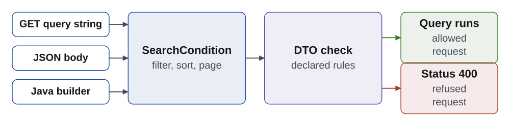

# First search API

After this page an endpoint searches posts by title and returns them sorted and paged. It needs a Spring Boot application with the starter from [Installation](/en/installation.md) and a configured datasource.



A query string, a JSON body and the Java builder all become one `SearchCondition`. The library checks the condition against the declaration of the search DTO and runs only what the declaration allows.

## Entity

The examples use the post entity `Post`. The listing shows the fields that are columns; constructors and accessors are left out. Associations are added in [Searching related data](/en/relationship-and-two-phase-query.md).

<!-- snippet: Post.java#columns -->
```java
@Entity
public class Post {

    @Id
    @GeneratedValue
    private Long id;
    private String title;
    @Enumerated(EnumType.STRING)
    private PostStatus status;
    private Long viewCount;
    private Instant createdAt;
    private LocalDateTime publishedAt;
    private Long tenantId;
}
```

## Search DTO

A search DTO lists the fields a client may use in conditions and sorts. No instance is created per request and only the declaration is read, so it needs no accessors.

<!-- snippet: PostSearchDTO.java#basic -->
```java
public class PostSearchDTO {

    @SearchableField(operators = {EQUALS, IN}, sortable = true)
    private Long id;

    @SearchableField(operators = {EQUALS, CONTAINS, STARTS_WITH}, sortable = true, keyword = true)
    @Schema(description = "Post title", example = "Spring")
    @Size(min = 2, max = 100)
    private String title;

    @SearchableField(operators = {EQUALS, IN}, aggregatable = true)
    private PostStatus status;

    @SearchableField(operators = {GREATER_THAN_OR_EQUAL_TO, BETWEEN}, sortable = true, aggregatable = true)
    private Long viewCount;

    @SearchableField(operators = {GREATER_THAN, LESS_THAN, BETWEEN}, sortable = true)
    private Instant createdAt;
}
```

`@SearchableField` is in the package `dev.simplecore.searchable.core.annotation`, and the operator constants are static imports from `SearchOperator`. Only the operators listed in `operators` are accepted in a request, and only a field with `sortable = true` can be sorted by. `@Size` is a constraint on search values and `@Schema` a description for the API document. The other attributes are explained in [Declaring search fields](/en/search-fields.md).

## Repository and service

The repository must extend both `JpaRepository` and `JpaSpecificationExecutor`.

<!-- snippet: PostRepository.java#repository -->
```java
public interface PostRepository extends JpaRepository<Post, Long>, JpaSpecificationExecutor<Post> {
}
```

The service extends `DefaultSearchableService`. A service that already extends another class uses the composition shown in [Extension and integration](/en/advanced-features.md).

<!-- snippet: PostService.java#service -->
```java
@Service
public class PostService extends DefaultSearchableService<Post, Long> {

    public PostService(PostRepository repository, EntityManager entityManager) {
        super(repository, entityManager);
    }
}
```

## Response type

Returning entities makes it hard to control which fields are exposed, and serialization loads lazy associations. The examples convert to a response record.

<!-- snippet: PostResponse.java#response -->
```java
public record PostResponse(Long id, String title, PostStatus status, Long viewCount, Instant createdAt) {

    public static PostResponse from(Post post) {
        return new PostResponse(post.getId(), post.getTitle(), post.getStatus(), post.getViewCount(),
                post.getCreatedAt());
    }
}
```

## Controller

<!-- snippet: PostController.java#controller -->
```java
@RestController
@RequestMapping("/api/posts")
public class PostController {

    private final PostService service;

    public PostController(PostService service) {
        this.service = service;
    }

    @GetMapping
    public Page<PostResponse> list(@SearchableParams SearchCondition<PostSearchDTO> condition) {
        return service.findAllWithSearch(condition).map(PostResponse::from);
    }

    @PostMapping("/search")
    public Page<PostResponse> search(@RequestBody SearchCondition<PostSearchDTO> condition) {
        return service.findAllWithSearch(condition).map(PostResponse::from);
    }
}
```

The starter resolves the `@SearchableParams SearchCondition<PostSearchDTO>` parameter of the GET method from the query string. The POST method takes a JSON body of the same type. In both cases the type argument `PostSearchDTO` decides which DTO validates the request, so do not leave it out.

## Example data

The requests and results of every later page refer to these posts.

| Title | Status | Views | Created (UTC) | Author | Tenant |
| --- | --- | --- | --- | --- | --- |
| Spring Boot basics | PUBLISHED | 120 | 2026-10-01 09:00 | Minjun Kim | 1 |
| JPA paging in depth | PUBLISHED | 480 | 2026-10-03 09:00 | Seoyeon Lee | 1 |
| Query tuning draft | DRAFT | 15 | 2026-10-05 09:00 | Minjun Kim | 1 |
| Spring Security notes | ARCHIVED | 300 | 2026-10-07 09:00 | Jiho Park | 2 |

## First request

<!-- snippet: first-search.http -->
```http
GET /api/posts?title.contains=Spring&sort=createdAt.desc&page=0&size=20
```

The request reads the posts whose title contains `Spring`, newest first. The `content` of the response holds Spring Security notes and Spring Boot basics, in that order. A condition parameter is written `field.operator=value` and a sort `sort=field.direction`. Without `page` and `size` the first page is read with the default size of 20.

The service returns a Spring Data `Page<T>`. The JSON form of the response depends on the Spring Data and Jackson configuration of the application, so define your own response type for a public API.

## Refused requests

A field the DTO does not declare, an operator a field does not allow and a sort on a field that is not sortable are refused before any query runs.

<!-- snippet: unknown-field.http -->
```http
GET /api/posts?content.contains=Spring
```

This request raises `SearchableValidationException`, because `PostSearchDTO` has no field `content`. [Errors and messages](/en/errors-and-messages.md) shows how to answer the exception with HTTP 400.

## Next step

[Declaring search fields](/en/search-fields.md) covers every attribute of `@SearchableField` and the shapes a DTO can take.
