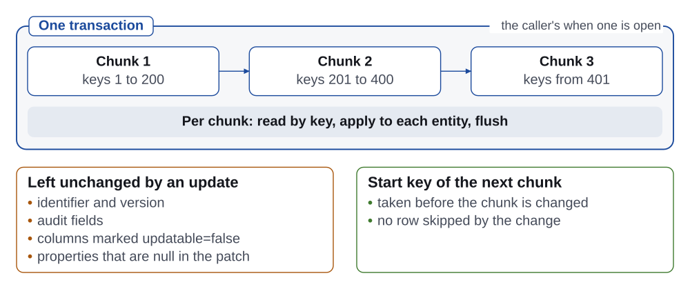

# Bulk update and delete

After this page you can update or delete every row a search condition matches, and explain the chunks and the transaction such a write runs in. The page uses the scope of [Server scope and limits](/en/server-scope-and-limits.md).

## How a write runs

`updateWithSearch` and `deleteWithSearch` read the matching entities in primary-key order, chunk by chunk, and apply the change to each entity. They are not one SQL statement, so JPA callbacks, cascades and optimistic locking work as usual.



## Update

The new values arrive in a patch object that holds only the attributes to change.

<!-- snippet: StatusPatch.java#patch -->
```java
public class StatusPatch {

    private PostStatus status;

    public PostStatus getStatus() {
        return status;
    }

    public void setStatus(PostStatus status) {
        this.status = status;
    }
}
```

<!-- snippet: PostMaintenance.java#update -->
```java
public long archiveDrafts(Long tenantId) {
    SearchCondition<PostSearchDTO> drafts = SearchConditionBuilder.create(PostSearchDTO.class)
            .where(w -> w.equals("status", PostStatus.DRAFT))
            .build();
    Specification<Post> ownTenant = (root, query, cb) -> cb.equal(root.get("tenantId"), tenantId);

    StatusPatch patch = new StatusPatch();
    patch.setStatus(PostStatus.ARCHIVED);
    return service.updateWithSearch(drafts, ownTenant, patch);
}
```

The method archives every draft of tenant 1 and returns the number of rows changed, one with the example data.

| Value in the patch | Handling |
| --- | --- |
| An attribute that is not null | Copied to the entity |
| An attribute that is null | Left unchanged |
| Identifier, version, audit fields | Left unchanged |
| Columns marked `updatable=false`, static, final and transient attributes | Left unchanged |
| Collection attributes | Left unchanged |

- Nothing expresses "set to null". Write a separate application operation to clear a value.
- A primitive attribute of a patch object counts as sent even when it is 0 or false. Declare a reference type such as `Long` or `Boolean` to tell an omitted value apart.
- A patch that changes an association other than a collection is applied as it is, so the application decides whether to allow it.

## Delete

<!-- snippet: PostMaintenance.java#delete -->
```java
public long deleteArchived(Long tenantId) {
    SearchCondition<PostSearchDTO> archived = SearchConditionBuilder.create(PostSearchDTO.class)
            .where(w -> w.equals("status", PostStatus.ARCHIVED))
            .build();
    Specification<Post> ownTenant = (root, query, cb) -> cb.equal(root.get("tenantId"), tenantId);
    return service.deleteWithSearch(archived, ownTenant);
}
```

A delete uses the entity deletion of the repository. When an update and a delete are called one after the other, the update can change which rows the condition of the delete matches.

## Target and condition

- The target is every row the condition matches. The `page`, the `size` and the sort of the condition do not narrow it.
- An empty condition targets the whole table. With `searchable.write.require-filter=true`, a call that neither a condition nor a scope narrows is refused.
- Apply an authorization check and a server scope to every write endpoint.

## Chunks and transactions

- A chunk holds `searchable.write.chunk-size` entities (200 by default) and is flushed when it is done.
- The start key of the next chunk is taken before the current chunk is changed. Changing a field the condition uses skips no later row.
- A write joins a transaction that is in progress, or runs the whole operation in one transaction. A chunk is not committed on its own.
- Entities are detached from the persistence context between chunks only when the service started the transaction itself. In a transaction of the caller they stay in the persistence context of the caller, so check the memory a large write needs.
- Concurrent changes follow the isolation level of the database and the version rules of the entities.

[Extension and integration](/en/advanced-features.md) shows how to name the transaction manager.

## Related settings

| Setting | Default | Meaning |
| --- | --- | --- |
| `searchable.write.chunk-size` | 200 | Entities handled per chunk |
| `searchable.write.require-filter` | false | Whether a write without a condition and a scope is refused |

The JDBC batch size of Hibernate (`searchable.hibernate.jdbc-batch-size`) groups SQL statements and is independent of the chunk size.

## Next step

[Aggregates](/en/aggregates.md) counts and sums the rows a condition matches.
