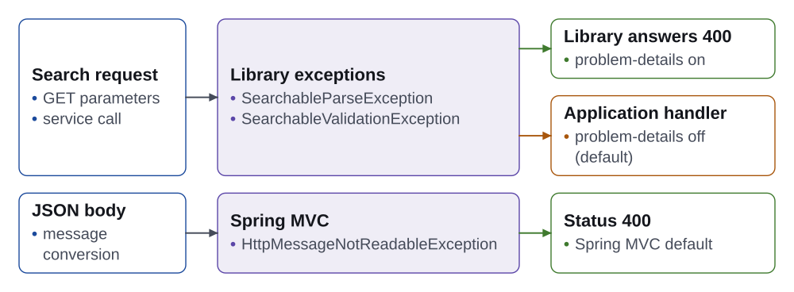

# Errors and messages

After this page an invalid search request is answered with HTTP 400, and the error messages can be replaced by the wording of the application.

## Where an error is handled



An error in the conversion of GET parameters or in a service call arrives as an exception of the library. An error in a JSON body arises in the message conversion of Spring MVC, which answers it with 400.

## Exceptions

Every exception is in the package `dev.simplecore.searchable.core.exception` and extends `SearchableException`, a `RuntimeException`.

| Exception | Raised when | Where the cause lies |
| --- | --- | --- |
| `SearchableValidationException` | A field, operator or sort is not declared, a constraint is violated, a request limit is exceeded, an aggregate or bucket input is invalid, a cursor is invalid | The request |
| `SearchableParseException` | A value cannot be converted to the field type, a sort or a parameter is malformed | The request |
| `SearchableConfigurationException` | A projection type is not an interface, a server scope joins a collection | Server code |
| `SearchableJoinException` | A path cannot be resolved on the entity | Server code, the DTO declaration |
| `SearchableOperationException` | An error while running, such as a keyset scroll over an `@EmbeddedId` entity | Server code |

Answer the exceptions caused by the request as client errors and treat the others as server errors.

## Status 400

With `searchable.web.problem-details.enabled=true` the starter answers `SearchableValidationException` and `SearchableParseException` with status 400 and a problem detail (`ProblemDetail`). The default is `false`.

<!-- snippet: operator-not-allowed.http -->
```http
GET /api/posts?status.contains=PUB
```

<!-- snippet: operator-not-allowed.json -->
```json
{
  "type": "about:blank",
  "title": "Invalid search request",
  "status": 400,
  "detail": "Operator status.CONTAINS is not allowed",
  "instance": "/api/posts"
}
```

The `SearchableExceptionHandler` that builds the answer is a `@RestControllerAdvice` of the lowest precedence. A handler the application defines for the same exceptions is chosen instead. With the setting off the exceptions are passed on, so write a handler that turns them into the error format of the application.

## Messages and locale

Messages are read from the `messages/message` bundle of the library, which has English and Korean texts. The locale follows the locale context of Spring.

With the starter, the `MessageSource` of the application is asked first. A key defined in the `messages.properties` of the application replaces the text of the library, and a key that is not defined there is read from the bundle.

```properties
validator.field.not.found=This field cannot be searched: {0}
```

- A message text is not a fixed error code. Branch on the exception type in a program.
- The message of a violated DTO constraint (`@Size` and others) is produced by Bean Validation and is not a key of this bundle. It follows the same locale context.
- Without the starter, connect the source with `MessageUtils.init(messageSource)`, as [Extension and integration](/en/advanced-features.md) shows.

## Message keys

`{0}`, `{1}` and `{2}` stand for a field name or a value.

| Key | Default text |
| --- | --- |
| `builder.dto.class.required` | DTO class must not be null |
| `builder.existing.condition.required` | Existing SearchCondition must not be null |
| `validator.field.not.found` | Field {0} not found in {1} |
| `validator.field.not.supported` | Operator {0} is not allowed |
| `validator.field.not.sortable` | Following fields are not sortable: {0} |
| `validator.field.not.searchable` | Field {0} is not searchable |
| `validator.operator.not.allowed` | Operator {0} is not allowed for field {1}. Allowed operators: {2} |
| `validator.value.null.not.allowed` | Value cannot be null for operator: {0} |
| `validator.pagination.page.invalid` | Page number must be greater than or equal to 0 |
| `validator.pagination.size.invalid` | Page size must be greater than 0 |
| `search.condition.operator.invalid` | Invalid operator: {0} |
| `search.condition.field.required` | Field is required |
| `search.condition.operator.required` | Search operator is required |
| `search.condition.conditions.not.array` | 'conditions' must be a JSON array |
| `search.condition.type.unresolved` | The DTO type of a SearchCondition is not available. Declare the condition with its type argument |
| `search.condition.sort.direction.invalid` | Sort direction must be asc or desc |
| `openapi.example.failed` | Cannot build the example search condition for {0} |
| `validator.sort.orders.required` | Sort orders cannot be null |
| `validator.sort.orders.min` | At least one sort order must be specified |
| `validator.sort.field.required` | Sort field must not be blank |
| `validator.sort.direction.required` | Sort direction must not be null |
| `parser.numeric.nonnegative` | {0} must be non-negative |
| `parser.numeric.invalid` | {0} must be a valid number |
| `parser.sort.invalid` | Invalid sort format: {0} |
| `parser.field.invalid` | Invalid field format: {0} |
| `parser.operator.invalid` | Invalid operator: {0} |
| `parser.operator.requires.two.values` | {0} operator requires exactly 2 values |
| `validator.value.must.be.collection` | Value must be a collection for field {0}, but was: {1} |
| `validator.collection.empty` | Collection cannot be empty for field: {0} |
| `validator.value.type.conversion` | Cannot convert value of type {0} to type {1} for field {2} |
| `validator.value.invalid` | Invalid value for field {0}: {1} |
| `validator.between.value2.required` | A second value (value2) is required for the {0} operator |
| `parser.pattern.empty` | Pattern search value must not be empty for the {0} operator |
| `parser.datetime.format.unsupported` | Unsupported datetime format: {0} |
| `parser.date.format.unsupported` | Unsupported date format: {0} |
| `parser.time.format.unsupported` | Unsupported time format: {0} |
| `parser.value.parse.failed` | Failed to parse value '{0}' to type {1}: {2} |
| `parser.enum.invalid` | Invalid enum value '{0}' for type {1}. Allowed values are: {2} |
| `parser.boolean.invalid` | Invalid boolean value: '{0}'. Allowed values are: true/false, 1/0, yes/no, y/n, on/off |
| `parser.character.invalid` | Invalid character value: '{0}'. Value must be exactly one character long |
| `parser.temporal.parse.failed` | Failed to parse temporal value '{0}' to type {1}. Error: {2} |
| `parser.temporal.type.unsupported` | Unsupported temporal type: {0} |
| `parser.datetime.timezone.failed` | Failed to parse timezone-aware datetime: '{0}' |
| `parser.zoneddatetime.invalid` | Invalid zoned datetime format: '{0}'. Expected ISO-8601 format with timezone |
| `parser.offsetdatetime.invalid` | Invalid offset datetime format: '{0}'. Expected ISO-8601 format with offset |
| `parser.instant.invalid` | Invalid instant format: '{0}'. Expected ISO-8601 format |
| `parser.date.invalid` | Invalid date format: '{0}' |
| `parser.numeric.value.invalid` | Invalid numeric value '{0}' for type {1}: {2} |
| `parser.numeric.type.unsupported` | Unsupported numeric type: {0} |
| `parser.uuid.invalid` | Invalid UUID value: '{0}'. Expected a valid UUID string |
| `parser.keyword.unsupported` | {0} declares no keyword-searchable field, so the keyword parameter cannot be used |
| `parser.keyword.field.invalid` | Keyword field {0} must be a String that allows the CONTAINS operator |
| `parser.type.unsupported` | Values of type {0} cannot be searched: no converter from text is registered for it |
| `parser.field.value.invalid` | Invalid value for field {0}: {1} |
| `operation.between.values.invalid` | A range needs two comparable values, but got: {0} and {1} |
| `aggregate.operation.unknown` | Unknown aggregate operation: {0} |
| `aggregate.field.unknown` | Field {0} is not an attribute of {1} |
| `aggregate.field.collection` | Field {0} is a collection and cannot be aggregated or grouped by |
| `aggregate.operation.type` | Operation {0} cannot be applied to field {1} of type {2} |
| `bucket.window.invalid` | The time window must start before it ends |
| `bucket.count.invalid` | The bucket count must be between 1 and {0} |
| `bucket.axis.type` | Field {0} of type {1} cannot be used as a time axis |
| `operation.node.unknown` | Unknown condition node type: {0} |
| `operation.field.required` | A condition needs a field |
| `operation.operator.required` | The condition on {0} needs a search operator |
| `operation.operator.unsupported` | Unsupported operator: {0} |
| `operation.group.empty` | A group needs at least one condition |
| `operation.match.query.required` | The condition on {0} is matched per collection element and needs the query it belongs to |
| `operation.collection.required` | Operator {0} on {1} needs a collection or an array of values |
| `operation.collection.empty` | Operator {0} on {1} needs at least one value |
| `operation.pattern.value.required` | The pattern operators need a non-empty value for {0} |
| `operation.pattern.type` | Field {0} must be text, or stored as text, for the pattern operators |
| `operation.comparison.type` | Field {0} of type {1} cannot be compared with an ordering operator |
| `operation.value.type` | A value of type {0} cannot be used for field {1} of type {2} |
| `write.filter.required` | A search-based update or delete needs at least one condition |
| `aggregate.field.not.allowed` | Field {0} cannot be aggregated |
| `bucket.unit.unsupported` | Buckets cannot be cut by {0}; use hours, days, weeks, months or years |
| `scope.join.unsupported` | A scope for {0} must not join a collection or add a fetch join; test a collection with a subquery instead |
| `sort.collection.unsupported` | Sorting by {0} runs through a collection and is not supported for this request |
| `scroll.embedded.id.unsupported` | Keyset scrolling is not supported for {0}, whose identifier is embedded; use an offset position |
| `scroll.position.invalid` | The scroll position does not match the sort of the request |
| `scroll.position.unsupported` | Unsupported scroll position type: {0} |
| `scroll.cursor.invalid` | The cursor is not valid for this search |
| `service.repository.specification.required` | Repository must implement JpaSpecificationExecutor |
| `service.projection.interface.required` | Projection class must be an interface |
| `service.update.copy.failed` | Failed to copy field {0} during batch update |
| `service.entity.type.unresolved` | Unable to resolve the entity type for {0}. Ensure the concrete service binds the entity type argument of DefaultSearchableService |
| `limits.sort.fields` | At most {0} sort fields are allowed |
| `limits.depth` | Search groups exceed maximum depth {0} |
| `limits.nodes.null` | Search nodes must not be null |
| `limits.nodes` | Search exceeds maximum node count {0} |
| `limits.collection` | Search collection exceeds maximum size {0} |
| `limits.node.type` | Search node must be a condition or group |
| `limits.tree` | Search tree exceeds the depth or node limit |
| `limits.page.range` | Page must be nonnegative and size must be between 1 and {0} |
| `limits.page.offset` | Page offset exceeds the JPA integer limit |
| `web.search.dto.unresolved` | The search DTO of a search parameter cannot be told from its annotation or its type: {0} |
| `web.problem.invalid.search` | Invalid search request |
| `join.entity.manager.closed` | EntityManager must be open |
| `join.path.required` | A field path must not be empty |
| `join.path.invalid` | Field path {0} cannot be resolved on {1} |
| `settings.positive.integer.required` | Setting {0} must be a positive integer, but was: {1} |

## Next step

[Settings](/en/auto-configuration.md) lists the settings used so far in one place.
