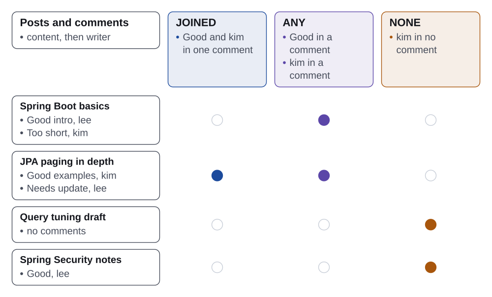

# Searching related data

After this page you can search by fields of related entities and collections, choose how conditions on a collection are matched, and load the associations a response needs. The page builds on everything up to [Operators and values](/en/search-operators.md).

## Associations of the example

A post has an author, comments, tags and labels.

<!-- snippet: Post.java#associations -->
```java
@ManyToOne(fetch = FetchType.LAZY)
private Author author;
@OneToMany(mappedBy = "post", cascade = CascadeType.ALL)
private List<Comment> comments = new ArrayList<>();
@ManyToMany
private Set<Tag> tags = new LinkedHashSet<>();
@ElementCollection
private Set<String> labels = new LinkedHashSet<>();
```

<!-- snippet: Comment.java#entity -->
```java
@Entity
@Table(name = "post_comment")
public class Comment {

    @Id
    @GeneratedValue
    private Long id;
    private String content;
    private String writer;
    @ManyToOne(fetch = FetchType.LAZY)
    private Post post;
}
```

| Post | Comments (content, writer) | Tags | Labels |
| --- | --- | --- | --- |
| Spring Boot basics | Good intro, lee / Too short, kim | spring, guide | featured |
| JPA paging in depth | Good examples, kim / Needs update, lee | jpa | featured, long-read |
| Query tuning draft | none | draft, jpa | none |
| Spring Security notes | Good, lee | spring | none |

## Fields of a single association

An attribute behind a `@ManyToOne` or `@OneToOne` association is declared as a dotted path in `entityField`.

<!-- snippet: PostSearchDTO.java#related -->
```java
@SearchableField(entityField = "author.name", operators = {EQUALS, CONTAINS}, sortable = true,
        sortField = "author.familyName", keyword = true, caseSensitivity = CaseSensitivity.INSENSITIVE)
private String authorName;
```

Only the associations a condition or a sort needs are joined, and since the target is a single row the number of result rows does not change.

## Fields of a collection

A path through `@OneToMany`, `@ManyToMany` or `@ElementCollection` is declared the same way.

<!-- snippet: PostSearchDTO.java#collection -->
```java
@SearchableField(entityField = "comments.content", operators = {CONTAINS})
private String commentContent;

@SearchableField(entityField = "comments.writer", operators = {EQUALS})
private String commentWriter;

@SearchableField(entityField = "comments.writer", operators = {EQUALS}, match = CollectionMatch.ANY)
private String anyCommentWriter;

@SearchableField(entityField = "comments.writer", operators = {EQUALS}, match = CollectionMatch.NONE)
private String noCommentWriter;

@SearchableField(entityField = "tags.name", operators = {EQUALS}, match = CollectionMatch.NONE)
private String withoutTag;

@SearchableField(entityField = "labels", operators = {EQUALS, IN})
private String label;
```

A condition on a collection is applied by one `EXISTS`, not by a join. A post is returned once however many elements match, and the total counts posts.

## Ways of matching

When several conditions reach into the same collection, `match` decides whether one element has to satisfy them together.

| `match` | A row matches when |
| --- | --- |
| `JOINED` (default) | One element satisfies every `JOINED` condition on that collection |
| `ANY` | Some element satisfies this condition, whatever the other conditions matched |
| `NONE` | No element satisfies this condition. A row without elements matches |



<!-- tabs:start -->

#### **JOINED**

<!-- snippet: collection-joined.http -->
```http
GET /api/posts?commentContent.contains=Good&commentWriter.equals=kim
```

One comment has to contain `Good` and be written by `kim`. Only JPA paging in depth matches.

#### **ANY**

<!-- snippet: collection-any.http -->
```http
GET /api/posts?commentContent.contains=Good&anyCommentWriter.equals=kim&sort=id.asc
```

The comment with `Good` and the comment by `kim` may be different comments. Spring Boot basics and JPA paging in depth match.

#### **NONE**

<!-- snippet: collection-none.http -->
```http
GET /api/posts?noCommentWriter.equals=kim&sort=id.asc
```

These are the posts without a comment by `kim`. Query tuning draft, which has no comments, and Spring Security notes match.

<!-- tabs:end -->

`NONE` finds the rows that have no element meeting a condition. The next request returns the three posts that carry no `draft` tag.

<!-- snippet: without-tag.http -->
```http
GET /api/posts?withoutTag.equals=draft&sort=id.asc
```

## Collections of values

When `entityField` names a collection of values, such as an `@ElementCollection`, the elements themselves are compared.

<!-- snippet: element-collection.http -->
```http
GET /api/posts?label.equals=featured&sort=id.asc
```

The request returns the two posts labelled `featured`.

## Conditions and loading

A condition decides which posts match; a fetch loads associations of the posts that are returned. Fetching `comments` for posts found by a comment condition loads every comment of those posts, not only the comments that matched.

Server code names the paths to fetch.

<!-- snippet: PostQueries.java#fetch -->
```java
public Page<Post> withAuthorAndComments(SearchCondition<PostSearchDTO> condition) {
    condition.setFetchFields(Set.of("author", "comments"));
    return service.findAllWithSearch(condition);
}
```

<!-- snippet: PostQueries.java#builder-fetch -->
```java
public Page<Post> newestWithAuthor() {
    SearchCondition<PostSearchDTO> condition = SearchConditionBuilder.create(PostSearchDTO.class)
            .sort(s -> s.desc("createdAt"))
            .fetchFields("author")
            .build();
    return service.findAllWithSearch(condition);
}
```

- `fetchFields` is not read from JSON input. To let a request choose paths, check them against an allow-list in the application. A fetch applies to the statement that loads entities only, not to a count or a column projection.
- A nested path such as `comments.author` can be named as well. A path that is not an association of the entity raises `SearchableJoinException`.
- Different collections (`comments`, `tags`) are loaded separately, so no cross product arises. A mapping with bags nested over several levels can still need a query written by the application.
- Single associations of the root are fetched automatically. Including the single associations of collection elements as well can be turned off with `searchable.hibernate.auto-fetch-collections=false`; `fetchFields` keeps working. `EAGER` mappings of JPA and the batch fetching of Hibernate behave as before in either case.

## Sorting through a collection

A sort path through a collection has several values per post, so an ascending sort uses the smallest and a descending sort the largest. Such a sort changes how the search is run, as [Query strategy and performance](/en/two-phase-query-optimization.md) explains. Scrolling and column projections do not support a sort through a collection.

## Composite identifiers

`@IdClass` and `@EmbeddedId` are both supported, and the parts of a key are read from the JPA metamodel. Declare a part of an `@EmbeddedId` by its real path, such as `id.tenantId`. Key parts are added to the sort in the order the identifier class declares them. Implement `equals` and `hashCode` on an identifier class as JPA requires.

## Transaction boundary and lazy loading

A read joins a transaction that is in progress, or starts a read-only one. Touching an association that was not initialized after the transaction has ended fails, so fetch what the response needs or convert to the response type inside the transaction. The library does not turn on open session in view.

## Next step

[Ways to read](/en/reading-results.md) reads results in other ways than a page.
