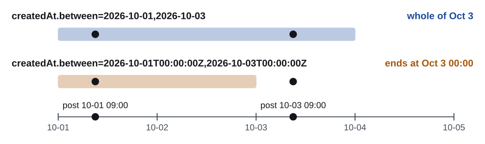

# Operators and values

After this page you know which value each operator needs and can predict how a date range and a text pattern are compared. The page uses the forms of [Writing requests](/en/request-formats.md).

## Operators

The name is the same in a GET parameter, in the `searchOperator` of JSON and as a builder method.

| Constant | Name | GET example | Meaning |
| --- | --- | --- | --- |
| `EQUALS` | `equals` | `status.equals=DRAFT` | Equal to the value |
| `NOT_EQUALS` | `notEquals` | `status.notEquals=DRAFT` | Not equal to the value |
| `GREATER_THAN` | `greaterThan` | `viewCount.greaterThan=100` | Greater than the value |
| `GREATER_THAN_OR_EQUAL_TO` | `greaterThanOrEqualTo` | `viewCount.greaterThanOrEqualTo=100` | Greater than or equal to the value |
| `LESS_THAN` | `lessThan` | `viewCount.lessThan=100` | Less than the value |
| `LESS_THAN_OR_EQUAL_TO` | `lessThanOrEqualTo` | `viewCount.lessThanOrEqualTo=100` | Less than or equal to the value |
| `CONTAINS` | `contains` | `title.contains=Spring` | Contains the text |
| `NOT_CONTAINS` | `notContains` | `title.notContains=Spring` | Does not contain the text |
| `STARTS_WITH` | `startsWith` | `title.startsWith=Spring` | Starts with the text |
| `NOT_STARTS_WITH` | `notStartsWith` | `title.notStartsWith=Spring` | Does not start with the text |
| `ENDS_WITH` | `endsWith` | `title.endsWith=notes` | Ends with the text |
| `NOT_ENDS_WITH` | `notEndsWith` | `title.notEndsWith=notes` | Does not end with the text |
| `IS_NULL` | `isNull` | `publishedAt.isNull=true` | Has no value |
| `IS_NOT_NULL` | `isNotNull` | `publishedAt.isNotNull=true` | Has a value |
| `IN` | `in` | `status.in=DRAFT,PUBLISHED` | Equal to one of the listed values |
| `NOT_IN` | `notIn` | `status.notIn=DRAFT,PUBLISHED` | Equal to none of the listed values |
| `BETWEEN` | `between` | `viewCount.between=100,500` | Between two values, both included |
| `NOT_BETWEEN` | `notBetween` | `viewCount.notBetween=100,500` | Outside the two values |

The `operators` declaration of the DTO decides which operators a field accepts. The builder has a method of the same name for each, as in `equals("status", "DRAFT")`, `in("status", List.of(...))`, `between("viewCount", 100L, 500L)` and `isNull("publishedAt")`, and the first condition starts with `where`.

## Number of values

| Operators | GET | JSON |
| --- | --- | --- |
| `isNull`, `isNotNull` | The value is not read. `isNull=false` is still a null check | `value` is left out |
| `in`, `notIn` | Values separated by commas, at least one | An array |
| `between`, `notBetween` | Two values separated by a comma | `value` and `value2` |
| Every other operator | One value | `value` |

<!-- snippet: op-comparison.http -->
```http
GET /api/posts?viewCount.greaterThanOrEqualTo=100&sort=viewCount.asc
```

The request returns the posts with at least 100 views: Spring Boot basics (120), Spring Security notes (300) and JPA paging in depth (480).

<!-- snippet: op-in.http -->
```http
GET /api/posts?status.in=PUBLISHED,DRAFT&sort=id.asc
```

The request returns the three posts whose status is `PUBLISHED` or `DRAFT`.

## Types and conversion

A search value is converted to the type of the DTO field before it is compared.

| Field type | Accepted values |
| --- | --- |
| `String` | The text as sent. It is neither trimmed nor normalized |
| Integers, decimals, `BigDecimal`, `BigInteger` | A number |
| `boolean` | `true/false`, `1/0`, `yes/no`, `y/n`, `on/off`, in any case |
| enum | The name of a constant |
| `UUID` | A UUID string |
| Dates and times | The formats below |
| Other types | With the starter, the conversion service of Spring MVC converts them. Without a converter the value is refused |

Use the ordering and range operators only on types that have an order. For enums and UUIDs, `equals`, `in` and the null checks are the fitting operators.

## Date and time formats

ISO formats are recommended. These formats are read as well.

| Target | Formats |
| --- | --- |
| Date | `uuuu-MM-dd`, `uuuu/MM/dd`, `uuuu.MM.dd`, `uuuuMMdd`, `dd-MM-uuuu`, `dd/MM/uuuu` |
| Date and time | `uuuu-MM-dd'T'HH:mm:ss` (with fractions), `uuuu-MM-dd HH:mm:ss`, `uuuu/MM/dd HH:mm:ss`, `uuuu.MM.dd HH:mm:ss`, `dd-MM-uuuu HH:mm:ss`, `dd/MM/uuuu HH:mm:ss`, `uuuuMMddHHmmss` |
| Time with an offset or a zone | `2026-10-30T12:34:56Z`, `2026-10-30T12:34:56+09:00`, `2026-10-30 12:34:56 +09:00`, RFC 1123 |
| Time of day | `HH:mm:ss` (with fractions), `HHmmss`, `HHmm`, `H:mm` |

- A date the calendar does not have, such as February 31, is refused instead of being moved to a nearby day.
- A value without an offset is read in the time zone of the application. [Settings](/en/auto-configuration.md) gives the order in which that zone is decided.
- Send both date and time for a `LocalDateTime` field. A date alone is accepted by the range operators described next.

## Ranges written with dates only

When the bounds of `between` are dates, the range starts at midnight of the first date and covers the whole of the last date. The upper bound is compared as "before the next midnight", so the precision a database stores times with cannot move it into the next day. A bound written with a time ends at that time.



<!-- snippet: op-between-date.http -->
```http
GET /api/posts?createdAt.between=2026-10-01,2026-10-03&sort=id.asc
```

The request returns the two posts created on October 1 and October 3. `between` includes both ends, which differs from the buckets of [Time buckets](/en/time-buckets.md) (start included, end excluded). To cut adjacent periods without overlap, combine `greaterThanOrEqualTo` with `lessThan`.

## Text patterns

- `%`, `_` and the escape character in a search text are compared as characters, and so is `[` on SQL Server. A client cannot insert a wildcard.
- An empty text and a text of spaces only are refused.
- Case follows the `caseSensitivity` of [Declaring search fields](/en/search-fields.md) and the setting `searchable.pattern-matching.case-insensitive`.
- `contains` and `endsWith` are patterns with an open start, which an ordinary index does not serve. With much data, consider `equals`, `startsWith` or a full-text search.
- A pattern operator on a JSON column compares the text the database produces for it. It is not a JSON path search; write a repository query to search the structure.

## Null and negated conditions

NULL in SQL does not compare like a value. A negated condition such as `notIn`, `notEquals` or `notContains` does not match rows without a value. When those rows are wanted too, combine `isNull` in an OR group.

## Refused requests

<!-- snippet: operator-not-allowed.http -->
```http
GET /api/posts?status.contains=PUB
```

`status` does not allow `CONTAINS`.

<!-- snippet: bad-enum.http -->
```http
GET /api/posts?status.equals=DONE
```

`DONE` is not a constant of `PostStatus`. The error message lists the constants that are allowed.

<!-- snippet: bad-date.http -->
```http
GET /api/posts?createdAt.between=2026-02-31,2026-03-01
```

February 31 is not a date of the calendar.

## Next step

[Searching related data](/en/relationship-and-two-phase-query.md) searches posts by fields of authors, comments and tags.
