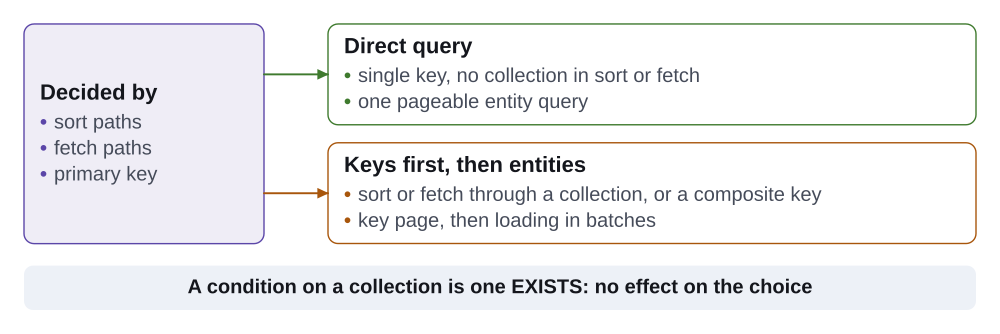
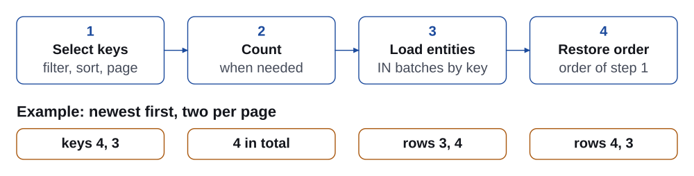

# Query strategy and performance

After this page you can predict the SQL a search runs and find the conditions that make it expensive.

## How the strategy is decided

The strategy follows from the sort paths, the fetch paths and the primary key. A condition never changes it.

| Shape of the search | How it runs |
| --- | --- |
| A single primary key, no sort or fetch through a collection | Entities are read as a page directly |
| A sort or a fetch through a collection | Keys are paged first, then entities are loaded |
| A composite primary key | Keys are paged first, then entities are loaded |
| `findFirstWithSearch` | One key and its entity are read, and nothing is counted |

Fetching a collection in a paged query multiplies the SQL rows by the number of elements, and the page is then cut in memory. Paging the keys first avoids that, and a search without row multiplication saves one round trip by reading directly.

## Conditions on a collection

A condition on a field behind a collection is applied by one `EXISTS` that holds the whole condition tree. The outer query keeps one row per entity and uses no `DISTINCT`. Conditions on the same collection follow the ways of matching in [Searching related data](/en/relationship-and-two-phase-query.md).

## Keys first, then entities

1. The keys that match are selected in the requested order, then by primary key, and the offset and the page size apply to this query.
2. The total is determined. When fewer rows than the page size were read it follows from the offset and the rows, and an empty first page means 0. Only otherwise a count query runs.
3. The entities are loaded by the selected keys. One statement carries `searchable.in-clause-batch-size` identifiers (500 by default), and for a composite key that number divided by the key columns.
4. An IN condition preserves no order, so the result is put back into the key order of step 1.

The count is a count of the entity under the same condition, and contains an `EXISTS` only when a condition reaches into a collection. The number of SQL statements depends on whether the count is skipped, on the number of key batches and on the collections that are fetched.

## Sorting through a collection

When a sort runs through a collection, the key query groups by key. An ascending sort uses the smallest of the related values and a descending sort the largest. The conditions are then applied to the same joins, so an element the conditions exclude does not contribute to the sort value. No other key query has a GROUP BY.

The order of nulls and the comparison of text follow the database. The primary key is added as the last sort to keep equal values in one order, but rows another transaction inserts or changes between two reads can still change what the pages hold.

## Fetching collections

Different collections (`comments`, `tags`) are loaded separately inside the same read transaction, which avoids a cross product between them and the multiple-bag restriction of Hibernate. Paths that share their first collection are loaded together.

With `searchable.hibernate.auto-fetch-collections=false` the single associations of collection elements are not loaded automatically. Turn it off when the response needs no collections and name the paths you need with `fetchFields`. A lazy association that is not named causes a further query when it is touched.

## Searches with many results

| Situation | Recommended |
| --- | --- |
| Walking to the late pages | The keyset scroll of [Ways to read](/en/reading-results.md) |
| A list that shows some columns | The column projection of [Ways to read](/en/reading-results.md) |
| Only counts and sums are needed | [Aggregates](/en/aggregates.md) |
| A trend over time | [Time buckets](/en/time-buckets.md) |

## How to check

- `org.hibernate.SQL=DEBUG` logs the SQL that runs and `org.hibernate.orm.jdbc.bind=TRACE` the bound values. The bind log contains request values, so follow your logging policy.
- Index the columns used by conditions and sorts and the foreign keys, and read the execution plan of the real database.
- `contains` and `endsWith` are not served by an ordinary index, and a search that ignores case needs an index on `lower(column)`.
- `./gradlew performanceTest` of this repository asserts that a page sends no more SQL statements than its page size, the IN batch size and the fetched collections account for. Elapsed times are logged for reference only.

## Supported databases

The integration tests run on H2 and SQL Server 2022. Other databases work through JPA Criteria and the Hibernate dialects but are not tested in this repository, so check the number of statements, the plans and the timestamp precision with representative data on the database you deploy to.

## Next step

[Extension and integration](/en/advanced-features.md) composes the search with an existing service and names the transaction manager.
