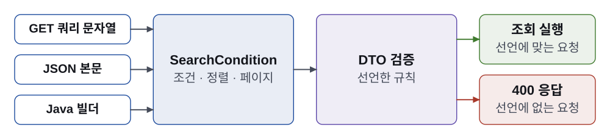

# 첫 검색 API

이 페이지를 마치면 게시글을 제목으로 검색하고 정렬·페이지 조회하는 엔드포인트가 동작합니다. [설치](/ko/installation.md)에서 starter를 추가한 Spring Boot 애플리케이션과 데이터소스 설정이 필요합니다.



쿼리 문자열, JSON 본문, Java 빌더는 모두 `SearchCondition` 하나로 변환됩니다. 라이브러리는 조건을 검색 DTO의 선언과 대조하고, 선언에 맞는 조건만 조회로 실행합니다.

## 엔티티

예제는 게시글 엔티티 `Post`를 사용합니다. 아래 목록은 열에 해당하는 필드이며, 생성자와 접근자는 생략했습니다. 연관 관계는 [연관 데이터 검색](/ko/relationship-and-two-phase-query.md)에서 추가합니다.

<!-- snippet: Post.java#columns -->
```java
@Entity
public class Post {

    @Id
    @GeneratedValue
    private Long id;
    private String title;
    @Enumerated(EnumType.STRING)
    private PostStatus status;
    private Long viewCount;
    private Instant createdAt;
    private LocalDateTime publishedAt;
    private Long tenantId;
}
```

## 검색 DTO

검색 DTO는 클라이언트가 조건과 정렬에 사용할 수 있는 필드의 목록입니다. 요청마다 인스턴스를 만들지 않으며, 선언만 읽으므로 접근자가 필요 없습니다.

<!-- snippet: PostSearchDTO.java#basic -->
```java
public class PostSearchDTO {

    @SearchableField(operators = {EQUALS, IN}, sortable = true)
    private Long id;

    @SearchableField(operators = {EQUALS, CONTAINS, STARTS_WITH}, sortable = true, keyword = true)
    @Schema(description = "Post title", example = "Spring")
    @Size(min = 2, max = 100)
    private String title;

    @SearchableField(operators = {EQUALS, IN}, aggregatable = true)
    private PostStatus status;

    @SearchableField(operators = {GREATER_THAN_OR_EQUAL_TO, BETWEEN}, sortable = true, aggregatable = true)
    private Long viewCount;

    @SearchableField(operators = {GREATER_THAN, LESS_THAN, BETWEEN}, sortable = true)
    private Instant createdAt;
}
```

`@SearchableField`는 `dev.simplecore.searchable.core.annotation` 패키지에 있고, 연산자 상수는 `SearchOperator`에서 static import합니다. `operators`에 적은 연산자만 요청에서 허용하고, `sortable = true`인 필드만 정렬에 사용할 수 있습니다. `@Size`는 검색값에 적용하는 제약이고 `@Schema`는 API 문서에 기재할 설명입니다. 나머지 속성은 [검색 필드 선언](/ko/search-fields.md)에서 설명합니다.

## Repository와 서비스

Repository는 `JpaRepository`와 `JpaSpecificationExecutor`를 모두 상속해야 합니다.

<!-- snippet: PostRepository.java#repository -->
```java
public interface PostRepository extends JpaRepository<Post, Long>, JpaSpecificationExecutor<Post> {
}
```

서비스는 `DefaultSearchableService`를 상속합니다. 이미 다른 클래스를 상속한 서비스는 [확장과 통합](/ko/advanced-features.md)의 조합 방식을 사용하세요.

<!-- snippet: PostService.java#service -->
```java
@Service
public class PostService extends DefaultSearchableService<Post, Long> {

    public PostService(PostRepository repository, EntityManager entityManager) {
        super(repository, entityManager);
    }
}
```

## 응답 타입

엔티티를 그대로 반환하면 공개할 필드를 통제하기 어렵고 지연 로딩 연관이 직렬화 과정에서 조회됩니다. 예제는 응답용 record로 변환합니다.

<!-- snippet: PostResponse.java#response -->
```java
public record PostResponse(Long id, String title, PostStatus status, Long viewCount, Instant createdAt) {

    public static PostResponse from(Post post) {
        return new PostResponse(post.getId(), post.getTitle(), post.getStatus(), post.getViewCount(),
                post.getCreatedAt());
    }
}
```

## 컨트롤러

<!-- snippet: PostController.java#controller -->
```java
@RestController
@RequestMapping("/api/posts")
public class PostController {

    private final PostService service;

    public PostController(PostService service) {
        this.service = service;
    }

    @GetMapping
    public Page<PostResponse> list(@SearchableParams SearchCondition<PostSearchDTO> condition) {
        return service.findAllWithSearch(condition).map(PostResponse::from);
    }

    @PostMapping("/search")
    public Page<PostResponse> search(@RequestBody SearchCondition<PostSearchDTO> condition) {
        return service.findAllWithSearch(condition).map(PostResponse::from);
    }
}
```

GET 메서드의 `@SearchableParams SearchCondition<PostSearchDTO>` 파라미터는 starter가 쿼리 문자열에서 변환합니다. POST 메서드는 JSON 본문을 같은 타입으로 받습니다. GET과 POST 모두 타입 인자 `PostSearchDTO`가 검증에 사용할 DTO를 결정하므로 생략하지 마세요.

## 예제 데이터

이후 모든 페이지의 요청과 결과는 다음 게시글을 기준으로 합니다.

| 제목 | 상태 | 조회 수 | 생성 시각 (UTC) | 작성자 | 테넌트 |
| --- | --- | --- | --- | --- | --- |
| Spring Boot basics | PUBLISHED | 120 | 2026-10-01 09:00 | Minjun Kim | 1 |
| JPA paging in depth | PUBLISHED | 480 | 2026-10-03 09:00 | Seoyeon Lee | 1 |
| Query tuning draft | DRAFT | 15 | 2026-10-05 09:00 | Minjun Kim | 1 |
| Spring Security notes | ARCHIVED | 300 | 2026-10-07 09:00 | Jiho Park | 2 |

## 첫 요청

<!-- snippet: first-search.http -->
```http
GET /api/posts?title.contains=Spring&sort=createdAt.desc&page=0&size=20
```

제목에 `Spring`이 포함된 게시글을 생성 시각의 내림차순으로 조회합니다. 응답의 `content`에는 Spring Security notes, Spring Boot basics가 이 순서로 들어 있습니다. 조건 파라미터의 형식은 `필드.연산자=값`이고, 정렬은 `sort=필드.방향`입니다. `page`와 `size`를 생략하면 0번 페이지를 기본 크기 20으로 조회합니다.

서비스는 Spring Data의 `Page<T>`를 반환합니다. 응답 JSON의 형태는 애플리케이션의 Spring Data와 Jackson 설정에 따라 달라지므로, 외부에 공개하는 API에는 자체 응답 타입을 정의하세요.

## 거부되는 요청

DTO에 선언하지 않은 필드, 허용하지 않은 연산자, 정렬을 허용하지 않은 필드는 조회 전에 거부합니다.

<!-- snippet: unknown-field.http -->
```http
GET /api/posts?content.contains=Spring
```

이 요청은 `content` 필드가 `PostSearchDTO`에 없으므로 `SearchableValidationException`이 발생합니다. 예외를 HTTP 400으로 응답하는 방법은 [오류와 메시지](/ko/errors-and-messages.md)에 있습니다.

## 다음 단계

[검색 필드 선언](/ko/search-fields.md)에서 `@SearchableField`의 모든 속성과 DTO 형태를 확인합니다.
