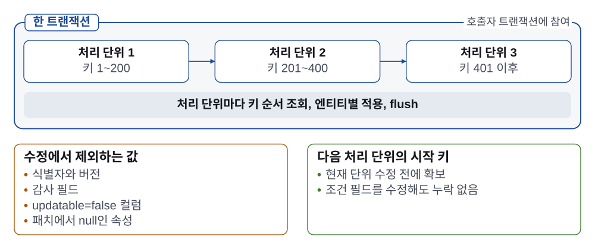

# 일괄 수정·삭제

이 페이지를 마치면 검색 조건에 맞는 모든 행을 수정하거나 삭제하고, 그 처리 단위와 트랜잭션 경계를 설명할 수 있습니다. [서버 범위와 제한](/ko/server-scope-and-limits.md)의 범위를 함께 사용합니다.

## 처리 방식

`updateWithSearch`와 `deleteWithSearch`는 조건에 맞는 엔티티를 기본키 순서로 처리 단위만큼씩 읽어 엔티티별로 적용합니다. SQL 한 문장으로 처리하지 않으므로 JPA 콜백, cascade, 낙관적 잠금이 그대로 동작합니다.



## 수정

수정할 값은 필요한 속성만 있는 패치 객체로 전달합니다.

<!-- snippet: StatusPatch.java#patch -->
```java
public class StatusPatch {

    private PostStatus status;

    public PostStatus getStatus() {
        return status;
    }

    public void setStatus(PostStatus status) {
        this.status = status;
    }
}
```

<!-- snippet: PostMaintenance.java#update -->
```java
public long archiveDrafts(Long tenantId) {
    SearchCondition<PostSearchDTO> drafts = SearchConditionBuilder.create(PostSearchDTO.class)
            .where(w -> w.equals("status", PostStatus.DRAFT))
            .build();
    Specification<Post> ownTenant = (root, query, cb) -> cb.equal(root.get("tenantId"), tenantId);

    StatusPatch patch = new StatusPatch();
    patch.setStatus(PostStatus.ARCHIVED);
    return service.updateWithSearch(drafts, ownTenant, patch);
}
```

테넌트 1의 초안을 모두 보관 상태로 바꾸고 변경한 건수를 반환합니다. 예제 데이터에서는 한 건입니다.

| 패치의 값 | 처리 |
| --- | --- |
| null이 아닌 속성 | 엔티티에 복사합니다 |
| null인 속성 | 변경하지 않습니다 |
| 식별자, 버전, 감사 필드 | 변경하지 않습니다 |
| `updatable=false` 컬럼, static·final·transient 속성 | 변경하지 않습니다 |
| 컬렉션 속성 | 변경하지 않습니다 |

- 값을 null로 지우는 표현은 없습니다. 값을 비워야 하면 별도의 애플리케이션 기능을 작성하세요.
- 패치 객체의 기본형 속성은 0이나 false도 "보낸 값"으로 처리합니다. 생략과 구분하려면 `Long`, `Boolean` 같은 참조 타입으로 선언하세요.
- 컬렉션이 아닌 연관을 바꾸는 패치는 그대로 적용하므로, 변경을 허용할지 애플리케이션에서 판단하세요.

## 삭제

<!-- snippet: PostMaintenance.java#delete -->
```java
public long deleteArchived(Long tenantId) {
    SearchCondition<PostSearchDTO> archived = SearchConditionBuilder.create(PostSearchDTO.class)
            .where(w -> w.equals("status", PostStatus.ARCHIVED))
            .build();
    Specification<Post> ownTenant = (root, query, cb) -> cb.equal(root.get("tenantId"), tenantId);
    return service.deleteWithSearch(archived, ownTenant);
}
```

삭제는 Repository의 엔티티 삭제를 사용합니다. 수정과 삭제를 이어서 호출하면, 앞의 수정이 뒤의 조건에 맞는 행을 바꿀 수 있습니다.

## 대상과 조건

- 대상은 조건에 맞는 모든 행입니다. 조건의 `page`, `size`, 정렬은 대상을 줄이지 않습니다.
- 조건이 비어 있으면 테이블 전체가 대상입니다. `searchable.write.require-filter=true`로 설정하면 조건과 범위가 모두 비어 있는 호출을 거부합니다.
- 쓰기 엔드포인트에는 인가 검사와 서버 범위를 적용하세요.

## 처리 단위와 트랜잭션

- 처리 단위는 `searchable.write.chunk-size`개(기본 200)이며 처리 단위마다 flush합니다.
- 다음 처리 단위의 시작 키는 현재 처리 단위를 변경하기 전에 정합니다. 조건에 사용한 필드를 수정해도 뒤의 행을 건너뛰지 않습니다.
- 진행 중인 트랜잭션이 있으면 참여하고, 없으면 작업 전체를 한 트랜잭션으로 실행합니다. 처리 단위마다 커밋하지 않습니다.
- 서비스가 트랜잭션을 직접 시작한 경우에만 처리 단위 사이에 엔티티를 영속성 컨텍스트에서 분리합니다. 호출자의 트랜잭션에 참여하면 호출자의 영속성 컨텍스트에 엔티티가 남으므로 대량 작업은 메모리 사용량을 확인하세요.
- 동시 변경은 데이터베이스의 격리 수준과 엔티티의 버전 규칙을 따릅니다.

트랜잭션 관리자를 지정하는 방법은 [확장과 통합](/ko/advanced-features.md)에 있습니다.

## 관련 설정

| 설정 | 기본값 | 설명 |
| --- | --- | --- |
| `searchable.write.chunk-size` | 200 | 처리 단위 하나의 엔티티 수 |
| `searchable.write.require-filter` | false | 조건과 범위가 없는 쓰기를 거부할지 여부 |

Hibernate의 JDBC 배치 크기(`searchable.hibernate.jdbc-batch-size`)는 SQL 문을 묶어 보내는 단위이며 처리 단위와 별개입니다.

## 다음 단계

[집계](/ko/aggregates.md)에서 조건에 맞는 행의 건수와 합계를 계산합니다.
