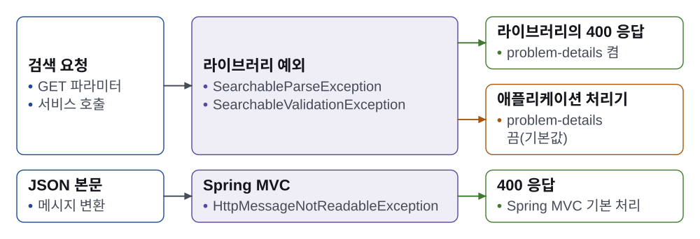

# 오류와 메시지

이 페이지를 마치면 잘못된 검색 요청에 HTTP 400으로 응답하고, 오류 메시지를 애플리케이션의 문구로 바꿀 수 있습니다.

## 오류가 처리되는 경로



GET 파라미터 변환과 서비스 호출에서 발생하는 오류는 라이브러리의 예외로 전달됩니다. JSON 본문의 오류는 Spring MVC의 메시지 변환 단계에서 발생하므로 Spring MVC가 400으로 응답합니다.

## 예외

모든 예외는 `dev.simplecore.searchable.core.exception` 패키지에 있고 `RuntimeException`인 `SearchableException`을 상속합니다.

| 예외 | 발생하는 경우 | 원인의 위치 |
| --- | --- | --- |
| `SearchableValidationException` | 선언하지 않은 필드·연산자·정렬, 제약 위반, 요청 제한 초과, 잘못된 집계·구간 입력, 잘못된 커서 | 요청 |
| `SearchableParseException` | 값을 필드 타입으로 변환할 수 없음, 정렬·파라미터 형식 오류 | 요청 |
| `SearchableConfigurationException` | 인터페이스가 아닌 프로젝션 타입, 컬렉션을 조인하는 서버 범위 | 서버 코드 |
| `SearchableJoinException` | 엔티티에서 해석할 수 없는 경로 | 서버 코드, DTO 선언 |
| `SearchableOperationException` | 실행 단계의 오류. `@EmbeddedId` 엔티티의 keyset 스크롤 등 | 서버 코드 |

요청이 원인인 예외는 클라이언트 오류로 응답하고, 나머지는 서버 오류로 처리하세요.

## 400 응답

`searchable.web.problem-details.enabled=true`로 설정하면 starter가 `SearchableValidationException`과 `SearchableParseException`에 상태 400과 문제 상세(`ProblemDetail`)로 응답합니다. 기본값은 `false`입니다.

<!-- snippet: operator-not-allowed.http -->
```http
GET /api/posts?status.contains=PUB
```

<!-- snippet: operator-not-allowed.json -->
```json
{
  "type": "about:blank",
  "title": "Invalid search request",
  "status": 400,
  "detail": "Operator status.CONTAINS is not allowed",
  "instance": "/api/posts"
}
```

응답을 만드는 `SearchableExceptionHandler`는 우선순위가 가장 낮은 `@RestControllerAdvice`입니다. 애플리케이션이 같은 예외의 처리기를 정의하면 애플리케이션의 처리기를 사용합니다. 설정을 끈 상태에서는 예외가 그대로 전달되므로, 애플리케이션의 오류 응답 형식으로 변환하는 처리기를 작성하세요.

## 메시지와 로캘

메시지는 라이브러리의 `messages/message` 번들에서 읽으며 영어와 한국어 문구가 있습니다. 로캘은 Spring의 로캘 컨텍스트를 따릅니다.

starter를 사용하면 애플리케이션의 `MessageSource`를 먼저 조회합니다. 애플리케이션의 `messages.properties`에 같은 키를 정의하면 그 문구를 사용하고, 정의하지 않은 키는 라이브러리 번들에서 읽습니다.

```properties
validator.field.not.found=This field cannot be searched: {0}
```

- 메시지 문자열은 고정된 오류 코드가 아닙니다. 프로그램에서 분기할 때는 예외 타입을 사용하세요.
- DTO 제약(`@Size` 등)의 위반 메시지는 Bean Validation의 문구이며 이 번들의 키가 아닙니다. 로캘은 같은 로캘 컨텍스트를 따릅니다.
- starter 없이 사용할 때는 `MessageUtils.init(messageSource)`로 연결합니다. [확장과 통합](/ko/advanced-features.md)에서 설명합니다.

## 메시지 키

`{0}`, `{1}`, `{2}`는 필드명이나 값이 들어가는 위치입니다.

| 키 | 기본 문구 |
| --- | --- |
| `builder.dto.class.required` | DTO 클래스는 null일 수 없습니다 |
| `builder.existing.condition.required` | 기존 SearchCondition은 null일 수 없습니다 |
| `validator.field.not.found` | {1}에서 찾을 수 없는 필드입니다: {0} |
| `validator.field.not.supported` | 허용하지 않는 연산자입니다: {0} |
| `validator.field.not.sortable` | 다음 필드들은 정렬할 수 없습니다: {0} |
| `validator.field.not.searchable` | 검색할 수 없는 필드입니다: {0} |
| `validator.operator.not.allowed` | 필드 {1}에 사용할 수 없는 연산자입니다: {0}. 허용하는 연산자: {2} |
| `validator.value.null.not.allowed` | 연산자 {0}에 대한 값은 null일 수 없습니다 |
| `validator.pagination.page.invalid` | 페이지 번호는 0 이상이어야 합니다 |
| `validator.pagination.size.invalid` | 페이지 크기는 0보다 커야 합니다 |
| `search.condition.operator.invalid` | 유효하지 않은 연산자: {0} |
| `search.condition.field.required` | 필드는 필수입니다 |
| `search.condition.operator.required` | 검색 연산자는 필수입니다 |
| `search.condition.conditions.not.array` | 'conditions'는 JSON 배열이어야 합니다 |
| `search.condition.type.unresolved` | SearchCondition의 DTO 타입을 확인할 수 없습니다. 타입 인자를 지정해 선언해 주세요 |
| `search.condition.sort.direction.invalid` | 정렬 방향은 asc 또는 desc여야 합니다 |
| `openapi.example.failed` | {0}의 예시 검색 조건을 만들 수 없습니다 |
| `validator.sort.orders.required` | 정렬 순서는 null일 수 없습니다 |
| `validator.sort.orders.min` | 정렬 순서가 한 개 이상 필요합니다 |
| `validator.sort.field.required` | 정렬 필드는 비어있을 수 없습니다 |
| `validator.sort.direction.required` | 정렬 방향은 null일 수 없습니다 |
| `parser.numeric.nonnegative` | {0} 값은 음수일 수 없습니다 |
| `parser.numeric.invalid` | {0} 값은 유효한 숫자여야 합니다 |
| `parser.sort.invalid` | 잘못된 정렬 형식: {0} |
| `parser.field.invalid` | 잘못된 필드 형식: {0} |
| `parser.operator.invalid` | 잘못된 연산자: {0} |
| `parser.operator.requires.two.values` | {0} 연산자는 정확히 2개의 값이 필요합니다 |
| `validator.value.must.be.collection` | 필드 {0}의 값은 컬렉션이어야 합니다. 현재 타입: {1} |
| `validator.collection.empty` | 필드 {0}의 컬렉션은 비어있을 수 없습니다 |
| `validator.value.type.conversion` | {2} 필드의 {0} 타입 값을 {1} 타입으로 변환할 수 없습니다 |
| `validator.value.invalid` | 필드 {0}의 값이 유효하지 않습니다: {1} |
| `validator.between.value2.required` | {0} 연산자에는 두 번째 값(value2)이 필요합니다 |
| `parser.pattern.empty` | {0} 연산자의 패턴 검색 값은 비어 있을 수 없습니다 |
| `parser.datetime.format.unsupported` | 지원되지 않는 날짜/시간 형식: {0} |
| `parser.date.format.unsupported` | 지원되지 않는 날짜 형식: {0} |
| `parser.time.format.unsupported` | 지원되지 않는 시간 형식: {0} |
| `parser.value.parse.failed` | 값 '{0}'의 타입 {1} 변환에 실패했습니다: {2} |
| `parser.enum.invalid` | 타입 {1}에 대한 유효하지 않은 열거형 값 '{0}'입니다. 허용되는 값: {2} |
| `parser.boolean.invalid` | 유효하지 않은 불린 값: '{0}'. 허용되는 값: true/false, 1/0, yes/no, y/n, on/off |
| `parser.character.invalid` | 유효하지 않은 문자 값: '{0}'. 값은 정확히 한 글자여야 합니다 |
| `parser.temporal.parse.failed` | 날짜/시간 값 '{0}'의 타입 {1} 변환에 실패했습니다. 오류: {2} |
| `parser.temporal.type.unsupported` | 지원되지 않는 날짜/시간 타입: {0} |
| `parser.datetime.timezone.failed` | 시간대 정보가 포함된 날짜/시간 '{0}' 구문 분석에 실패했습니다 |
| `parser.zoneddatetime.invalid` | 유효하지 않은 ZonedDateTime 형식: '{0}'. 시간대를 포함한 ISO-8601 형식이어야 합니다 |
| `parser.offsetdatetime.invalid` | 유효하지 않은 OffsetDateTime 형식: '{0}'. 오프셋을 포함한 ISO-8601 형식이어야 합니다 |
| `parser.instant.invalid` | 유효하지 않은 Instant 형식: '{0}'. ISO-8601 형식이어야 합니다 |
| `parser.date.invalid` | 유효하지 않은 날짜 형식: '{0}' |
| `parser.numeric.value.invalid` | 타입 {1}에 대한 유효하지 않은 숫자 값 '{0}'입니다: {2} |
| `parser.numeric.type.unsupported` | 지원되지 않는 숫자 타입: {0} |
| `parser.uuid.invalid` | 유효하지 않은 UUID 값: '{0}'. 올바른 UUID 문자열이어야 합니다 |
| `parser.keyword.unsupported` | {0}에 키워드 검색 필드가 없어 keyword 매개변수를 사용할 수 없습니다 |
| `parser.keyword.field.invalid` | 키워드 검색 필드는 CONTAINS 연산자를 허용하는 String이어야 합니다: {0} |
| `parser.type.unsupported` | 타입 {0}의 값은 검색할 수 없습니다. 문자열에서 변환하는 컨버터를 등록해 주세요 |
| `parser.field.value.invalid` | 필드 {0}의 값이 올바르지 않습니다: {1} |
| `operation.between.values.invalid` | 범위 조건에는 비교할 수 있는 값이 두 개 필요합니다. 입력값: {0}, {1} |
| `aggregate.operation.unknown` | 알 수 없는 집계 연산입니다: {0} |
| `aggregate.field.unknown` | {1}의 속성이 아닌 필드입니다: {0} |
| `aggregate.field.collection` | 컬렉션 필드는 집계하거나 그룹 기준으로 사용할 수 없습니다: {0} |
| `aggregate.operation.type` | 타입이 {2}인 필드 {1}에 적용할 수 없는 연산입니다: {0} |
| `bucket.window.invalid` | 기간의 시작은 끝보다 앞서야 합니다 |
| `bucket.count.invalid` | 구간 수는 1 이상 {0} 이하여야 합니다 |
| `bucket.axis.type` | 시간축으로 사용할 수 없는 필드입니다: {0} (타입 {1}) |
| `operation.node.unknown` | 알 수 없는 조건 노드 타입입니다: {0} |
| `operation.field.required` | 조건에는 필드가 필요합니다 |
| `operation.operator.required` | 필드 {0}의 조건에는 검색 연산자가 필요합니다 |
| `operation.operator.unsupported` | 지원하지 않는 연산자입니다: {0} |
| `operation.group.empty` | 그룹에는 조건이 하나 이상 필요합니다 |
| `operation.match.query.required` | 필드 {0}의 조건은 컬렉션 요소별로 검사하므로 조건이 포함된 쿼리가 필요합니다 |
| `operation.collection.required` | 필드 {1}의 {0} 연산자에는 값의 컬렉션이나 배열이 필요합니다 |
| `operation.collection.empty` | 필드 {1}의 {0} 연산자에는 값이 하나 이상 필요합니다 |
| `operation.pattern.value.required` | 필드 {0}의 패턴 연산자에는 비어 있지 않은 값이 필요합니다 |
| `operation.pattern.type` | 패턴 연산자는 문자열이거나 문자열로 저장하는 필드에만 사용할 수 있습니다: {0} |
| `operation.comparison.type` | 크기 비교 연산자로 비교할 수 없는 필드입니다: {0} (타입 {1}) |
| `operation.value.type` | 타입이 {0}인 값은 타입이 {2}인 필드 {1}에 사용할 수 없습니다 |
| `write.filter.required` | 검색 조건으로 수정하거나 삭제하려면 조건이 하나 이상 필요합니다 |
| `aggregate.field.not.allowed` | 집계할 수 없는 필드입니다: {0} |
| `bucket.unit.unsupported` | {0} 단위로는 구간을 나눌 수 없습니다. 시간, 일, 주, 월, 연 단위를 사용해 주세요 |
| `scope.join.unsupported` | {0}의 서버 범위 조건은 컬렉션을 조인하거나 페치 조인을 추가할 수 없습니다. 컬렉션은 서브쿼리로 검사해 주세요 |
| `sort.collection.unsupported` | {0} 정렬은 컬렉션을 거치므로 이 요청에서는 지원하지 않습니다 |
| `scroll.embedded.id.unsupported` | 식별자가 임베디드 타입인 {0}에는 keyset 스크롤을 지원하지 않습니다. 오프셋 위치를 사용해 주세요 |
| `scroll.position.invalid` | 스크롤 위치가 요청의 정렬과 일치하지 않습니다 |
| `scroll.position.unsupported` | 지원하지 않는 스크롤 위치 타입입니다: {0} |
| `scroll.cursor.invalid` | 이 검색에 사용할 수 없는 커서입니다 |
| `service.repository.specification.required` | Repository는 JpaSpecificationExecutor를 구현해야 합니다 |
| `service.projection.interface.required` | 프로젝션 클래스는 인터페이스여야 합니다 |
| `service.update.copy.failed` | 일괄 수정 중 필드를 복사하지 못했습니다: {0} |
| `service.entity.type.unresolved` | {0}의 엔티티 타입을 확인할 수 없습니다. 구체 서비스가 DefaultSearchableService의 엔티티 타입 인자를 지정했는지 확인해 주세요 |
| `limits.sort.fields` | 정렬 필드는 최대 {0}개까지 지정할 수 있습니다 |
| `limits.depth` | 검색 그룹의 중첩 깊이가 최대값을 초과했습니다: {0} |
| `limits.nodes.null` | 검색 노드는 null일 수 없습니다 |
| `limits.nodes` | 검색 노드 수가 최대값을 초과했습니다: {0} |
| `limits.collection` | 검색 값 목록의 크기가 최대값을 초과했습니다: {0} |
| `limits.node.type` | 검색 노드는 조건 또는 그룹이어야 합니다 |
| `limits.tree` | 검색 트리가 깊이 또는 노드 수 한도를 초과했습니다 |
| `limits.page.range` | 페이지 번호는 0 이상이고 페이지 크기는 1 이상 {0} 이하여야 합니다 |
| `limits.page.offset` | 페이지 오프셋이 JPA 정수 한도를 초과했습니다 |
| `web.search.dto.unresolved` | 검색 파라미터의 어노테이션이나 타입에서 검색 DTO를 확인할 수 없습니다: {0} |
| `web.problem.invalid.search` | 잘못된 검색 요청 |
| `join.entity.manager.closed` | EntityManager가 열려 있어야 합니다 |
| `join.path.required` | 필드 경로는 비어 있을 수 없습니다 |
| `join.path.invalid` | {1}에서 찾을 수 없는 필드 경로입니다: {0} |
| `settings.positive.integer.required` | 설정 {0}의 값은 양의 정수여야 합니다. 현재 값: {1} |

## 다음 단계

[설정](/ko/auto-configuration.md)에서 지금까지 사용한 설정 값을 한곳에서 확인합니다.
