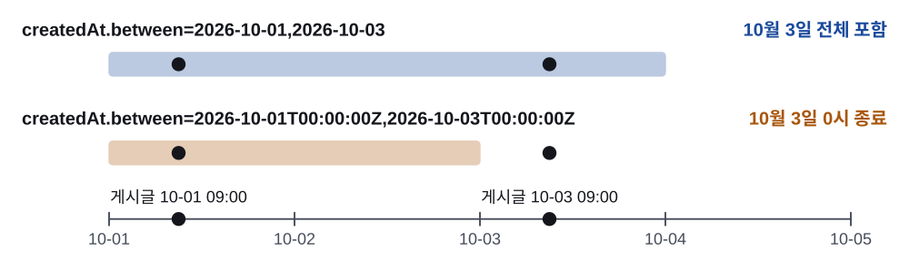

# 연산자와 값

이 페이지를 마치면 연산자마다 필요한 값의 형식을 알고, 날짜 범위와 문자열 패턴이 어떻게 비교되는지 예측할 수 있습니다. [요청 작성](/ko/request-formats.md)의 형식을 사용합니다.

## 연산자

이름은 GET 파라미터, JSON의 `searchOperator`, 빌더 메서드에서 같습니다.

| 상수 | 이름 | GET 예 | 의미 |
| --- | --- | --- | --- |
| `EQUALS` | `equals` | `status.equals=DRAFT` | 값과 같음 |
| `NOT_EQUALS` | `notEquals` | `status.notEquals=DRAFT` | 값과 다름 |
| `GREATER_THAN` | `greaterThan` | `viewCount.greaterThan=100` | 값보다 큼 |
| `GREATER_THAN_OR_EQUAL_TO` | `greaterThanOrEqualTo` | `viewCount.greaterThanOrEqualTo=100` | 값 이상 |
| `LESS_THAN` | `lessThan` | `viewCount.lessThan=100` | 값보다 작음 |
| `LESS_THAN_OR_EQUAL_TO` | `lessThanOrEqualTo` | `viewCount.lessThanOrEqualTo=100` | 값 이하 |
| `CONTAINS` | `contains` | `title.contains=Spring` | 문자열 포함 |
| `NOT_CONTAINS` | `notContains` | `title.notContains=Spring` | 문자열 미포함 |
| `STARTS_WITH` | `startsWith` | `title.startsWith=Spring` | 문자열로 시작 |
| `NOT_STARTS_WITH` | `notStartsWith` | `title.notStartsWith=Spring` | 문자열로 시작하지 않음 |
| `ENDS_WITH` | `endsWith` | `title.endsWith=notes` | 문자열로 끝남 |
| `NOT_ENDS_WITH` | `notEndsWith` | `title.notEndsWith=notes` | 문자열로 끝나지 않음 |
| `IS_NULL` | `isNull` | `publishedAt.isNull=true` | 값이 없음 |
| `IS_NOT_NULL` | `isNotNull` | `publishedAt.isNotNull=true` | 값이 있음 |
| `IN` | `in` | `status.in=DRAFT,PUBLISHED` | 목록 중 하나와 같음 |
| `NOT_IN` | `notIn` | `status.notIn=DRAFT,PUBLISHED` | 목록의 어느 값과도 다름 |
| `BETWEEN` | `between` | `viewCount.between=100,500` | 두 값 사이. 양 끝 포함 |
| `NOT_BETWEEN` | `notBetween` | `viewCount.notBetween=100,500` | 두 값 사이가 아님 |

필드에 사용할 수 있는 연산자는 DTO의 `operators` 선언이 정합니다. 빌더에서는 `equals("status", "DRAFT")`, `in("status", List.of(...))`, `between("viewCount", 100L, 500L)`, `isNull("publishedAt")`처럼 같은 이름의 메서드를 호출하고, 첫 조건은 `where`로 시작합니다.

## 값의 개수

| 연산자 | GET | JSON |
| --- | --- | --- |
| `isNull`, `isNotNull` | 값을 읽지 않습니다. `isNull=false`도 null 검사입니다 | `value`를 생략합니다 |
| `in`, `notIn` | 쉼표로 나눈 값. 1개 이상 | 배열 |
| `between`, `notBetween` | 쉼표로 나눈 두 값 | `value`와 `value2` |
| 그 밖의 연산자 | 값 하나 | `value` |

<!-- snippet: op-comparison.http -->
```http
GET /api/posts?viewCount.greaterThanOrEqualTo=100&sort=viewCount.asc
```

조회 수가 100 이상인 Spring Boot basics(120), Spring Security notes(300), JPA paging in depth(480)를 반환합니다.

<!-- snippet: op-in.http -->
```http
GET /api/posts?status.in=PUBLISHED,DRAFT&sort=id.asc
```

상태가 `PUBLISHED` 또는 `DRAFT`인 세 건을 반환합니다.

## 타입과 변환

검색값은 DTO 필드의 타입으로 변환한 뒤 비교합니다.

| 필드 타입 | 허용하는 값 |
| --- | --- |
| `String` | 보낸 문자열 그대로. 앞뒤 공백을 지우거나 정규화하지 않습니다 |
| 정수·실수, `BigDecimal`, `BigInteger` | 숫자 표기 |
| `boolean` | `true/false`, `1/0`, `yes/no`, `y/n`, `on/off`. 대소문자를 구분하지 않습니다 |
| enum | 상수 이름 |
| `UUID` | UUID 문자열 |
| 날짜·시간 | 아래 형식 |
| 그 밖의 타입 | starter를 사용하면 Spring MVC의 변환 서비스로 변환합니다. 변환기가 없으면 거부합니다 |

크기 비교와 범위 연산자는 순서를 비교할 수 있는 타입에만 사용하세요. enum과 UUID에는 `equals`, `in`, null 검사가 적합합니다.

## 날짜와 시간의 형식

ISO 형식을 권장합니다. 다음 형식도 읽습니다.

| 대상 타입 | 형식 |
| --- | --- |
| 날짜 | `uuuu-MM-dd`, `uuuu/MM/dd`, `uuuu.MM.dd`, `uuuuMMdd`, `dd-MM-uuuu`, `dd/MM/uuuu` |
| 날짜와 시간 | `uuuu-MM-dd'T'HH:mm:ss`(소수 초 포함), `uuuu-MM-dd HH:mm:ss`, `uuuu/MM/dd HH:mm:ss`, `uuuu.MM.dd HH:mm:ss`, `dd-MM-uuuu HH:mm:ss`, `dd/MM/uuuu HH:mm:ss`, `uuuuMMddHHmmss` |
| 오프셋이나 시간대가 있는 시각 | `2026-10-30T12:34:56Z`, `2026-10-30T12:34:56+09:00`, `2026-10-30 12:34:56 +09:00`, RFC 1123 |
| 시간 | `HH:mm:ss`(소수 초 포함), `HHmmss`, `HHmm`, `H:mm` |

- 2월 31일처럼 달력에 없는 날짜는 가까운 날짜로 바꾸지 않고 거부합니다.
- 오프셋이 없는 값은 애플리케이션 시간대의 시각으로 해석합니다. 시간대를 정하는 순서는 [설정](/ko/auto-configuration.md)에 있습니다.
- `LocalDateTime` 필드에는 날짜와 시간을 모두 보내세요. 날짜만 보낼 수 있는 경우는 아래의 범위 연산자입니다.

## 날짜만 쓴 범위

`between`의 경계에 날짜만 쓰면 시작 날짜의 0시부터 끝 날짜 전체를 포함합니다. 끝 경계는 "다음 날 0시 미만"으로 비교하므로, 데이터베이스의 시각 정밀도와 무관하게 다음 날의 데이터를 포함하지 않습니다. 시각까지 쓴 경계는 그 시각에서 끝납니다.



<!-- snippet: op-between-date.http -->
```http
GET /api/posts?createdAt.between=2026-10-01,2026-10-03&sort=id.asc
```

10월 1일과 10월 3일에 생성한 두 건을 반환합니다. `between`은 양 끝을 포함하므로 [시간 구간 집계](/ko/time-buckets.md)의 구간(시작 포함, 끝 제외)과 다릅니다. 이어지는 기간을 겹치지 않게 나누려면 `greaterThanOrEqualTo`와 `lessThan`을 함께 사용하세요.

## 문자열 패턴

- 검색어의 `%`, `_`, 이스케이프 문자는 문자 그대로 비교합니다. SQL Server에서는 `[`도 이스케이프합니다. 클라이언트가 와일드카드를 넣을 수 없습니다.
- 빈 문자열과 공백뿐인 검색어는 거부합니다.
- 대소문자 처리는 [검색 필드 선언](/ko/search-fields.md)의 `caseSensitivity`와 `searchable.pattern-matching.case-insensitive` 설정을 따릅니다.
- `contains`와 `endsWith`는 앞부분이 정해지지 않은 패턴이므로 일반 인덱스를 사용하지 못합니다. 데이터가 많으면 `equals`나 `startsWith`, 또는 전문 검색을 검토하세요.
- JSON 타입 컬럼에 패턴 연산자를 쓰면 데이터베이스가 만든 문자열 표현과 비교합니다. JSON 경로 검색이 아니므로, 구조를 검색하려면 Repository 쿼리를 작성하세요.

## null과 부정 조건

SQL의 NULL은 일반 값과 다르게 비교됩니다. `notIn`, `notEquals`, `notContains` 같은 부정 조건은 값이 없는 행을 포함하지 않습니다. 값이 없는 행도 필요하면 `isNull`을 OR 그룹으로 결합하세요.

## 거부되는 요청

<!-- snippet: operator-not-allowed.http -->
```http
GET /api/posts?status.contains=PUB
```

`status`는 `CONTAINS`를 허용하지 않습니다.

<!-- snippet: bad-enum.http -->
```http
GET /api/posts?status.equals=DONE
```

`DONE`은 `PostStatus`의 상수가 아닙니다. 오류 메시지에 허용하는 상수 이름이 포함됩니다.

<!-- snippet: bad-date.http -->
```http
GET /api/posts?createdAt.between=2026-02-31,2026-03-01
```

2월 31일은 달력에 없는 날짜입니다.

## 다음 단계

[연관 데이터 검색](/ko/relationship-and-two-phase-query.md)에서 작성자, 댓글, 태그의 필드로 게시글을 검색합니다.
