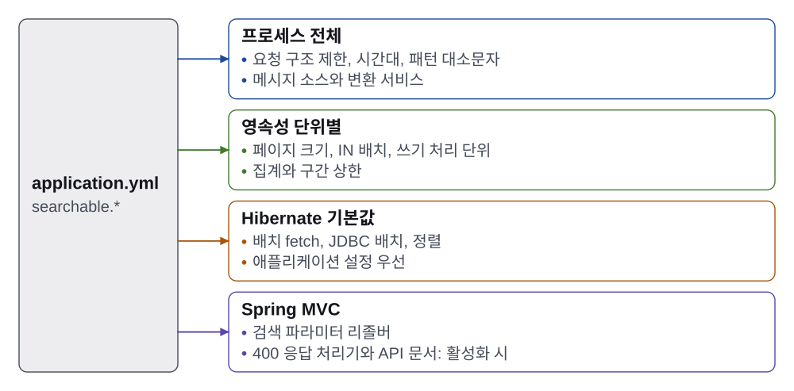

# 설정

이 페이지에는 starter가 읽는 모든 설정과 적용 범위, 자동으로 등록하는 빈이 있습니다. 설정은 모두 선택이며 지정하지 않으면 기본값을 사용합니다.

## 설정이 적용되는 범위



`searchable.*` 설정은 전달되는 대상마다 적용 범위가 다릅니다. 요청 구조 제한, 시간대, 패턴의 대소문자 처리는 프로세스 전체에 적용합니다. 페이지 크기와 처리 단위는 영속성 단위마다 따로 적용합니다. Hibernate 기본값은 애플리케이션이 지정하지 않은 항목에만 적용합니다.

## 전체 예제

```yaml
searchable:
  max-page-size: 1000
  default-page-size: 20
  in-clause-batch-size: 500
  swagger:
    enabled: true
  date-time:
    default-timezone: Asia/Seoul
  pattern-matching:
    case-insensitive: false
  limits:
    max-nodes: 1000
    max-depth: 32
    max-in-values: 1000
    max-sort-fields: 16
  write:
    chunk-size: 200
    require-filter: false
  aggregate:
    max-groups: 1000
  bucket:
    max-buckets: 512
  params:
    ignore-unknown: false
  web:
    argument-resolver:
      enabled: true
    problem-details:
      enabled: false
  hibernate:
    auto-optimization: true
    auto-fetch-collections: true
    default-batch-fetch-size: 100
    jdbc-batch-size: 1000
    order-inserts: true
    order-updates: true
    in-clause-parameter-padding: true
```

`Asia/Seoul`은 예시이며 시간대의 기본값이 아닙니다.

## 설정 목록

| 설정 | 기본값 | 설명 | 관련 페이지 |
| --- | --- | --- | --- |
| `searchable.default-page-size` | 20 | 조건에 `size`가 없을 때의 페이지 크기 | [조회 방법](/ko/reading-results.md) |
| `searchable.max-page-size` | 1000 | 허용하는 최대 페이지 크기 | [조회 방법](/ko/reading-results.md) |
| `searchable.in-clause-batch-size` | 500 | 엔티티 로딩 한 문장에 넣는 식별자 수 | [조회 전략과 성능](/ko/two-phase-query-optimization.md) |
| `searchable.limits.max-nodes` | 1000 | 조건과 그룹의 최대 개수 | [서버 범위와 제한](/ko/server-scope-and-limits.md) |
| `searchable.limits.max-depth` | 32 | 그룹 중첩의 최대 깊이 | [서버 범위와 제한](/ko/server-scope-and-limits.md) |
| `searchable.limits.max-in-values` | 1000 | 조건 하나의 목록 값 최대 개수 | [서버 범위와 제한](/ko/server-scope-and-limits.md) |
| `searchable.limits.max-sort-fields` | 16 | 정렬 필드의 최대 개수 | [서버 범위와 제한](/ko/server-scope-and-limits.md) |
| `searchable.params.ignore-unknown` | false | 검색 파라미터가 아닌 쿼리 파라미터를 거부하지 않고 무시 | [요청 작성](/ko/request-formats.md) |
| `searchable.write.chunk-size` | 200 | 일괄 수정·삭제의 처리 단위 | [일괄 수정·삭제](/ko/bulk-write.md) |
| `searchable.write.require-filter` | false | 조건과 범위가 없는 쓰기를 거부 | [일괄 수정·삭제](/ko/bulk-write.md) |
| `searchable.aggregate.max-groups` | 1000 | 값별 건수가 반환하는 값의 최대 개수 | [집계](/ko/aggregates.md) |
| `searchable.bucket.max-buckets` | 512 | 한 번에 요청할 수 있는 구간 수 | [시간 구간 집계](/ko/time-buckets.md) |
| `searchable.date-time.default-timezone` | 없음 | 오프셋이 없는 검색값을 해석할 시간대 | 아래 「시간대 결정 순서」 |
| `searchable.pattern-matching.case-insensitive` | false | 패턴 연산자에서 대소문자를 구분하지 않음 | [검색 필드 선언](/ko/search-fields.md) |
| `searchable.web.argument-resolver.enabled` | true | `@SearchableParams SearchCondition<D>` 파라미터를 쿼리 문자열에서 변환 | [요청 작성](/ko/request-formats.md) |
| `searchable.web.problem-details.enabled` | false | 잘못된 검색에 400과 문제 상세로 응답 | [오류와 메시지](/ko/errors-and-messages.md) |
| `searchable.swagger.enabled` | true | 검색 파라미터의 API 문서 생성 | [OpenAPI](/ko/openapi-integration.md) |
| `searchable.hibernate.auto-optimization` | true | 아래 Hibernate 기본값을 추가 | 아래 「Hibernate 기본값」 |
| `searchable.hibernate.auto-fetch-collections` | true | 컬렉션 요소의 단일 연관을 자동 fetch 대상에 포함 | [연관 데이터 검색](/ko/relationship-and-two-phase-query.md) |
| `searchable.hibernate.default-batch-fetch-size` | 100 | Hibernate의 지연 로딩 배치 크기 | 아래 「Hibernate 기본값」 |
| `searchable.hibernate.jdbc-batch-size` | 1000 | Hibernate의 JDBC 문장 배치 크기 | 아래 「Hibernate 기본값」 |
| `searchable.hibernate.order-inserts` | true | JDBC 배치를 위한 INSERT 정렬 | 아래 「Hibernate 기본값」 |
| `searchable.hibernate.order-updates` | true | JDBC 배치를 위한 UPDATE 정렬 | 아래 「Hibernate 기본값」 |
| `searchable.hibernate.in-clause-parameter-padding` | true | IN 파라미터 수를 맞춰 쿼리 플랜 재사용 | 아래 「Hibernate 기본값」 |
| `searchable.hibernate.batch-versioned-data` | true | deprecated. Hibernate 7은 이 설정을 읽지 않으므로 효과가 없습니다 | [업그레이드 안내](/ko/upgrade.md) |

페이지 크기와 배치 크기는 양수여야 하고 기본 페이지 크기는 최대 크기보다 클 수 없습니다. 위반하면 애플리케이션 시작을 중단합니다.

## 영속성 단위별 설정

starter는 다음 값을 Spring Boot가 만드는 `EntityManagerFactory`의 속성으로 전달합니다. 영속성 단위를 직접 구성하거나 starter 없이 사용할 때는 같은 키를 그 단위의 속성에 지정하세요.

| starter 설정 | 영속성 단위 속성 |
| --- | --- |
| `searchable.default-page-size` | `searchable.default_page_size` |
| `searchable.max-page-size` | `searchable.max_page_size` |
| `searchable.hibernate.auto-fetch-collections` | `searchable.auto_fetch_collections` |
| `searchable.in-clause-batch-size` | `searchable.in_clause_batch_size` |
| `searchable.write.chunk-size` | `searchable.write_chunk_size` |
| `searchable.write.require-filter` | `searchable.require_write_filter` |
| `searchable.aggregate.max-groups` | `searchable.max_aggregate_groups` |
| `searchable.bucket.max-buckets` | `searchable.max_buckets` |

요청 구조 제한(`searchable.limits.*`)은 요청을 읽는 시점에 적용하고 그때는 영속성 단위가 정해지지 않았으므로 프로세스 전체에 적용합니다.

## Hibernate 기본값

`auto-optimization`이 켜져 있으면 다음 속성을 애플리케이션이 지정하지 않은 경우에만 추가합니다. `spring.jpa.properties`에 지정한 값이 항상 우선합니다.

| starter 설정 | Hibernate 속성 |
| --- | --- |
| `default-batch-fetch-size` | `hibernate.default_batch_fetch_size` |
| `jdbc-batch-size` | `hibernate.jdbc.batch_size` |
| `order-inserts` | `hibernate.order_inserts` |
| `order-updates` | `hibernate.order_updates` |
| `in-clause-parameter-padding` | `hibernate.query.in_clause_parameter_padding` |

- `auto-optimization: false`는 이 기본값만 끕니다. 검증, 페이지 제한, 시간대 설정은 계속 적용합니다.
- starter는 `hibernate.connection.provider_disables_autocommit`을 설정하지 않습니다. 이 속성은 데이터소스의 자동 커밋 동작을 보증하는 값이어서, 잘못 켜면 롤백해야 할 쓰기를 커밋할 수 있습니다.
- JDBC 배치 크기는 SQL 문을 묶어 보내는 단위이고 `searchable.write.chunk-size`는 엔티티를 읽는 단위입니다. 서로 영향을 주지 않습니다.

## 시간대 결정 순서

오프셋이 없는 검색값과 날짜만 쓴 범위의 경계는 다음 순서로 정한 시간대에서 해석합니다.

1. `searchable.date-time.default-timezone`
2. 이름이 `applicationZoneId`인 `ZoneId` 빈
3. `spring.jackson.time-zone`
4. UTC

존재하지 않는 시간대 ID를 지정하면 애플리케이션 시작을 중단합니다. 잘못된 ID를 무시하고 다음 순위의 시간대를 적용하면 모든 날짜 조건이 어긋난 채로 실행되기 때문입니다. 검색값에 오프셋이 있으면 그 오프셋을 사용합니다. 시간대는 프로세스 전체에 적용하므로 한 JVM의 여러 애플리케이션 컨텍스트는 같은 시간대를 사용해야 합니다.

## 등록하는 빈

| 빈 | 등록 조건 | 역할 |
| --- | --- | --- |
| `TimeBucketCounter` | 같은 타입의 빈이 없을 때 | 시간 구간 집계 |
| `SearchAggregator` | 같은 타입의 빈이 없을 때 | 집계 |
| `SearchConditionArgumentResolver` | 서블릿 애플리케이션이고 `web.argument-resolver.enabled`가 true일 때 | 컨트롤러 파라미터 변환 |
| `SearchableExceptionHandler` | `web.problem-details.enabled`가 true일 때 | 400 응답 |
| `searchConditionCustomizer` | 서블릿 애플리케이션에 SpringDoc과 Spring MVC의 `RequestMappingHandlerMapping`이 있고 `swagger.enabled`가 true일 때 | API 문서 생성 |

애플리케이션 시작이 끝나면 애플리케이션의 `MessageSource`를 라이브러리 메시지 앞에 연결하고, Spring MVC의 변환 서비스를 검색값 변환에 연결합니다.

자동 설정이 적용되지 않으면 starter가 런타임 클래스패스에 있는지, JPA 구성이 있는지, `SearchableJpaConfiguration`을 제외하지 않았는지 확인하세요. `debug=true`로 Spring Boot의 조건 평가 보고서를 볼 수 있습니다.

## 다음 단계

[조회 전략과 성능](/ko/two-phase-query-optimization.md)에서 요청이 어떤 SQL로 실행되는지 확인합니다.
