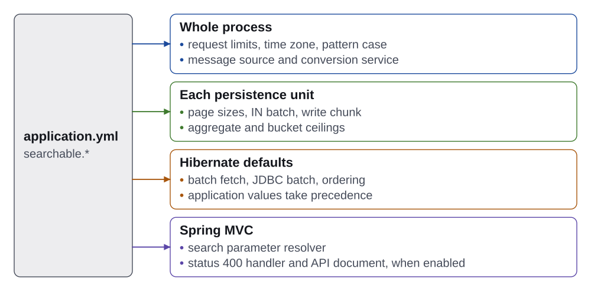

# Settings

This page lists every setting the starter reads, where each one applies, and the beans that are registered. All settings are optional and fall back to their defaults.

## Where settings apply



The `searchable.*` settings apply with a different reach in each place they are handed to. Request limits, the time zone and the case of patterns apply to the whole process. Page sizes and chunk sizes apply to each persistence unit separately. The Hibernate defaults apply only where the application set nothing.

## Complete example

```yaml
searchable:
  max-page-size: 1000
  default-page-size: 20
  in-clause-batch-size: 500
  swagger:
    enabled: true
  date-time:
    default-timezone: Asia/Seoul
  pattern-matching:
    case-insensitive: false
  limits:
    max-nodes: 1000
    max-depth: 32
    max-in-values: 1000
    max-sort-fields: 16
  write:
    chunk-size: 200
    require-filter: false
  aggregate:
    max-groups: 1000
  bucket:
    max-buckets: 512
  params:
    ignore-unknown: false
  web:
    argument-resolver:
      enabled: true
    problem-details:
      enabled: false
  hibernate:
    auto-optimization: true
    auto-fetch-collections: true
    default-batch-fetch-size: 100
    jdbc-batch-size: 1000
    order-inserts: true
    order-updates: true
    in-clause-parameter-padding: true
```

`Asia/Seoul` is an example, not the default time zone.

## List of settings

| Setting | Default | Meaning | Page |
| --- | --- | --- | --- |
| `searchable.default-page-size` | 20 | The page size when a condition has no `size` | [Ways to read](./reading-results.md) |
| `searchable.max-page-size` | 1000 | The largest page size accepted | [Ways to read](./reading-results.md) |
| `searchable.in-clause-batch-size` | 500 | Identifiers one entity-loading statement carries | [Query strategy and performance](./two-phase-query-optimization.md) |
| `searchable.limits.max-nodes` | 1000 | The most conditions and groups | [Server scope and limits](./server-scope-and-limits.md) |
| `searchable.limits.max-depth` | 32 | The deepest nesting of groups | [Server scope and limits](./server-scope-and-limits.md) |
| `searchable.limits.max-in-values` | 1000 | The most listed values of one condition | [Server scope and limits](./server-scope-and-limits.md) |
| `searchable.limits.max-sort-fields` | 16 | The most sort fields | [Server scope and limits](./server-scope-and-limits.md) |
| `searchable.params.ignore-unknown` | false | Leaves out a query parameter that is not a search parameter instead of refusing it | [Writing requests](./request-formats.md) |
| `searchable.write.chunk-size` | 200 | The chunk of a bulk update or delete | [Bulk update and delete](./bulk-write.md) |
| `searchable.write.require-filter` | false | Refuses a write without a condition and a scope | [Bulk update and delete](./bulk-write.md) |
| `searchable.aggregate.max-groups` | 1000 | The most values a count per value returns | [Aggregates](./aggregates.md) |
| `searchable.bucket.max-buckets` | 512 | The most buckets one call may ask for | [Time buckets](./time-buckets.md) |
| `searchable.date-time.default-timezone` | none | The zone a search value without an offset is read in | "Order of the time zone" below |
| `searchable.pattern-matching.case-insensitive` | false | Pattern operators ignore case | [Declaring search fields](./search-fields.md) |
| `searchable.web.argument-resolver.enabled` | true | Resolves a `@SearchableParams SearchCondition<D>` parameter from the query string | [Writing requests](./request-formats.md) |
| `searchable.web.problem-details.enabled` | false | Answers an invalid search with 400 and a problem detail | [Errors and messages](./errors-and-messages.md) |
| `searchable.swagger.enabled` | true | Documents search parameters in the API document | [OpenAPI](./openapi-integration.md) |
| `searchable.hibernate.auto-optimization` | true | Adds the Hibernate defaults below | "Hibernate defaults" below |
| `searchable.hibernate.auto-fetch-collections` | true | Includes single associations of collection elements in the automatic fetch | [Searching related data](./relationship-and-two-phase-query.md) |
| `searchable.hibernate.default-batch-fetch-size` | 100 | The lazy-loading batch size of Hibernate | "Hibernate defaults" below |
| `searchable.hibernate.jdbc-batch-size` | 1000 | The JDBC statement batch size of Hibernate | "Hibernate defaults" below |
| `searchable.hibernate.order-inserts` | true | Orders inserts for JDBC batching | "Hibernate defaults" below |
| `searchable.hibernate.order-updates` | true | Orders updates for JDBC batching | "Hibernate defaults" below |
| `searchable.hibernate.in-clause-parameter-padding` | true | Pads IN parameter lists so query plans are reused | "Hibernate defaults" below |
| `searchable.hibernate.batch-versioned-data` | true | Deprecated. Hibernate 7 does not read the setting, so it has no effect | [Upgrade guide](./upgrade.md) |

Page sizes and batch sizes must be positive, and the default page size must not exceed the maximum. A violation stops the start of the application.

## Settings of a persistence unit

The starter hands these values to the `EntityManagerFactory` Spring Boot builds, as properties. For a persistence unit you configure yourself, or without the starter, set the same keys in the properties of that unit.

| Starter setting | Persistence unit property |
| --- | --- |
| `searchable.default-page-size` | `searchable.default_page_size` |
| `searchable.max-page-size` | `searchable.max_page_size` |
| `searchable.hibernate.auto-fetch-collections` | `searchable.auto_fetch_collections` |
| `searchable.in-clause-batch-size` | `searchable.in_clause_batch_size` |
| `searchable.write.chunk-size` | `searchable.write_chunk_size` |
| `searchable.write.require-filter` | `searchable.require_write_filter` |
| `searchable.aggregate.max-groups` | `searchable.max_aggregate_groups` |
| `searchable.bucket.max-buckets` | `searchable.max_buckets` |

The structural request limits (`searchable.limits.*`) are applied while a request is read, before a persistence unit is known, so they belong to the whole process.

## Hibernate defaults

With `auto-optimization` on, these properties are added only where the application set none. A value under `spring.jpa.properties` always takes precedence.

| Starter setting | Hibernate property |
| --- | --- |
| `default-batch-fetch-size` | `hibernate.default_batch_fetch_size` |
| `jdbc-batch-size` | `hibernate.jdbc.batch_size` |
| `order-inserts` | `hibernate.order_inserts` |
| `order-updates` | `hibernate.order_updates` |
| `in-clause-parameter-padding` | `hibernate.query.in_clause_parameter_padding` |

- `auto-optimization: false` turns off these defaults only. Validation, page limits and the time zone stay active.
- The starter does not set `hibernate.connection.provider_disables_autocommit`. The property asserts how the datasource handles auto-commit, and turning it on wrongly can commit writes that should roll back.
- The JDBC batch size groups SQL statements and `searchable.write.chunk-size` groups the entities that are read. Neither affects the other.

## Order of the time zone

A search value without an offset, and the bounds of a range written with dates only, are read in the zone decided in this order.

1. `searchable.date-time.default-timezone`
2. A `ZoneId` bean named `applicationZoneId`
3. `spring.jackson.time-zone`
4. UTC

A zone ID that does not exist stops the start of the application, because falling through to another zone would shift every date condition unnoticed. An offset in a search value is used as sent. The zone belongs to the whole process, so several application contexts in one JVM have to use the same zone.

## Registered beans

| Bean | Registered when | Role |
| --- | --- | --- |
| `TimeBucketCounter` | No bean of the type exists | Time buckets |
| `SearchAggregator` | No bean of the type exists | Aggregates |
| `SearchConditionArgumentResolver` | A servlet application with `web.argument-resolver.enabled` true | Conversion of controller parameters |
| `SearchableExceptionHandler` | `web.problem-details.enabled` is true | The 400 answer |
| `searchConditionCustomizer` | A servlet application with SpringDoc, the `RequestMappingHandlerMapping` of Spring MVC and `swagger.enabled` true | The API document |

When the application has started, its `MessageSource` is placed in front of the messages of the library, and the conversion service of Spring MVC is connected to the conversion of search values.

When the auto-configuration does not apply, check that the starter is on the runtime classpath, that JPA is configured and that `SearchableJpaConfiguration` is not excluded. `debug=true` prints the condition evaluation report of Spring Boot.

## Next step

[Query strategy and performance](./two-phase-query-optimization.md) shows which SQL a request runs.
