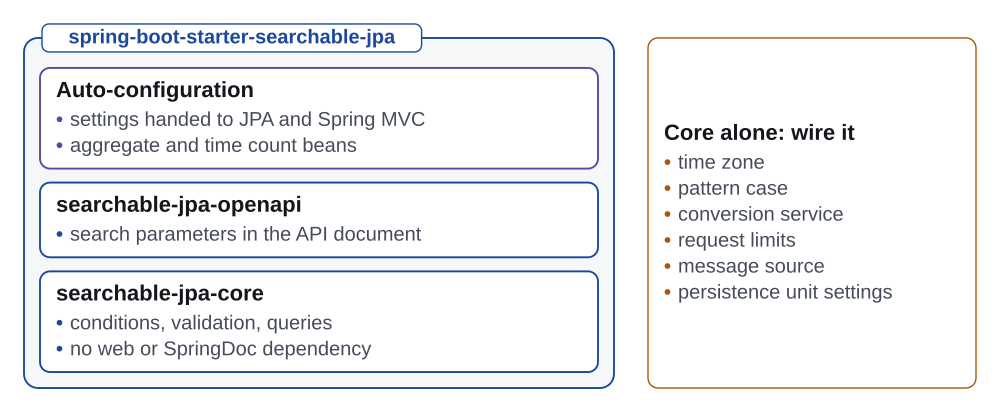

# Installation

After this page Searchable JPA is on the classpath of your application. The page describes `2.1.2-SNAPSHOT`; a version ending in `-SNAPSHOT` is a development build.

## Compatibility

| Searchable JPA | Spring Boot | Java packages | Source branch |
| --- | --- | --- | --- |
| 2.x | 4.1.x and later 4.x | `jakarta.*` | `master` |
| 1.x | 3.2.x-3.5.x | `jakarta.*` | `spring-boot-3x` |
| 0.1.x | 2.7.x | `javax.*` | `spring-boot-2x` (unmaintained) |

The current build is tested with Java 17, 21 and 25, Spring Boot 4.1.2 and Hibernate ORM 7.4.14.Final. Java 17 is the minimum source and bytecode level. Use one version for every module. A Spring Boot 3 application stays on 1.x until it moves to Boot 4.

## Choosing modules

Use the starter in a Spring MVC application. It holds both library modules and configures the hand-over of settings, the conversion of controller parameters and the API document. With `searchable-jpa-core` alone no web or SpringDoc dependency is added, and the application wires the items on the right of the figure itself, as [Extension and integration](./advanced-features.md) shows.



| Artifact | Contents |
| --- | --- |
| `spring-boot-starter-searchable-jpa` | The core and OpenAPI modules and Spring Boot auto-configuration |
| `searchable-jpa-openapi` | The API document. Includes core |
| `searchable-jpa-core` | Conditions, DTO validation, JPA queries, services, aggregates, time buckets |

The application supplies its datasource, entities, repositories, controllers and access control.

## Adding the dependency

A published version comes from GitHub Packages. Name a version that exists in that repository and keep credentials outside committed files.

```groovy
repositories {
    mavenCentral()
    maven {
        url = uri('https://maven.pkg.github.com/simplix-framework/searchable-jpa')
        credentials {
            username = System.getenv('GITHUB_USERNAME')
            password = System.getenv('GITHUB_TOKEN')
        }
    }
}

dependencies {
    implementation 'dev.simplecore.searchable:spring-boot-starter-searchable-jpa:2.1.2-SNAPSHOT'
}
```

The token needs permission to read packages. Maven uses the same coordinates.

```xml
<dependency>
  <groupId>dev.simplecore.searchable</groupId>
  <artifactId>spring-boot-starter-searchable-jpa</artifactId>
  <version>2.1.2-SNAPSHOT</version>
</dependency>
```

## Installing from source

Building with the committed Gradle wrapper and Java 17 or later installs every module into the local Maven repository.

```bash
./gradlew check performanceTest publishToMavenLocal
```

The command creates no Git tag and publishes nothing remotely. Add `mavenLocal()` to the repositories of the consuming project, and run a Gradle project that cached an older snapshot with `--refresh-dependencies`. When the repositories are declared in `settings.gradle`, add `mavenLocal()` there. The modules are installed under `~/.m2/repository/dev/simplecore/searchable/`. When the source build reaches GitHub Packages, it reads the credentials from `gpr.user` and `gpr.token` in an ignored `gradle.properties`, or from the environment variables `GITHUB_USERNAME` and `GITHUB_TOKEN`.

```groovy
repositories {
    mavenLocal()
    mavenCentral()
}
```

## Verified dependency versions

These versions were checked on 2026-10-30.

| Component | Version |
| --- | --- |
| Gradle wrapper | 9.8.2 |
| Spring Boot | 4.1.2 |
| Spring dependency management plugin | 1.1.7 |
| SpringDoc OpenAPI | 3.2.0 |
| Hibernate ORM | 7.4.14.Final |
| Jackson 2 databind / Java time | 2.22.4 |
| Jackson 3 databind | 3.2.4 |
| ModelMapper | 3.2.8 |
| HikariCP | 7.1.0 |
| H2 (tests) | 2.5.252 |
| SQL Server JDBC (test profile) | 13.6.1.jre11 |
| JUnit / Mockito | 6.1.3 / 5.24.0 |

The root `build.gradle` holds every managed version. The dependency management of an application can change transitive versions, so inspect the resolved runtime classpath after an upgrade. [Security](./security.md) describes the advisories that remain on the Boot 3 line.

## Source verification commands

```bash
./gradlew test
./gradlew performanceTest
./gradlew :searchable-jpa-core:test -Dspring.profiles.active=mssql
```

Regular tests use H2 and leave out the `performance` tag. `performanceTest` asserts that results are not empty and counts the SQL statements a page sends. The SQL Server profile needs a reachable database created with a case-sensitive collation, because the tests compare text with regard to case. A passing H2 suite does not establish the plans or the timestamp precision of another database.

## Next step

[First search API](./basic-usage.md) builds an entity, a search DTO, a service and a controller, and sends the first request.
