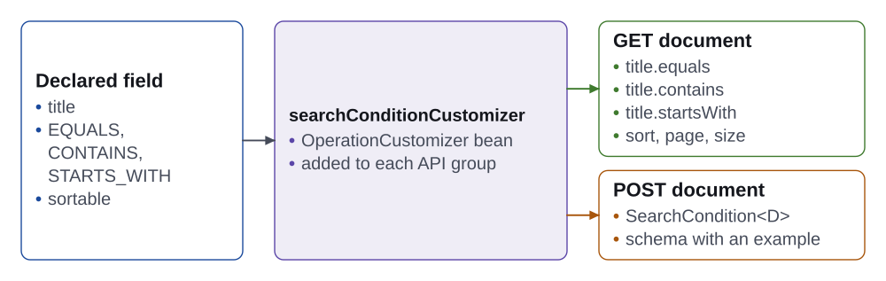

# OpenAPI

After this page the GET parameters and the POST body of a search endpoint appear in the API document. It needs the starter and SpringDoc on the classpath. Boot 4 with library 2.x uses SpringDoc 3.2.0, Boot 3 with library 1.x uses SpringDoc 2.10.0.



## GET document

A controller parameter that carries `@SearchableParams` is documented with the query parameters the DTO declares. Both declarations of [Writing requests](./request-formats.md) are documented the same way.

| Documented parameter | Content |
| --- | --- |
| `field.operator` | One for each operator the field allows; every operator when `operators` is empty |
| `sort` | One comma-separated value. The description lists the sortable fields |
| `keyword` | Documented only when the DTO has a keyword field |
| `page`, `size` | The page number and size |

- Search fields of a superclass are included.
- A parameter that only carries the raw values, such as a `Map`, is left out of the document.
- The annotation of the same name in `dev.simplecore.searchable.openapi.annotation` is deprecated and still honored. Use `dev.simplecore.searchable.core.annotation.SearchableParams`.

## POST document

For a `@RequestBody SearchCondition<PostSearchDTO>` parameter a JSON example is added to the schema SpringDoc resolved. Without a type argument, or with a wildcard, nothing can be generated, so name the DTO type in the controller. The example is an illustration picked from the allowed fields and operators; it is not validated against the constraints of the DTO.

## Field descriptions and examples

The description and the example value of a field come from the `@Schema` annotation of Swagger.

<!-- snippet: PostSearchDTO.java#described -->
```java
@SearchableField(operators = {EQUALS, CONTAINS, STARTS_WITH}, sortable = true, keyword = true)
@Schema(description = "Post title", example = "Spring")
@Size(min = 2, max = 100)
private String title;
```

## Value schemas

| Subject | In the document |
| --- | --- |
| Dates and times | The formats `date`, `partial-time` or `date-time`, by type |
| Values of `in` and `between` | A comma-separated string |
| enum | The list of values, written into the parameter schema |
| `isNull`, `isNotNull` | A value that allows `true` only |

Parameter schemas carry their type under OpenAPI 3.0 and 3.1, and every schema reference resolves. Example values in the document are hints; they replace neither authorization nor validation.

## Settings and API groups

The document is produced by an `OperationCustomizer` bean named `searchConditionCustomizer`. It is registered by default in a servlet application that has SpringDoc and Spring MVC. A bean of the same name replaces it, and this setting turns it off.

```yaml
searchable:
  swagger:
    enabled: false
```

`searchable.swagger.enabled` turns off the documentation of this library only. Configure the endpoints of SpringDoc with `springdoc.api-docs.enabled` and `springdoc.swagger-ui.enabled`.

A group built with `GroupedOpenApi` does not receive global `OperationCustomizer` beans. Add the customizer to each group.

<!-- snippet: PostApiGroup.java#group -->
```java
@Configuration
public class PostApiGroup {

    @Bean
    GroupedOpenApi postsApi(@Qualifier("searchConditionCustomizer") OperationCustomizer customizer) {
        return GroupedOpenApi.builder()
                .group("posts")
                .pathsToMatch("/api/posts/**")
                .addOperationCustomizer(customizer)
                .build();
    }
}
```

- Registering the same customizer twice in one group duplicates the parameters.
- When several `OperationCustomizer` beans make the injection ambiguous, name the bean with `@Qualifier("searchConditionCustomizer")`.
- A description the application wrote in `@Operation` is kept, and the summary of search fields is appended to it.

## Checking the result

With the default paths of SpringDoc, look at `/v3/api-docs` and `/swagger-ui/index.html`; a group is at `/v3/api-docs/{group}`. Check aliased fields, inherited fields, allowed operators, date formats and example values. The page examples of the document are general values, and the real maximum size comes from the settings of the application.

The library applies no authentication to the documentation endpoints and generates no error or response schema of the application.

## Next step

[Errors and messages](./errors-and-messages.md) answers invalid requests.
