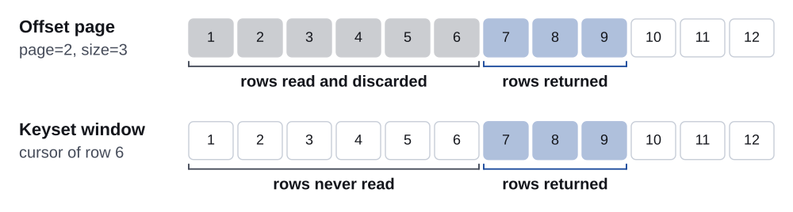

# Ways to read

After this page you can pick the read method that fits a screen or a job, read the next window without a total, and select only the columns you need. Conditions are `SearchCondition` values built as [Writing requests](./request-formats.md) shows.

## Choosing a method

| Result needed | Method | Return type | How it runs |
| --- | --- | --- | --- |
| A page and the total | `findAllWithSearch(condition)` | `Page<T>` | A page query and a count |
| The first row of the sort | `findFirstWithSearch(condition)` | `Optional<T>` | Reads one row and counts nothing |
| The only matching row | `findOneWithSearch(condition)` | `Optional<T>` | Fails when two or more rows match |
| A count | `countWithSearch(condition)` | `long` | Runs the count only |
| Whether a row exists | `existsWithSearch(condition)` | `boolean` | Runs the existence check only |
| The next window, without a total | `scrollWithSearch(condition, position)` | `Window<T>` | Reads one window |
| Some columns | `projectWithSearch(condition, type)` | `Page<P>` | Selects only the columns the projection reads |
| An interface over the entity | `findAllWithSearch(condition, type)` | `Page<P>` | Loads entities, then wraps them in the projection |

Every method has an overload that also takes a server scope, explained in [Server scope and limits](./server-scope-and-limits.md).

## Pages

`findAllWithSearch` reads one page by the `page` and `size` of the condition. Left out, it reads page 0 with the default size of 20, and a size of up to 1,000 is accepted. [Settings](./auto-configuration.md) changes both values.

- The content of a page and the total refer to root entities. A row counts once however many elements of a collection match.
- The primary key is added as the last sort, so rows with equal sort values keep one order.
- When fewer rows than the page size are read, the total follows from them and the count query is skipped.
- A late page reads and skips every row before it, so its cost grows. Use a scroll to walk to the end.

## One row, counts, existence

<!-- snippet: PostQueries.java#single -->
```java
public Optional<Post> newestPublished() {
    SearchCondition<PostSearchDTO> condition = SearchConditionBuilder.create(PostSearchDTO.class)
            .where(w -> w.equals("status", PostStatus.PUBLISHED))
            .sort(s -> s.desc("createdAt"))
            .build();
    return service.findFirstWithSearch(condition);
}

public Optional<Post> theOnlyDraft() {
    SearchCondition<PostSearchDTO> condition = SearchConditionBuilder.create(PostSearchDTO.class)
            .where(w -> w.equals("status", PostStatus.DRAFT))
            .build();
    return service.findOneWithSearch(condition);
}
```

`findFirstWithSearch` does not read the page number of the condition and returns the first row of the sort. `findOneWithSearch` does not mean "the first row": when two or more rows match, an incorrect-result-size error is raised. Spring Data may translate it to `IncorrectResultSizeDataAccessException`, so do not depend on the exception type of a JPA provider. Use the method only where the condition guarantees one row.

<!-- snippet: PostQueries.java#count -->
```java
public long countPublished(SearchCondition<PostSearchDTO> condition) {
    return service.countWithSearch(condition);
}

public boolean anyMatch(SearchCondition<PostSearchDTO> condition) {
    return service.existsWithSearch(condition);
}
```

A count and an existence check do not use the page, the sort or the fetch settings of the condition.

## Scrolling

A scroll returns one window (`Window`) and whether another follows, and counts no total. A keyset position remembers the sort values and the primary key of the last row of the previous window and continues with the row after it.



An offset page has to read every row it skips, while a keyset scroll reads a late window at the cost of the first one. Rows inserted between two reads do not shift the position.

<!-- snippet: PostReadController.java#scroll -->
```java
@GetMapping("/scroll")
public ScrollResponse scroll(@RequestParam @SearchableParams(PostSearchDTO.class) Map<String, String> params) {
    Map<String, String> filters = new LinkedHashMap<>(params);
    String cursor = filters.remove("cursor");
    SearchCondition<PostSearchDTO> condition = new SearchableParamsParser<>(PostSearchDTO.class).convert(filters);

    Window<Post> window = service.scrollWithSearch(condition, service.scrollPosition(cursor));
    String next = window.hasNext() ? SearchCursor.encode(window.positionAt(window.size() - 1)) : null;
    return new ScrollResponse(window.map(PostResponse::from).getContent(), next);
}
```

<!-- snippet: ScrollResponse.java#response -->
```java
public record ScrollResponse(List<PostResponse> items, String next) {
}
```

This endpoint takes search parameters and a parameter of its own, `cursor`, so it removes `cursor` from the `Map` before it calls the parser.

<!-- snippet: scroll-first.http -->
```http
GET /api/posts/scroll?sort=createdAt.desc&size=2
```

The request returns two rows, newest first (Spring Security notes, Query tuning draft), and the cursor of the next position. Sending the `next` of the response back as `cursor` returns the other two rows, and `next` is `null`.

- `scrollPosition(null)` is the first position. `SearchCursor.encode` turns a position into text that fits a URL, and `scrollPosition(cursor)` reads it back with `SearchCursor.decode`.
- The `size` of the condition is the window size, and `page` is not used.
- The sort must not run through a collection.
- A row without a sort value is ordered as the smallest value. Where the default null order of a database differs, the library states the null order in the SQL.
- An entity with an `@EmbeddedId` does not support keyset positions. Use an offset scroll that starts at `ScrollPosition.offset()`.
- A cursor that does not fit the sort of the request, or that is not a cursor, is refused with `SearchableValidationException`.
- A cursor is not signed. It holds sort values of a row the client already received, and changing it only moves the client within the rows of its own search.

## Projections

Use a projection when a response needs some attributes only. Each kind runs different SQL.

| Kind | Method | Selected | Projection type |
| --- | --- | --- | --- |
| Column projection | `projectWithSearch` | The columns the projection reads | Interface, record |
| Entity-backed projection | `findAllWithSearch(condition, type)` | The whole entity | Interface |

<!-- snippet: PostTitle.java#record -->
```java
public record PostTitle(Long id, String title) {
}
```

<!-- snippet: PostReadController.java#project -->
```java
@GetMapping("/titles")
public Page<PostTitle> titles(@SearchableParams SearchCondition<PostSearchDTO> condition) {
    return service.projectWithSearch(condition, PostTitle.class);
}
```

<!-- snippet: titles.http -->
```http
GET /api/posts/titles?status.equals=PUBLISHED&sort=id.asc
```

Only the columns `id` and `title` are selected, and the page and the total are those of the search. The component names of a record, or the getter names of an interface, have to equal entity attribute names. The sort of a column projection must not run through a collection, and a getter that returns another projection loads the associated entity whole.

<!-- snippet: PostSummary.java#interface -->
```java
public interface PostSummary {

    Long getId();

    String getTitle();
}
```

<!-- snippet: PostQueries.java#interface-projection -->
```java
public Page<PostSummary> summaries(SearchCondition<PostSearchDTO> condition) {
    return service.findAllWithSearch(condition, PostSummary.class);
}
```

An entity-backed projection wraps loaded entities in the interface. It selects no fewer columns, and a computed getter that touches an association can cause further queries. Passing a class that is not an interface raises `SearchableConfigurationException`.

## Refused requests

<!-- snippet: page-size.http -->
```http
GET /api/posts?size=5000
```

A page size above the maximum is refused before any query runs, and so are a negative page number and a `page × size` beyond the integer offset range of JPA.

## Next step

[Server scope and limits](./server-scope-and-limits.md) combines the conditions of a client with a condition the server decides.
