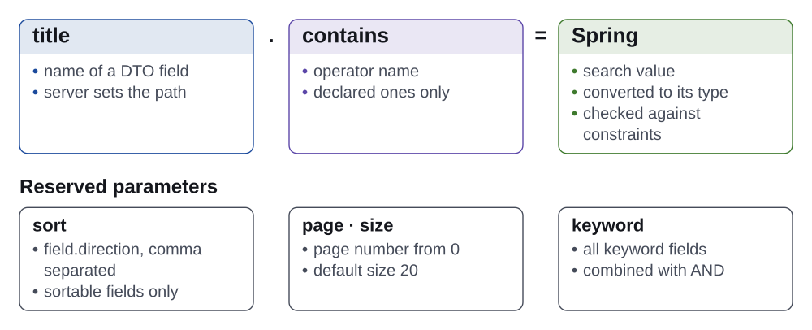
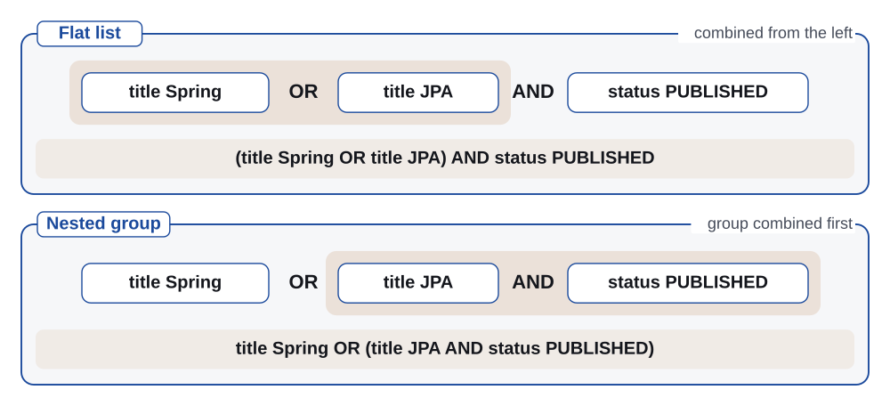

# Writing requests

After this page you can write the same search as GET parameters, as a JSON body and with the Java builder, and build AND and OR groups that mean what you intend. The page uses the `PostSearchDTO` of [Declaring search fields](./search-fields.md).

## Input forms

Each form becomes a `SearchCondition<PostSearchDTO>` and passes the same validation. The examples below all find the posts with 100 to 500 views whose status is `PUBLISHED` or `ARCHIVED`.

<!-- tabs:start -->

#### **GET**

<!-- snippet: values-get.http -->
```http
GET /api/posts?viewCount.between=100,500&status.in=PUBLISHED,ARCHIVED&sort=id.asc
```

#### **JSON**

<!-- snippet: post-values.http -->
```http
POST /api/posts/search
Content-Type: application/json

{
  "conditions": [
    {"field": "viewCount", "searchOperator": "between", "value": 100, "value2": 500},
    {"operator": "and", "field": "status", "searchOperator": "in", "value": ["PUBLISHED", "ARCHIVED"]}
  ],
  "sort": {"orders": [{"field": "id", "direction": "asc"}]}
}
```

#### **Builder**

<!-- snippet: PostQueries.java#builder-values -->
```java
public Page<Post> viewedPublishedOrArchived() {
    SearchCondition<PostSearchDTO> condition = SearchConditionBuilder.create(PostSearchDTO.class)
            .where(w -> w.between("viewCount", 100L, 500L)
                    .in("status", List.of(PostStatus.PUBLISHED, PostStatus.ARCHIVED)))
            .sort(s -> s.asc("id"))
            .build();
    return service.findAllWithSearch(condition);
}
```

<!-- tabs:end -->

| Form | Used for | Conditions it can express |
| --- | --- | --- |
| GET parameters | Filters of a list screen, a search shared as a link | Conditions combined by AND |
| JSON body | A search that needs OR or nested groups | Every condition |
| Java builder | A search composed by server code | Every condition |

## GET parameters



The name of a condition parameter is `field.operator` and its value is the search value. `title.contains=Spring` finds the posts whose title contains `Spring`. The field is a DTO field name and the operator one of the names in [Operators and values](./search-operators.md). All condition parameters are combined by AND.

| Reserved parameter | Form | Meaning |
| --- | --- | --- |
| `sort` | `sort=createdAt.desc,id.asc` | `field.direction` entries separated by commas. The direction is `asc` or `desc` |
| `page` | `page=0` | The page number, starting at 0 |
| `size` | `size=20` | The page size. Left out, the default size is used |
| `keyword` | `keyword=Spring` | Searches every keyword field |

<!-- snippet: sort-multiple.http -->
```http
GET /api/posts?sort=viewCount.desc,id.asc&size=2
```

The request sorts by views, descending, then by ID, ascending, and returns the first two rows.

- A comma separates values only for `in`, `notIn`, `between` and `notBetween`. In the value of any other operator a comma is a character.
- When a value of `in` has to contain a comma, use the array of a JSON body.
- The parameter resolver of the starter reads a parameter sent more than once as its values joined by commas. `sort=viewCount.desc&sort=id.asc` equals the example above.
- URL-encode `+`, `&`, spaces and non-ASCII characters in a value. `curl --data-urlencode` does the encoding for you.

## JSON body

<!-- snippet: post-group.http -->
```http
POST /api/posts/search
Content-Type: application/json

{
  "conditions": [
    {"field": "status", "searchOperator": "equals", "value": "PUBLISHED"},
    {"operator": "and", "conditions": [
      {"field": "title", "searchOperator": "contains", "value": "Spring"},
      {"operator": "or", "field": "title", "searchOperator": "contains", "value": "JPA"}
    ]}
  ],
  "sort": {"orders": [{"field": "createdAt", "direction": "desc"}]},
  "page": 0,
  "size": 20
}
```

The request finds the posts whose status is `PUBLISHED` and whose title contains `Spring` or `JPA`. With the example data it returns JPA paging in depth and Spring Boot basics.

| Property | Where | Meaning |
| --- | --- | --- |
| `conditions` | Top level, group | The ordered list of conditions and groups |
| `field` | Condition | A DTO field name |
| `searchOperator` | Condition | An operator name |
| `value` | Condition | The search value. `in` and `notIn` take an array |
| `value2` | Condition | The second bound of `between` and `notBetween` |
| `operator` | Condition, group | How the entry combines with the result so far: `and` or `or`. The first entry of a list needs none, and any other value is refused |
| `sort.orders` | Top level | A list of `field` and `direction` (`asc`, `desc`) |
| `page`, `size` | Top level | The page number and size |

An entity path (`entityField`) or fetch paths (`fetchFields`) sent by a client are not used. The entity path comes from the DTO declaration and fetch paths from server code only.

Server code that handles a JSON string itself uses `SearchCondition.fromJson(json, PostSearchDTO.class)` and `toJson()`. `fromJson` runs the DTO validation as well.

## Java builder

<!-- snippet: PostQueries.java#builder -->
```java
public Page<Post> publishedAboutSpringOrJpa() {
    SearchCondition<PostSearchDTO> condition = SearchConditionBuilder.create(PostSearchDTO.class)
            .where(w -> w.equals("status", PostStatus.PUBLISHED))
            .and(g -> g.contains("title", "Spring").orContains("title", "JPA"))
            .sort(s -> s.desc("createdAt").asc("id"))
            .page(0).size(20)
            .build();
    return service.findAllWithSearch(condition);
}
```

`where` starts the first condition, and `and` and `or` combine groups. Inside a group, operator methods written one after another are combined by AND, and the methods that start with `or` (`orContains`, `orIn` and the others) combine by OR. Field names are strings and `build()` checks them against the DTO declaration.

<!-- snippet: PostQueries.java#builder-operators -->
```java
public Page<Post> popularOrFeatured() {
    SearchCondition<PostSearchDTO> condition = SearchConditionBuilder.create(PostSearchDTO.class)
            .where(w -> w.between("viewCount", 100L, 500L).orIn("label", List.of("featured")))
            .and(g -> g.isNotNull("publishedAt"))
            .sort(s -> s.asc("id"))
            .build();
    return service.findAllWithSearch(condition);
}
```

<!-- snippet: PostQueries.java#builder-or -->
```java
public Page<Post> draftsOrPopular() {
    SearchCondition<PostSearchDTO> condition = SearchConditionBuilder.create(PostSearchDTO.class)
            .where(w -> w.equals("status", PostStatus.DRAFT))
            .or(g -> g.greaterThanOrEqualTo("viewCount", 400L).equals("status", PostStatus.PUBLISHED))
            .sort(s -> s.asc("id"))
            .build();
    return service.findAllWithSearch(condition);
}
```

`sort` applies `asc(field)` and `desc(field)` in the order they are called, and `page` and `size` set the page. The [API reference](./api-reference.md) lists every builder method.

## Groups and evaluation order

A list of conditions is combined from the left in the order it is declared, not by the operator precedence of SQL. The `operator` of an entry says how that entry combines with the whole result before it.



- `A, or B, and C` is `(A OR B) AND C`.
- For `A OR (B AND C)`, put B and C into a group.
- The `operator` of a group applies to the group as a whole, also when the group has one entry.

## Wiring a controller

| Parameter declaration | Converted by | Used when |
| --- | --- | --- |
| `@SearchableParams SearchCondition<PostSearchDTO> condition` | The parameter resolver of the starter | The whole query string is search parameters |
| `@RequestParam @SearchableParams(PostSearchDTO.class) Map<String, String> params` | The `SearchableParamsParser` the controller calls | Search parameters arrive beside parameters of the endpoint, or no starter is used |
| `@RequestBody SearchCondition<PostSearchDTO> condition` | Jackson | A JSON body |

<!-- snippet: PostController.java#raw -->
```java
@GetMapping("/raw")
public Page<PostResponse> listRaw(
        @RequestParam @SearchableParams(PostSearchDTO.class) Map<String, String> params) {
    SearchCondition<PostSearchDTO> condition = new SearchableParamsParser<>(PostSearchDTO.class).convert(params);
    return service.findAllWithSearch(condition).map(PostResponse::from);
}
```

The resolver and the parser refuse a name that is not a search parameter of the DTO.

<!-- snippet: unknown-param.http -->
```http
GET /api/posts?cursor=abc
```

An endpoint that takes parameters of its own receives a `Map`, removes its own parameters and then calls the parser. The scroll example in [Ways to read](./reading-results.md) does this. When unknown names such as tracking parameters have to be ignored, set `searchable.params.ignore-unknown=true` or use `new SearchableParamsParser<>(PostSearchDTO.class, true)`. A parameter that starts with the name of a DTO field is validated in every case.

Spring Boot 3 converts a JSON body with Jackson 2. A Jackson 3 mapper reads the same body with the same validation. A `SearchCondition` without a type argument names no DTO to validate against, so do not use one.

## Refused requests

| Request | Reason |
| --- | --- |
| `sort=createdAt,desc` | A sort entry is written `field.direction` |
| `viewCount.between=100` | `between` needs two values |
| A JSON condition whose `field` the DTO does not have | The field is not declared |

<!-- snippet: bad-sort-syntax.http -->
```http
GET /api/posts?sort=createdAt,desc
```

<!-- snippet: between-one-value.http -->
```http
GET /api/posts?viewCount.between=100
```

<!-- snippet: post-unknown-field.http -->
```http
POST /api/posts/search
Content-Type: application/json

{
  "conditions": [
    {"field": "content", "searchOperator": "contains", "value": "Spring"}
  ]
}
```

## Next step

[Operators and values](./search-operators.md) gives the value format of each operator and the bounds of a date range.
