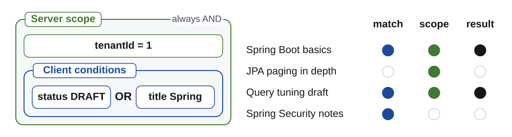

# Server scope and limits

After this page you can add a condition no client can leave to every read and write, and bound the size one request may have. The page uses the methods of [Ways to read](./reading-results.md).

## Server scope

A condition the server decides, such as a tenant, an owner or a visibility state, is not taken as a DTO field but handed over as a `Specification`. The library combines the server scope with AND outside the whole expression of the client.



A client that sends `status DRAFT OR title Spring` still does not receive Spring Security notes, which lies outside the scope.

<!-- snippet: PostQueries.java#scope -->
```java
public Page<Post> ofTenant(SearchCondition<PostSearchDTO> fromClient, Long tenantId) {
    Specification<Post> ownTenant = (root, query, cb) -> cb.equal(root.get("tenantId"), tenantId);
    return service.findAllWithSearch(fromClient, ownTenant);
}
```

- Reads, counts, scrolls, projections, updates, deletes, aggregates and time buckets all have an overload with a scope, passed as the argument after the condition.
- Take the values of a scope from a source the server trusts, such as the authentication. Never use a tenant value sent by the client.
- A scope applies to the entity row itself. A scope that joins a collection or adds a fetch is refused with `SearchableConfigurationException`; write a restriction on a collection as a subquery.

## Extending a condition

A fixed condition that DTO fields can express may be added after the conditions of the client with the builder.

<!-- snippet: PostQueries.java#extend -->
```java
public Page<Post> publishedOnly(SearchCondition<PostSearchDTO> fromClient) {
    SearchCondition<PostSearchDTO> condition = SearchConditionBuilder.from(fromClient, PostSearchDTO.class)
            .and(g -> g.equals("status", PostStatus.PUBLISHED))
            .build();
    return service.findAllWithSearch(condition);
}
```

`from` copies the conditions, the sort and the fetch paths before it extends them, so the original condition stays unchanged. Add a mandatory condition with AND after the whole expression of the client; adding it with OR widens the result. For access control a server scope is the better choice, because it needs no field in the DTO and applies to writes and aggregates in the same way.

## Request limits

| Subject | Default limit | Setting |
| --- | --- | --- |
| Page number | 0 or greater | none |
| Page size | At least 1, at most 1,000 | `searchable.max-page-size` |
| Offset | `page × size` up to 2,147,483,647 | none |
| Conditions and groups | 1,000 | `searchable.limits.max-nodes` |
| Group nesting | 32 levels | `searchable.limits.max-depth` |
| Listed values, such as `in` | 1,000 per condition | `searchable.limits.max-in-values` |
| Sort fields | 16 | `searchable.limits.max-sort-fields` |

The structural limits apply to JSON bodies, to the builder and to conditions passed to a service, and a request over a limit is refused before any query runs. Structural limits belong to the whole process, page sizes to each persistence unit.

## Requiring a filter for writes

A method that updates or deletes by a search condition targets the whole table when the condition is empty. With `searchable.write.require-filter=true`, a write that neither a condition nor a scope narrows is refused with `SearchableValidationException`. [Bulk update and delete](./bulk-write.md) explains the writes.

## Controls the application implements

| Subject | Note |
| --- | --- |
| Authentication and authorization | The library does not identify users. The application decides what goes into a scope |
| Body size and text length | Limit them in the server, the proxy and with DTO constraints |
| Request rate and query timeout | Set them at the gateway and the datasource |
| Response fields | Convert entities to a response type |
| Fetch paths | Check them against an allow-list before a request may choose them |

DTO validation runs for GET parameters, for JSON bodies with a type argument and in the builder. A condition server code builds with `new SearchCondition<>()` is treated as trusted input, so do not pass outside input along that path unchecked.

## Next step

[Bulk update and delete](./bulk-write.md) changes the rows a condition matches.
