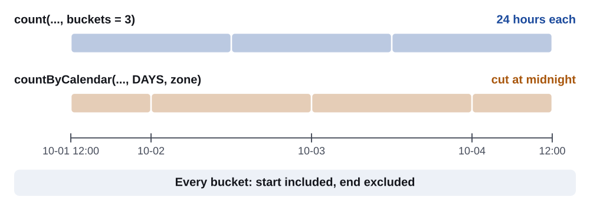

# Time buckets

After this page you can cut a period into equal or calendar buckets, count each one, and build a chart endpoint that takes the same search parameters as a list. The rules for conditions and scopes are those of [Aggregates](./aggregates.md).

## Kinds of buckets

A time window is the whole period that is counted, and a bucket is one slice of it.



| Method | Cut by | Return type |
| --- | --- | --- |
| `count` | Buckets of equal width | `List<Long>` |
| `countByCalendar` | The hours, days, weeks, months or years of a zone | `List<TimeBucket>` |

The starter registers a `TimeBucketCounter` bean. Without the starter, create one with `new TimeBucketCounter(entityManager)`.

## Equal buckets

<!-- snippet: PostStatsController.java#counts -->
```java
@GetMapping("/counts")
public List<Long> counts(@RequestParam Instant from, @RequestParam Instant to, @RequestParam int buckets,
                         @RequestParam @SearchableParams(PostSearchDTO.class) Map<String, String> params) {
    SearchCondition<PostSearchDTO> condition =
            new SearchableParamsParser<>(PostSearchDTO.class).convert(TimeWindowParams.strip(params));
    return counter.count(Post.class, condition, null, "createdAt", from, to, buckets);
}
```

<!-- snippet: counts.http -->
```http
GET /api/posts/counts?from=2026-10-01T00:00:00Z&to=2026-10-08T00:00:00Z&buckets=7&status.in=PUBLISHED,ARCHIVED
```

<!-- snippet: counts.json -->
```json
[1, 0, 1, 0, 0, 0, 1]
```

The request cuts the seven days from October 1 into seven buckets of one day and counts the posts whose status is `PUBLISHED` or `ARCHIVED`. The result always holds as many values as buckets were asked for, in time order, including buckets with a count of 0.

The query string of this endpoint carries the window parameters `from`, `to` and `buckets` beside the search parameters. They are not DTO fields and the parser would refuse them, so `TimeWindowParams.strip` removes them before the parser is called. The names are also available as the constants `TimeWindowParams.FROM`, `TO` and `BUCKETS`.

## Calendar buckets

<!-- snippet: PostStatsController.java#calendar -->
```java
public List<TimeBucket> perDay(SearchCondition<PostSearchDTO> condition, Instant from, Instant to, ZoneId zone) {
    return counter.countByCalendar(Post.class, condition, null, "createdAt", from, to, ChronoUnit.DAYS, zone);
}
```

`countByCalendar` cuts the period at the calendar boundaries of the given zone and returns a `TimeBucket(from, to, count)` for each bucket.

| Unit | Boundary |
| --- | --- |
| `ChronoUnit.HOURS` | Every full hour |
| `ChronoUnit.DAYS` | Midnight |
| `ChronoUnit.WEEKS` | Midnight on Monday |
| `ChronoUnit.MONTHS` | Midnight on the first day of a month |
| `ChronoUnit.YEARS` | Midnight on January 1 |

- When the period does not start or end on a boundary, the first and the last bucket are shorter.
- A day on which daylight saving time changes is a bucket of its real length, 23 or 25 hours.
- Any other unit raises `SearchableValidationException`.

## Counting rules

- The period and every bucket include their start and exclude their end. A row on the boundary of two buckets belongs to the later one.
- Each matching root entity is counted once. A row whose time is null is left out.
- The page, the sort and the fetch settings of the condition do not affect what is counted.
- `from` has to lie before `to`, and the number of buckets between 1 and `searchable.bucket.max-buckets` (512 by default). An invalid period, bucket count or time axis is refused with `SearchableValidationException`.

## The time axis

The time axis is named by an attribute of the root entity; a DTO alias or a path through an association cannot be used. To let client input choose the axis, check the allowed attributes in the application.

| Attribute type | Read as |
| --- | --- |
| `Instant`, `OffsetDateTime`, `ZonedDateTime` | An instant |
| `LocalDateTime` | A time in the zone of the application |

## How each database computes

When the period lies on millisecond boundaries and divides evenly by the number of buckets, the counts are computed in one pass by grouping with the `epoch_millis` function, which turns a time into a number of milliseconds. `EpochMillisFunctionContributor` registers the function with an expression per database, and having the library on the classpath is enough to apply it.

| Database | Way |
| --- | --- |
| PostgreSQL, CockroachDB, H2, MySQL, MariaDB, SQL Server, SQLite (integer milliseconds) | Grouping by `epoch_millis` |
| Oracle, databases without an entry | A conditional sum per bucket |

Conditional sums are used on every database in these cases.

- A boundary finer than a millisecond, or a period that does not divide evenly by the number of buckets
- A column without an offset that the driver writes in a zone other than UTC
- Calendar buckets

With conditional sums the number of buckets determines the size of the SQL expression. Index the time axis column and the range conditions used often, and check representative periods and boundary times on the real database. The table describes code paths; databases other than H2 and SQL Server are not part of the integration tests. Bucket boundaries are computed in whole nanoseconds, but the precision of a stored time is decided by the column and the JDBC mapping, so precision the database did not store cannot be counted. Oracle uses conditional sums because a cast to DATE loses fractions of a second. Check a SQLite mapping that stores times in another format separately.

## Related settings

| Setting | Default | Meaning |
| --- | --- | --- |
| `searchable.bucket.max-buckets` | 512 | The most buckets one call may ask for |

## Next step

[OpenAPI](./openapi-integration.md) puts the search parameters into the API document.
