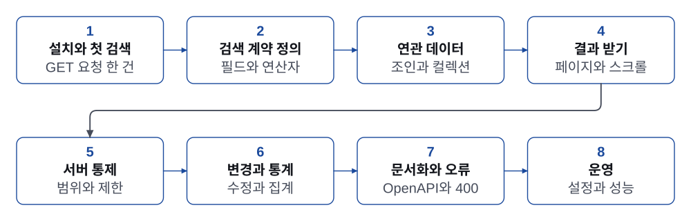

# Searchable JPA

[English](/en/README.md) | 한국어

Searchable JPA는 Spring Data JPA에 검색, 정렬, 페이지 조회를 추가하는 라이브러리입니다. 애플리케이션은 검색을 허용할 필드를 DTO에 `@SearchableField`로 선언합니다. 클라이언트는 쿼리 문자열이나 JSON으로 조건을 보내고, 라이브러리는 선언에 맞는 요청만 JPA 조회로 실행합니다.

```text
GET /api/posts?title.contains=Spring&sort=createdAt.desc&page=0&size=20
```

## 지원 계열

| 라이브러리 | Spring Boot | 브랜치 | 상태 |
| --- | --- | --- | --- |
| 2.x | 4.1.x 이상의 4.x | `master` | 개발 중 |
| 1.x | 3.2.x~3.5.x | `spring-boot-3x` | 유지보수 |
| 0.1.x | 2.7.x | `spring-boot-2x` | 지원 종료 |

이 문서는 `2.1.0-SNAPSHOT`을 기준으로 작성했습니다. Java 17 이상, Spring Boot 4.1.2, Hibernate 7.4.14.Final에서 빌드합니다. 사용하는 의존성 버전에 맞는 문서 버전을 선택하세요.

## 읽는 순서

문서는 적용 순서대로 구성했습니다. 각 페이지는 앞 페이지의 내용만 전제하며, 모든 예제는 게시글(Post), 작성자(Author), 댓글(Comment), 태그(Tag)로 이루어진 같은 모델을 사용합니다. 모델과 예제 데이터는 [첫 검색 API](./basic-usage.md)에서 정의합니다.



## 기능별 안내

| 하려는 일 | 페이지 |
| --- | --- |
| 의존성을 추가하고 첫 검색 엔드포인트를 만듭니다 | [설치](./installation.md), [첫 검색 API](./basic-usage.md) |
| 검색·정렬·키워드 검색을 허용할 필드를 선언합니다 | [검색 필드 선언](./search-fields.md) |
| GET 파라미터, JSON 본문, Java 빌더로 조건을 작성합니다 | [요청 작성](./request-formats.md) |
| 연산자와 값의 형식, 날짜 범위를 확인합니다 | [연산자와 값](./search-operators.md) |
| 연관 엔티티와 컬렉션의 필드로 검색합니다 | [연관 데이터 검색](./relationship-and-two-phase-query.md) |
| 페이지, 단건, 건수, 스크롤, 프로젝션으로 결과를 받습니다 | [조회 방법](./reading-results.md) |
| 서버가 정한 범위를 결합하고 요청 크기를 제한합니다 | [서버 범위와 제한](./server-scope-and-limits.md) |
| 조건에 맞는 행을 수정하거나 삭제합니다 | [일괄 수정·삭제](./bulk-write.md) |
| 값별 건수, 합계, 평균을 계산합니다 | [집계](./aggregates.md) |
| 기간을 나누어 구간별 건수를 계산합니다 | [시간 구간 집계](./time-buckets.md) |
| 검색 파라미터를 API 문서에 기재합니다 | [OpenAPI](./openapi-integration.md) |
| 잘못된 요청에 응답하고 메시지를 바꿉니다 | [오류와 메시지](./errors-and-messages.md) |
| 설정 값을 조정합니다 | [설정](./auto-configuration.md) |
| 실행되는 SQL과 비용을 확인합니다 | [조회 전략과 성능](./two-phase-query-optimization.md) |
| 기존 서비스에 조합하거나 starter 없이 사용합니다 | [확장과 통합](./advanced-features.md) |

타입과 메서드 목록은 [API 레퍼런스](./api-reference.md), 증상별 해결 방법은 [문제 해결](./faq.md), 버전 간 차이는 [업그레이드 안내](./upgrade.md)에 있습니다.

## 적용 범위

라이브러리는 조건의 구조와 값을 검증하고, 페이지 크기를 제한하며, 값을 SQL 문자열에 이어 붙이지 않고 Criteria 조건으로 전달합니다. 접근 권한, 테넌트 격리, 응답 DTO, 요청 본문 크기와 호출 빈도 제한은 애플리케이션에서 구현하세요. 조회 성능은 인덱스, 조건의 선택도, 연관 데이터의 크기에 따라 달라집니다.

## 모듈

| 모듈 | 역할 |
| --- | --- |
| `searchable-jpa-core` | 조건, 검증, JPA 조회, 서비스, 집계 |
| `searchable-jpa-openapi` | 검색 파라미터의 API 문서 생성 |
| `spring-boot-starter-searchable-jpa` | core와 openapi 모듈, Spring Boot 자동 설정 |

## 라이선스와 지원

[SimpleCORE License 1.0](./license.md)을 적용합니다. 재현할 수 있는 문제는 [GitHub Issues](https://github.com/simplix-framework/searchable-jpa/issues)에 등록하세요. 라이브러리·Java·Spring Boot·데이터베이스 버전, 최소한의 DTO와 엔티티 매핑, 민감 정보를 제거한 요청을 함께 적어 주세요.
