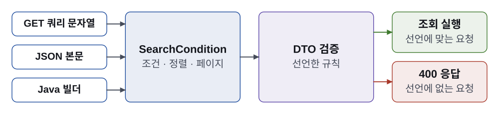

# 기본 사용법

이 문서는 Searchable JPA의 기본적인 사용 방법을 단계별로 설명합니다.

## 1. 엔티티 정의

먼저 검색할 JPA 엔티티를 정의합니다.

```java
@Entity
@Table(name = "posts")
public class Post {
    @Id
    @GeneratedValue(strategy = GenerationType.IDENTITY)
    private Long id;
    
    private String title;
    
    @Column(length = 10000)
    private String content;
    
    @Enumerated(EnumType.STRING)
    private PostStatus status;
    
    @Column(name = "view_count")
    private Long viewCount;
    
    @Column(name = "created_at")
    private LocalDateTime createdAt;
    
    @ManyToOne(fetch = FetchType.LAZY)
    @JoinColumn(name = "author_id")
    private Author author;
    
    // getters, setters...
}
```

```java
@Entity
@Table(name = "authors")
public class Author {
    @Id
    @GeneratedValue(strategy = GenerationType.IDENTITY)
    private Long id;
    
    private String name;
    private String email;
    
    // getters, setters...
}
```

## 2. 검색 DTO 정의

검색 조건을 정의할 DTO 클래스를 작성하고 `@SearchableField` 어노테이션을 사용합니다.

```java
public class PostSearchDTO {
    
    @SearchableField(operators = {EQUALS}, sortable = true)
    private Long id;
    
    @SearchableField(operators = {EQUALS, CONTAINS, STARTS_WITH, ENDS_WITH}, sortable = true)
    private String title;
    
    // 게시글 본문 - 임시 저장 상태에서는 비어 있을 수 있어 NULL 체크가 필요
    @SearchableField(operators = {CONTAINS, IS_NULL, IS_NOT_NULL})
    private String content;
    
    @SearchableField(operators = {EQUALS, NOT_EQUALS, IN, NOT_IN})
    private PostStatus status;
    
    @SearchableField(operators = {GREATER_THAN, LESS_THAN, BETWEEN}, sortable = true)
    private Long viewCount;
    
    @SearchableField(operators = {GREATER_THAN, LESS_THAN, BETWEEN}, sortable = true)
    private LocalDateTime createdAt;
    
    // 중첩 필드 검색 - 연관 엔티티의 필드에 접근
    @SearchableField(entityField = "author.name", operators = {EQUALS, CONTAINS})
    private String authorName;
    
    @SearchableField(entityField = "author.email", operators = {EQUALS, CONTAINS, ENDS_WITH})
    private String authorEmail;
    
    // getters, setters...
}
```

### @SearchableField 어노테이션 속성

- **entityField**: 엔티티의 실제 필드명 (DTO 필드명과 다를 때 사용)
- **operators**: 허용할 검색 연산자 배열
- **sortable**: 정렬 가능 여부 (기본값: false)

## 3. Repository 정의

표준 JPA Repository를 정의합니다. **JpaSpecificationExecutor 상속이 필수입니다.**

```java
@Repository
public interface PostRepository extends JpaRepository<Post, Long>, JpaSpecificationExecutor<Post> {
    // JpaSpecificationExecutor 상속 필수
    // 추가 메서드가 필요한 경우 정의
}
```

## 4. 서비스 정의

`DefaultSearchableService`를 상속받아 검색 서비스를 구현합니다.

```java
@Service
public class PostService extends DefaultSearchableService<Post, Long> {
    
    public PostService(PostRepository repository, EntityManager entityManager) {
        super(repository, entityManager);
    }
    
    // 기본 검색 메서드가 자동으로 제공됨
    // findAllWithSearch, findOneWithSearch, countWithSearch 등
}
```

### 다른 클래스를 상속해야 하는 경우

이미 다른 클래스를 상속하고 있어 `DefaultSearchableService`를 직접 상속할 수 없다면, `SearchableServiceSupport` 인터페이스와 `SearchableServiceDelegate`를 조합해 동일한 기능을 구현합니다.

```java
public class PostService extends SomeOtherBaseClass
        implements SearchableServiceSupport<Post, Long> {
    
    private final SearchableServiceDelegate<Post, Long> searchableDelegate;
    
    public PostService(PostRepository repository, EntityManager entityManager) {
        this.searchableDelegate = new SearchableServiceDelegate<>(repository, entityManager, Post.class);
    }
    
    @Override
    public SearchableServiceDelegate<Post, Long> getSearchableDelegate() {
        return searchableDelegate;
    }
}
```

`getSearchableDelegate()`가 반환하는 델리게이트가 `findAllWithSearch`, `findOneWithSearch`, `countWithSearch` 등 `SearchableService`의 모든 메서드를 실제로 처리합니다. 상속 구조에 제약이 없다면 `DefaultSearchableService`를 상속하는 방식이 더 간단합니다.

## 5. 컨트롤러 구현

### GET 방식 검색 (쿼리 파라미터)

```java
@RestController
@RequestMapping("/api/posts")
public class PostController {
    
    private final PostService postService;
    
    public PostController(PostService postService) {
        this.postService = postService;
    }
    
    @GetMapping("/search")
    public Page<Post> searchPosts(
        @RequestParam Map<String, String> params
    ) {
        SearchCondition<PostSearchDTO> condition =
            new SearchableParamsParser<>(PostSearchDTO.class).convert(params);
        return postService.findAllWithSearch(condition);
    }
}
```

#### GET 방식 요청 예제

```bash
# 제목에 "Spring"이 포함된 게시글 검색
GET /api/posts/search?title.contains=Spring

# 상태가 PUBLISHED이고 조회수가 100 이상인 게시글
GET /api/posts/search?status.equals=PUBLISHED&viewCount.greaterThan=100

# 작성자 이름으로 검색하고 제목으로 정렬
GET /api/posts/search?authorName.contains=John&sort=title.asc

# 페이징 포함
GET /api/posts/search?title.contains=Java&page=0&size=10
```

### POST 방식 검색 (JSON 바디)

```java
@PostMapping("/search")
public Page<Post> searchPosts(
    @RequestBody SearchCondition<PostSearchDTO> searchCondition
) {
    return postService.findAllWithSearch(searchCondition);
}
```

#### POST 방식 요청 예제

```json
{
  "conditions": [
    {
      "operator": "and",
      "field": "title",
      "searchOperator": "contains",
      "value": "Spring"
    },
    {
      "operator": "and",
      "field": "status",
      "searchOperator": "equals",
      "value": "PUBLISHED"
    },
    {
      "operator": "and",
      "field": "viewCount",
      "searchOperator": "greaterThan",
      "value": 100
    }
  ],
  "sort": {
    "orders": [
      {
        "field": "createdAt",
        "direction": "desc"
      }
    ]
  },
  "page": 0,
  "size": 10
}
```

### 검색 요청 처리 흐름

GET 요청의 쿼리 파라미터는 `SearchableParamsParser`가, POST 요청의 JSON 바디는 Jackson `SearchConditionDeserializer`가 각각 `SearchCondition`으로 변환합니다. 이후 `SearchableFieldValidator`와 `SearchConditionValidator`가 필드·연산자·정렬 조건을 검증하고, `SearchableSpecificationBuilder`가 JPA `Specification`으로 조립합니다. 마지막으로 `TwoPhaseQueryExecutor`가 ID 조회(Phase 1), 카운트 조회(Phase 3), 배치 조회(Phase 2) 순서로 실행해 `Page<T>` 결과를 컨트롤러에 반환합니다.



*GET·POST 검색 요청이 검증과 두 단계 조회를 거쳐 `Page<T>` 결과로 반환되는 흐름*

## 6. 기본 검색 연산자 사용법

### 문자열 검색

```bash
# 정확히 일치
title.equals=Spring Boot

# 포함
title.contains=Spring

# 시작
title.startsWith=Spring

# 끝
title.endsWith=Boot
```

### 숫자/날짜 비교

```bash
# 크다
viewCount.greaterThan=100

# 작다
viewCount.lessThan=1000

# 범위 (BETWEEN)
viewCount.between=100,1000

# 날짜 범위
createdAt.between=2024-01-01T00:00:00,2024-12-31T23:59:59
```

### NULL 체크

```bash
# NULL 값
content.isNull

# NOT NULL 값
content.isNotNull
```

### IN 연산자

```bash
# 여러 값 중 하나
status.in=PUBLISHED,DRAFT

# 여러 값에 포함되지 않음
status.notIn=DELETED,ARCHIVED
```

## 7. 정렬

### 단일 필드 정렬

```bash
GET /api/posts/search?sort=title.asc
GET /api/posts/search?sort=createdAt.desc
```

### 다중 필드 정렬

```bash
GET /api/posts/search?sort=viewCount.desc,createdAt.desc
```

### JSON 방식 정렬

```json
{
  "sort": {
    "orders": [
      {
        "field": "viewCount",
        "direction": "desc"
      },
      {
        "field": "createdAt",
        "direction": "desc"
      }
    ]
  }
}
```

## 8. 페이징

```bash
# 첫 번째 페이지, 10개씩
GET /api/posts/search?page=0&size=10

# 두 번째 페이지, 20개씩
GET /api/posts/search?page=1&size=20
```

## 9. 실제 사용 예제

### 복합 검색 조건

```bash
# 제목에 "Spring"이 포함되고, 상태가 PUBLISHED이며, 
# 조회수가 100 이상인 게시글을 최신순으로 정렬
GET /api/posts/search?title.contains=Spring&status.equals=PUBLISHED&viewCount.greaterThan=100&sort=createdAt.desc&page=0&size=10
```

### 중첩 필드 검색

```bash
# 작성자 이름에 "John"이 포함된 게시글
GET /api/posts/search?authorName.contains=John

# 작성자 이메일이 특정 도메인인 게시글
GET /api/posts/search?authorEmail.endsWith=@company.com
```

## 다음 단계

기본 사용법을 익혔다면 다음 문서를 참조하세요:

- [고급 기능](advanced-features.md) - 복잡한 검색 조건과 중첩 쿼리
- [검색 연산자](search-operators.md) - 모든 검색 연산자 상세 설명
- [OpenAPI 통합](openapi-integration.md) - Swagger 문서 자동 생성
