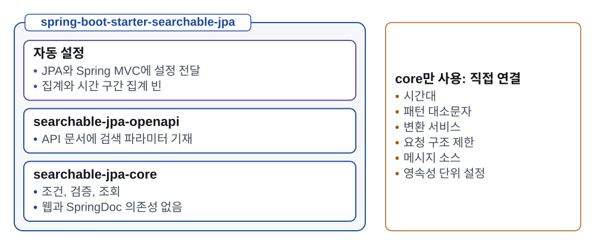

# 설치

이 페이지를 마치면 애플리케이션의 클래스패스에 Searchable JPA가 추가됩니다. `2.1.1-SNAPSHOT`을 기준으로 설명하며, `-SNAPSHOT`으로 끝나는 버전은 개발 빌드입니다.

## 호환성

| Searchable JPA | Spring Boot | Java 패키지 | 소스 브랜치 |
| --- | --- | --- | --- |
| 2.x | 4.1.x 이상의 4.x | `jakarta.*` | `master` |
| 1.x | 3.2.x~3.5.x | `jakarta.*` | `spring-boot-3x` |
| 0.1.x | 2.7.x | `javax.*` | `spring-boot-2x` (지원 종료) |

현재 빌드는 Java 17, 21, 25와 Spring Boot 4.1.2, Hibernate ORM 7.4.14.Final에서 테스트합니다. 소스와 바이트코드의 최소 수준은 Java 17입니다. 모든 모듈에 같은 버전을 사용하세요. Spring Boot 3 애플리케이션은 Boot 4로 이전하기 전까지 1.x를 사용합니다.

## 모듈 선택

Spring MVC 애플리케이션에는 starter를 사용하세요. starter는 core와 openapi 모듈을 포함하고 설정 전달, 컨트롤러 파라미터 변환, API 문서 생성을 자동으로 구성합니다. `searchable-jpa-core`만 사용하면 웹과 SpringDoc 의존성이 추가되지 않으며, 그림 오른쪽의 항목을 애플리케이션에서 직접 연결합니다. 연결 방법은 [확장과 통합](./advanced-features.md)에 있습니다.



| 아티팩트 | 내용 |
| --- | --- |
| `spring-boot-starter-searchable-jpa` | core와 openapi 모듈, Spring Boot 자동 설정 |
| `searchable-jpa-openapi` | API 문서 생성. core를 포함합니다 |
| `searchable-jpa-core` | 조건, DTO 검증, JPA 조회, 서비스, 집계, 시간 구간 집계 |

데이터소스, 엔티티, Repository, 컨트롤러, 접근 제어는 애플리케이션에서 구성합니다.

## 의존성 추가

원격 저장소에 배포된 버전은 GitHub Packages에서 받습니다. 저장소에 실제로 존재하는 버전을 지정하고, 인증 정보는 커밋하지 않는 위치에 두세요.

```groovy
repositories {
    mavenCentral()
    maven {
        url = uri('https://maven.pkg.github.com/simplix-framework/searchable-jpa')
        credentials {
            username = System.getenv('GITHUB_USERNAME')
            password = System.getenv('GITHUB_TOKEN')
        }
    }
}

dependencies {
    implementation 'dev.simplecore.searchable:spring-boot-starter-searchable-jpa:2.1.1-SNAPSHOT'
}
```

토큰에는 패키지 읽기 권한이 필요합니다. Maven에서는 같은 좌표를 사용합니다.

```xml
<dependency>
  <groupId>dev.simplecore.searchable</groupId>
  <artifactId>spring-boot-starter-searchable-jpa</artifactId>
  <version>2.1.1-SNAPSHOT</version>
</dependency>
```

## 소스에서 로컬 설치

저장소의 Gradle Wrapper와 Java 17 이상으로 빌드하면 모든 모듈을 로컬 Maven 저장소에 설치합니다.

```bash
./gradlew check performanceTest publishToMavenLocal
```

이 명령은 Git 태그를 만들거나 원격 저장소에 배포하지 않습니다. 사용하는 프로젝트의 저장소 목록에 `mavenLocal()`을 추가하고, 이전 스냅샷을 캐시한 Gradle 프로젝트는 `--refresh-dependencies`로 다시 받으세요. 저장소 선언이 `settings.gradle`에 있으면 그곳에 `mavenLocal()`을 추가합니다. 모듈은 `~/.m2/repository/dev/simplecore/searchable/` 아래에 설치됩니다. 소스 빌드가 GitHub Packages에 접근할 때는 커밋하지 않는 `gradle.properties`의 `gpr.user`, `gpr.token`이나 환경 변수 `GITHUB_USERNAME`, `GITHUB_TOKEN`에서 인증 정보를 읽습니다.

```groovy
repositories {
    mavenLocal()
    mavenCentral()
}
```

## 검증한 의존성 버전

2026년 10월 30일에 확인한 버전입니다.

| 구성 요소 | 버전 |
| --- | --- |
| Gradle Wrapper | 9.8.2 |
| Spring Boot | 4.1.2 |
| Spring 의존성 관리 플러그인 | 1.1.7 |
| SpringDoc OpenAPI | 3.2.0 |
| Hibernate ORM | 7.4.14.Final |
| Jackson 2 databind / Java time | 2.22.4 |
| Jackson 3 databind | 3.2.4 |
| ModelMapper | 3.2.8 |
| HikariCP | 7.1.0 |
| H2 (테스트) | 2.5.252 |
| SQL Server JDBC (테스트 프로파일) | 13.6.1.jre11 |
| JUnit / Mockito | 6.1.3 / 5.24.0 |

전체 버전 지정은 루트 `build.gradle`에 있습니다. 애플리케이션의 의존성 관리 설정이 전이 의존성 버전을 바꿀 수 있으므로, 업그레이드한 뒤 실제 런타임 클래스패스를 확인하세요. Boot 3 계열에 남아 있는 보안 권고는 [보안](./security.md)에서 설명합니다.

## 소스 검증 명령

```bash
./gradlew test
./gradlew performanceTest
./gradlew :searchable-jpa-core:test -Dspring.profiles.active=mssql
```

일반 테스트는 H2를 사용하며 `performance` 태그를 제외합니다. `performanceTest`는 조회 결과가 비어 있지 않은지와 실행한 SQL 문 수를 검사합니다. SQL Server 프로파일은 접속할 수 있는 데이터베이스가 필요하고, 테스트가 문자열의 대소문자를 구분해 비교하므로 대소문자를 구분하는 정렬 규칙으로 데이터베이스를 생성해야 합니다. H2 테스트 통과가 다른 데이터베이스의 실행 계획이나 시각 정밀도까지 보장하지는 않습니다.

## 다음 단계

[첫 검색 API](./basic-usage.md)에서 엔티티, 검색 DTO, 서비스, 컨트롤러를 만들고 첫 요청을 보냅니다.
