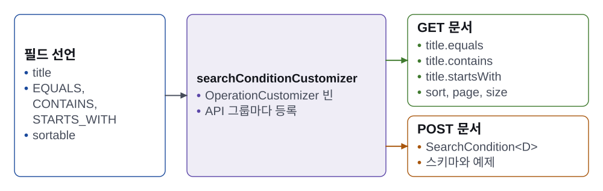

# OpenAPI

이 페이지를 마치면 검색 엔드포인트의 GET 파라미터와 POST 본문이 API 문서에 기재됩니다. starter를 사용하고 SpringDoc이 클래스패스에 있어야 합니다. Boot 4와 라이브러리 2.x는 SpringDoc 3.2.0, Boot 3과 라이브러리 1.x는 SpringDoc 2.10.0을 사용합니다.



## GET 문서

컨트롤러 파라미터에 `@SearchableParams`가 있으면 DTO의 선언대로 쿼리 파라미터를 기재합니다. [요청 작성](./request-formats.md)의 선언 형태를 모두 같은 방식으로 문서화합니다.

| 기재하는 파라미터 | 내용 |
| --- | --- |
| `필드.연산자` | 필드가 허용하는 연산자마다 하나씩. `operators`가 비어 있으면 모든 연산자 |
| `sort` | 쉼표로 구분한 값 하나. 설명에 정렬할 수 있는 필드를 나열합니다 |
| `keyword` | DTO에 키워드 필드가 있을 때만 기재합니다 |
| `page`, `size` | 페이지 번호와 크기 |

- 상위 클래스의 검색 필드도 포함합니다.
- `Map` 파라미터처럼 원시 값을 담기만 하는 파라미터는 문서에서 제외합니다.
- `dev.simplecore.searchable.openapi.annotation` 패키지의 같은 이름 어노테이션은 deprecated이며 계속 동작합니다. `dev.simplecore.searchable.core.annotation.SearchableParams`를 사용하세요.

## POST 문서

`@RequestBody SearchCondition<PostSearchDTO>` 파라미터에는 SpringDoc이 해석한 스키마에 JSON 예제를 추가합니다. 타입 인자가 없거나 와일드카드이면 문서를 생성하지 못하므로 컨트롤러에서 DTO 타입을 명시하세요. 예제는 허용하는 필드와 연산자 중에서 고른 설명용 값이며 DTO의 제약 조건으로 검증한 값이 아닙니다.

## 필드 설명과 예제

필드의 설명과 예제 값은 Swagger의 `@Schema`로 지정합니다.

<!-- snippet: PostSearchDTO.java#described -->
```java
@SearchableField(operators = {EQUALS, CONTAINS, STARTS_WITH}, sortable = true, keyword = true)
@Schema(description = "Post title", example = "Spring")
@Size(min = 2, max = 100)
private String title;
```

## 값의 스키마

| 대상 | 문서의 표현 |
| --- | --- |
| 날짜와 시간 | 타입에 따라 `date`, `partial-time`, `date-time` 형식 |
| `in`, `between`의 값 | 쉼표로 구분한 문자열 |
| enum | 파라미터 스키마에 값 목록을 직접 기재 |
| `isNull`, `isNotNull` | `true`만 허용하는 값 |

파라미터 스키마는 OpenAPI 3.0과 3.1에서 모두 타입을 기재하고, 스키마 참조는 모두 해석됩니다. 문서의 예제 값은 안내용입니다. 인가와 검증은 서버에서 수행합니다.

## 설정과 API 그룹

문서 생성은 이름이 `searchConditionCustomizer`인 `OperationCustomizer` 빈이 수행합니다. 서블릿 애플리케이션에 SpringDoc과 Spring MVC가 있으면 기본으로 등록합니다. 같은 이름의 빈을 정의하면 대체하고, 다음 설정으로 끕니다.

```yaml
searchable:
  swagger:
    enabled: false
```

`searchable.swagger.enabled`는 이 라이브러리의 문서 생성만 끕니다. SpringDoc의 엔드포인트는 `springdoc.api-docs.enabled`와 `springdoc.swagger-ui.enabled`로 따로 설정하세요.

`GroupedOpenApi`로 그룹을 직접 구성하면 전역 `OperationCustomizer`가 그룹에 적용되지 않습니다. 그룹마다 등록하세요.

<!-- snippet: PostApiGroup.java#group -->
```java
@Configuration
public class PostApiGroup {

    @Bean
    GroupedOpenApi postsApi(@Qualifier("searchConditionCustomizer") OperationCustomizer customizer) {
        return GroupedOpenApi.builder()
                .group("posts")
                .pathsToMatch("/api/posts/**")
                .addOperationCustomizer(customizer)
                .build();
    }
}
```

- 한 그룹에 같은 customizer를 두 번 등록하면 파라미터가 중복됩니다.
- `OperationCustomizer` 빈이 여러 개여서 주입이 모호하면 `@Qualifier("searchConditionCustomizer")`로 지정하세요.
- 애플리케이션이 `@Operation`에 쓴 설명은 유지하고, 검색 필드 요약을 뒤에 덧붙입니다.

## 생성 결과 확인

SpringDoc의 기본 경로에서 `/v3/api-docs`와 `/swagger-ui/index.html`을 확인합니다. 그룹은 `/v3/api-docs/{group}`입니다. 별칭 필드, 상속 필드, 허용 연산자, 날짜 형식, 예제 값을 확인하세요. 문서의 페이지 예제는 일반적인 값이며 실제 최대 크기는 애플리케이션 설정이 정합니다.

이 라이브러리는 문서 엔드포인트에 인증을 적용하지 않고, 애플리케이션의 오류·응답 스키마를 생성하지 않습니다.

## 다음 단계

[오류와 메시지](./errors-and-messages.md)에서 잘못된 요청에 대한 응답을 구성합니다.
