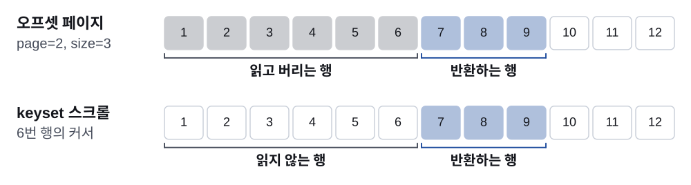

# 조회 방법

이 페이지를 마치면 화면과 용도에 맞는 조회 메서드를 고르고, 전체 건수 없이 다음 `Window`를 읽거나 필요한 컬럼만 조회할 수 있습니다. 조건은 [요청 작성](./request-formats.md)의 방식으로 만든 `SearchCondition`을 사용합니다.

## 메서드 선택

| 필요한 결과 | 메서드 | 반환 타입 | 실행 방식 |
| --- | --- | --- | --- |
| 한 페이지와 전체 건수 | `findAllWithSearch(condition)` | `Page<T>` | 페이지 조회와 건수 조회 |
| 정렬 기준의 첫 한 건 | `findFirstWithSearch(condition)` | `Optional<T>` | 한 건만 조회하고 건수는 세지 않습니다 |
| 조건에 맞는 유일한 한 건 | `findOneWithSearch(condition)` | `Optional<T>` | 두 건 이상이면 예외가 발생합니다 |
| 건수 | `countWithSearch(condition)` | `long` | 건수 조회만 실행합니다 |
| 존재 여부 | `existsWithSearch(condition)` | `boolean` | 존재 확인만 실행합니다 |
| 전체 건수 없이 다음 `Window` | `scrollWithSearch(condition, position)` | `Window<T>` | `Window` 하나만 조회합니다 |
| 일부 컬럼 | `projectWithSearch(condition, type)` | `Page<P>` | 프로젝션이 읽는 컬럼만 SELECT합니다 |
| 엔티티를 감싼 인터페이스 | `findAllWithSearch(condition, type)` | `Page<P>` | 엔티티를 조회한 뒤 프로젝션으로 감쌉니다 |

모든 메서드에는 서버 범위를 함께 받는 오버로드가 있습니다. [서버 범위와 제한](./server-scope-and-limits.md)에서 설명합니다.

## 페이지

`findAllWithSearch`는 조건의 `page`와 `size`로 한 페이지를 조회합니다. 생략하면 0번 페이지를 기본 크기 20으로 조회하고, 크기는 최대 1,000까지 허용합니다. 기본 크기와 최대 크기는 [설정](./auto-configuration.md)에서 바꿉니다.

- 페이지의 내용과 전체 건수는 루트 엔티티 기준입니다. 컬렉션 조건에 맞는 요소가 여러 개여도 한 건으로 계산합니다.
- 정렬값이 같은 행의 순서를 고정하기 위해 기본키 정렬을 마지막에 추가합니다.
- 조회한 행이 페이지 크기보다 적으면 전체 건수를 계산할 수 있으므로 건수 조회를 생략합니다.
- 뒤쪽 페이지는 앞의 행을 모두 읽은 뒤 건너뛰므로 비용이 커집니다. 끝까지 순회하는 용도에는 스크롤을 사용하세요.

## 단건, 건수, 존재 여부

<!-- snippet: PostQueries.java#single -->
```java
public Optional<Post> newestPublished() {
    SearchCondition<PostSearchDTO> condition = SearchConditionBuilder.create(PostSearchDTO.class)
            .where(w -> w.equals("status", PostStatus.PUBLISHED))
            .sort(s -> s.desc("createdAt"))
            .build();
    return service.findFirstWithSearch(condition);
}

public Optional<Post> theOnlyDraft() {
    SearchCondition<PostSearchDTO> condition = SearchConditionBuilder.create(PostSearchDTO.class)
            .where(w -> w.equals("status", PostStatus.DRAFT))
            .build();
    return service.findOneWithSearch(condition);
}
```

`findFirstWithSearch`는 조건의 페이지 번호를 읽지 않고 정렬 기준의 첫 행을 반환합니다. `findOneWithSearch`는 "첫 행"을 뜻하지 않습니다. 조건에 맞는 행이 두 건 이상이면 결과 수 불일치 예외가 발생합니다. Spring Data가 이 예외를 `IncorrectResultSizeDataAccessException`으로 변환할 수 있으므로 JPA 구현체의 예외 타입에 의존하지 마세요. 유일함이 보장되는 조건에만 사용하세요.

<!-- snippet: PostQueries.java#count -->
```java
public long countPublished(SearchCondition<PostSearchDTO> condition) {
    return service.countWithSearch(condition);
}

public boolean anyMatch(SearchCondition<PostSearchDTO> condition) {
    return service.existsWithSearch(condition);
}
```

건수와 존재 확인은 조건의 페이지, 정렬, fetch 설정을 사용하지 않습니다.

## 스크롤

스크롤은 `Window` 하나와 다음 `Window`의 존재 여부만 반환하며 전체 건수를 세지 않습니다. keyset 위치는 이전 `Window` 마지막 행의 정렬값과 기본키를 기억했다가 그다음 행부터 조회합니다.



오프셋 페이지는 건너뛸 행을 모두 읽어야 하지만, keyset 스크롤은 뒤쪽 `Window`도 첫 `Window`와 같은 비용으로 조회합니다. 조회 사이에 행이 추가되어도 위치가 밀리지 않습니다.

<!-- snippet: PostReadController.java#scroll -->
```java
@GetMapping("/scroll")
public ScrollResponse scroll(@RequestParam @SearchableParams(PostSearchDTO.class) Map<String, String> params) {
    Map<String, String> filters = new LinkedHashMap<>(params);
    String cursor = filters.remove("cursor");
    SearchCondition<PostSearchDTO> condition = new SearchableParamsParser<>(PostSearchDTO.class).convert(filters);

    Window<Post> window = service.scrollWithSearch(condition, service.scrollPosition(cursor));
    String next = window.hasNext() ? SearchCursor.encode(window.positionAt(window.size() - 1)) : null;
    return new ScrollResponse(window.map(PostResponse::from).getContent(), next);
}
```

<!-- snippet: ScrollResponse.java#response -->
```java
public record ScrollResponse(List<PostResponse> items, String next) {
}
```

이 엔드포인트는 검색 파라미터와 자체 파라미터 `cursor`를 함께 받으므로, `Map`에서 `cursor`를 제거한 뒤 파서를 호출합니다.

<!-- snippet: scroll-first.http -->
```http
GET /api/posts/scroll?sort=createdAt.desc&size=2
```

생성 시각의 내림차순으로 두 건(Spring Security notes, Query tuning draft)과 다음 위치의 커서를 반환합니다. 응답의 `next`를 `cursor` 파라미터로 다시 보내면 나머지 두 건을 반환하고 `next`는 `null`이 됩니다.

- `scrollPosition(null)`은 첫 위치입니다. `SearchCursor.encode`는 위치를 URL에 넣을 수 있는 문자열로 바꾸고, `scrollPosition(cursor)`는 `SearchCursor.decode`로 되돌립니다.
- 조건의 `size`가 `Window` 크기이며 `page`는 사용하지 않습니다.
- 정렬은 컬렉션을 거칠 수 없습니다.
- 정렬값이 없는 행은 가장 작은 값으로 정렬합니다. 데이터베이스의 기본 null 정렬 순서가 이와 다르면 라이브러리는 SQL에 null 정렬 순서를 명시합니다.
- `@EmbeddedId`를 사용하는 엔티티는 keyset 위치를 지원하지 않습니다. `ScrollPosition.offset()`으로 시작하는 오프셋 스크롤을 사용하세요.
- 요청의 정렬과 맞지 않는 커서나 형식이 잘못된 커서는 `SearchableValidationException`으로 거부합니다.
- 커서에는 서명이 없습니다. 커서의 내용은 클라이언트가 이미 받은 행의 정렬값이며, 값을 바꿔도 자신의 검색 결과 안에서 조회 위치만 달라집니다.

## 프로젝션

응답에 일부 속성만 필요하면 프로젝션을 사용합니다. 방식에 따라 실행하는 SQL이 다릅니다.

| 방식 | 메서드 | SELECT 대상 | 프로젝션 타입 |
| --- | --- | --- | --- |
| 컬럼 프로젝션 | `projectWithSearch` | 프로젝션이 읽는 컬럼 | 인터페이스, record |
| 엔티티 기반 프로젝션 | `findAllWithSearch(condition, type)` | 엔티티 전체 | 인터페이스 |

<!-- snippet: PostTitle.java#record -->
```java
public record PostTitle(Long id, String title) {
}
```

<!-- snippet: PostReadController.java#project -->
```java
@GetMapping("/titles")
public Page<PostTitle> titles(@SearchableParams SearchCondition<PostSearchDTO> condition) {
    return service.projectWithSearch(condition, PostTitle.class);
}
```

<!-- snippet: titles.http -->
```http
GET /api/posts/titles?status.equals=PUBLISHED&sort=id.asc
```

`id`와 `title` 컬럼만 조회하며, 페이지와 전체 건수는 검색 결과와 같습니다. record의 구성 요소 이름이나 인터페이스의 getter 이름은 엔티티 속성 이름과 같아야 합니다. 컬럼 프로젝션의 정렬은 컬렉션을 거칠 수 없고, 다른 프로젝션을 반환하는 getter는 연관 엔티티 전체를 조회합니다.

<!-- snippet: PostSummary.java#interface -->
```java
public interface PostSummary {

    Long getId();

    String getTitle();
}
```

<!-- snippet: PostQueries.java#interface-projection -->
```java
public Page<PostSummary> summaries(SearchCondition<PostSearchDTO> condition) {
    return service.findAllWithSearch(condition, PostSummary.class);
}
```

엔티티 기반 프로젝션은 조회한 엔티티를 인터페이스로 감쌉니다. SELECT 대상이 줄지 않으며, 계산 getter가 연관에 접근하면 추가 조회가 발생할 수 있습니다. 인터페이스가 아닌 클래스를 넘기면 `SearchableConfigurationException`이 발생합니다.

## 거부되는 요청

<!-- snippet: page-size.http -->
```http
GET /api/posts?size=5000
```

페이지 크기가 최대값을 넘으면 조회 전에 거부합니다. 페이지 번호가 음수이거나 `page × size`가 JPA의 정수 오프셋 범위를 넘는 요청도 거부합니다.

## 다음 단계

[서버 범위와 제한](./server-scope-and-limits.md)에서 클라이언트 조건에 서버가 정한 조건을 결합합니다.
