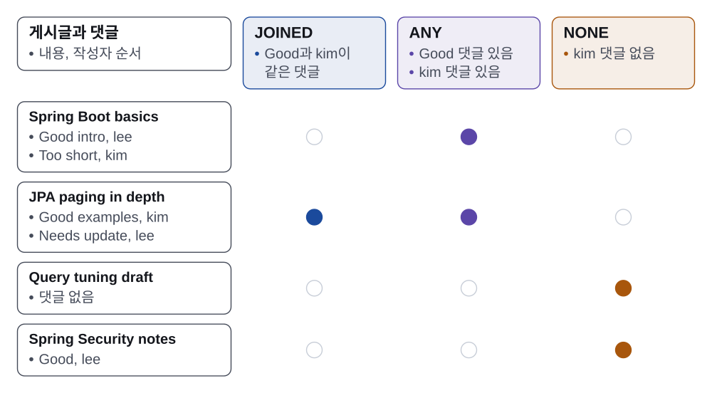

# 연관 데이터 검색

이 페이지를 마치면 연관 엔티티와 컬렉션의 필드로 검색하고, 컬렉션 조건의 비교 방식을 선택하며, 응답에 필요한 연관을 함께 조회할 수 있습니다. [연산자와 값](./search-operators.md)까지의 내용을 전제합니다.

## 예제의 연관 관계

게시글에는 작성자, 댓글, 태그, 라벨이 연결되어 있습니다.

<!-- snippet: Post.java#associations -->
```java
@ManyToOne(fetch = FetchType.LAZY)
private Author author;
@OneToMany(mappedBy = "post", cascade = CascadeType.ALL)
private List<Comment> comments = new ArrayList<>();
@ManyToMany
private Set<Tag> tags = new LinkedHashSet<>();
@ElementCollection
private Set<String> labels = new LinkedHashSet<>();
```

<!-- snippet: Comment.java#entity -->
```java
@Entity
@Table(name = "post_comment")
public class Comment {

    @Id
    @GeneratedValue
    private Long id;
    private String content;
    private String writer;
    @ManyToOne(fetch = FetchType.LAZY)
    private Post post;
}
```

| 게시글 | 댓글 (내용, 작성자) | 태그 | 라벨 |
| --- | --- | --- | --- |
| Spring Boot basics | Good intro, lee / Too short, kim | spring, guide | featured |
| JPA paging in depth | Good examples, kim / Needs update, lee | jpa | featured, long-read |
| Query tuning draft | 없음 | draft, jpa | 없음 |
| Spring Security notes | Good, lee | spring | 없음 |

## 단일 연관의 필드

`@ManyToOne`과 `@OneToOne` 연관의 속성은 `entityField`에 점으로 이은 경로로 선언합니다.

<!-- snippet: PostSearchDTO.java#related -->
```java
@SearchableField(entityField = "author.name", operators = {EQUALS, CONTAINS}, sortable = true,
        sortField = "author.familyName", keyword = true, caseSensitivity = CaseSensitivity.INSENSITIVE)
private String authorName;
```

조건과 정렬에 필요한 연관만 조인하며, 대상이 한 건뿐이므로 결과 행 수는 달라지지 않습니다.

## 컬렉션의 필드

`@OneToMany`, `@ManyToMany`, `@ElementCollection`을 거치는 경로도 같은 방식으로 선언합니다.

<!-- snippet: PostSearchDTO.java#collection -->
```java
@SearchableField(entityField = "comments.content", operators = {CONTAINS})
private String commentContent;

@SearchableField(entityField = "comments.writer", operators = {EQUALS})
private String commentWriter;

@SearchableField(entityField = "comments.writer", operators = {EQUALS}, match = CollectionMatch.ANY)
private String anyCommentWriter;

@SearchableField(entityField = "comments.writer", operators = {EQUALS}, match = CollectionMatch.NONE)
private String noCommentWriter;

@SearchableField(entityField = "tags.name", operators = {EQUALS}, match = CollectionMatch.NONE)
private String withoutTag;

@SearchableField(entityField = "labels", operators = {EQUALS, IN})
private String label;
```

컬렉션 조건은 `EXISTS` 하나로 적용하며 조인을 사용하지 않습니다. 조건에 맞는 요소가 여러 개여도 게시글은 한 번만 반환하고, 전체 건수도 게시글 기준으로 계산합니다.

## 비교 방식

같은 컬렉션에 조건이 여러 개 있을 때, 조건들을 한 요소가 함께 만족해야 하는지는 `match`로 정합니다.

| `match` | 일치로 판정하는 경우 |
| --- | --- |
| `JOINED` (기본값) | 한 요소가 그 컬렉션의 `JOINED` 조건을 모두 만족합니다 |
| `ANY` | 다른 조건과 관계없이, 이 조건을 만족하는 요소가 하나라도 있습니다 |
| `NONE` | 이 조건을 만족하는 요소가 없습니다. 요소가 없는 행도 일치합니다 |



<!-- tabs:start -->

#### **JOINED**

<!-- snippet: collection-joined.http -->
```http
GET /api/posts?commentContent.contains=Good&commentWriter.equals=kim
```

내용에 `Good`이 있고 작성자가 `kim`인 댓글이 하나 있어야 합니다. JPA paging in depth만 일치합니다.

#### **ANY**

<!-- snippet: collection-any.http -->
```http
GET /api/posts?commentContent.contains=Good&anyCommentWriter.equals=kim&sort=id.asc
```

`Good`이 있는 댓글과 `kim`이 쓴 댓글이 서로 달라도 됩니다. Spring Boot basics와 JPA paging in depth가 일치합니다.

#### **NONE**

<!-- snippet: collection-none.http -->
```http
GET /api/posts?noCommentWriter.equals=kim&sort=id.asc
```

`kim`이 쓴 댓글이 없는 게시글입니다. 댓글이 없는 Query tuning draft와 Spring Security notes가 일치합니다.

<!-- tabs:end -->

`NONE`은 조건에 해당하는 요소가 하나도 없는 행을 찾을 때 사용합니다. 다음 요청은 `draft` 태그가 없는 게시글 세 건을 반환합니다.

<!-- snippet: without-tag.http -->
```http
GET /api/posts?withoutTag.equals=draft&sort=id.asc
```

## 값의 컬렉션

`entityField`가 `@ElementCollection`처럼 값의 컬렉션을 가리키면 요소 자체를 비교합니다.

<!-- snippet: element-collection.http -->
```http
GET /api/posts?label.equals=featured&sort=id.asc
```

`featured` 라벨이 있는 두 건을 반환합니다.

## 조건과 로딩의 차이

조건은 어떤 게시글이 일치하는지를 정하고, fetch는 반환할 게시글의 연관을 함께 조회합니다. 댓글 조건으로 찾은 게시글의 `comments`를 fetch하면 조건에 맞지 않는 댓글까지 그 게시글의 모든 댓글을 조회합니다.

fetch할 경로는 서버 코드에서 지정합니다.

<!-- snippet: PostQueries.java#fetch -->
```java
public Page<Post> withAuthorAndComments(SearchCondition<PostSearchDTO> condition) {
    condition.setFetchFields(Set.of("author", "comments"));
    return service.findAllWithSearch(condition);
}
```

<!-- snippet: PostQueries.java#builder-fetch -->
```java
public Page<Post> newestWithAuthor() {
    SearchCondition<PostSearchDTO> condition = SearchConditionBuilder.create(PostSearchDTO.class)
            .sort(s -> s.desc("createdAt"))
            .fetchFields("author")
            .build();
    return service.findAllWithSearch(condition);
}
```

- `fetchFields`는 JSON 입력에서 읽지 않습니다. 요청이 경로를 고르게 하려면 애플리케이션에서 허용 목록으로 검사하세요. fetch는 엔티티를 조회하는 문장에만 적용하며 건수 조회와 컬럼 프로젝션에는 적용하지 않습니다.
- `comments.author`처럼 중첩 경로도 지정할 수 있습니다. 엔티티의 연관이 아닌 경로를 지정하면 `SearchableJoinException`이 발생합니다.
- 서로 다른 컬렉션(`comments`, `tags`)은 따로 조회해 곱집합이 생기지 않게 합니다. bag 컬렉션이 여러 단계로 중첩된 매핑은 애플리케이션에서 쿼리를 작성해야 할 수 있습니다.
- 루트의 단일 연관은 자동으로 fetch 대상에 포함합니다. 컬렉션 요소의 단일 연관까지 자동으로 포함하는 동작은 `searchable.hibernate.auto-fetch-collections=false`로 끌 수 있고, 이때도 `fetchFields`는 동작합니다. JPA의 `EAGER` 매핑과 Hibernate의 배치 fetch는 설정과 관계없이 그대로 동작합니다.

## 컬렉션을 거치는 정렬

정렬 경로가 컬렉션을 거치면 게시글마다 값이 여러 개이므로, 오름차순은 가장 작은 값, 내림차순은 가장 큰 값으로 정렬합니다. 이 경우 조회 방식이 달라지며 [조회 전략과 성능](./two-phase-query-optimization.md)에서 설명합니다. 스크롤과 컬럼 프로젝션은 컬렉션을 거치는 정렬을 지원하지 않습니다.

## 복합 식별자

`@IdClass`와 `@EmbeddedId`를 모두 지원하며, 키의 구성은 JPA 메타모델에서 읽습니다. `@EmbeddedId`의 구성 요소는 `id.tenantId`처럼 실제 경로로 선언하세요. 키 구성 요소는 식별자 클래스에 선언한 순서로 정렬에 추가합니다. 식별자 클래스에는 JPA의 규칙대로 `equals`와 `hashCode`를 구현하세요.

## 트랜잭션 경계와 지연 로딩

조회 메서드는 진행 중인 트랜잭션이 있으면 참여하고 없으면 읽기 전용 트랜잭션을 시작합니다. 트랜잭션이 끝난 뒤 초기화하지 않은 연관에 접근하면 오류가 발생하므로, 응답에 필요한 연관은 fetch하거나 트랜잭션 안에서 응답 타입으로 변환하세요. 이 라이브러리는 OSIV를 켜지 않습니다.

## 다음 단계

[조회 방법](./reading-results.md)에서 페이지 외의 방식으로 결과를 받습니다.
