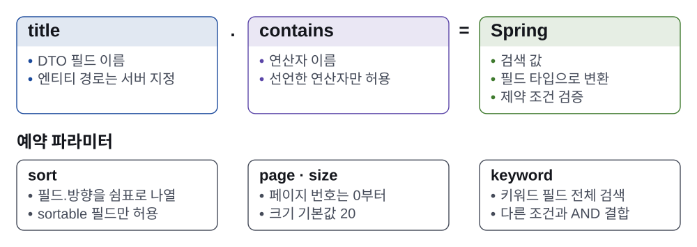
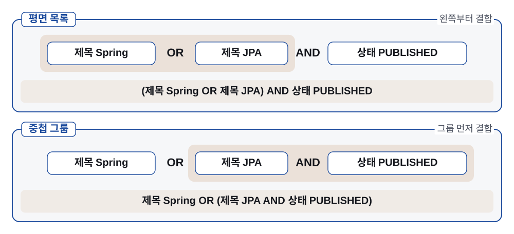

# 요청 작성

이 페이지를 마치면 같은 검색을 GET 파라미터, JSON 본문, Java 빌더로 작성하고 AND·OR 그룹을 의도대로 구성할 수 있습니다. [검색 필드 선언](./search-fields.md)의 `PostSearchDTO`를 사용합니다.

## 입력 형식

어느 형식으로 작성해도 `SearchCondition<PostSearchDTO>`가 되며 같은 검증을 거칩니다. 다음 예제는 모두 조회 수가 100 이상 500 이하이고 상태가 `PUBLISHED` 또는 `ARCHIVED`인 게시글을 찾습니다.

<!-- tabs:start -->

#### **GET**

<!-- snippet: values-get.http -->
```http
GET /api/posts?viewCount.between=100,500&status.in=PUBLISHED,ARCHIVED&sort=id.asc
```

#### **JSON**

<!-- snippet: post-values.http -->
```http
POST /api/posts/search
Content-Type: application/json

{
  "conditions": [
    {"field": "viewCount", "searchOperator": "between", "value": 100, "value2": 500},
    {"operator": "and", "field": "status", "searchOperator": "in", "value": ["PUBLISHED", "ARCHIVED"]}
  ],
  "sort": {"orders": [{"field": "id", "direction": "asc"}]}
}
```

#### **빌더**

<!-- snippet: PostQueries.java#builder-values -->
```java
public Page<Post> viewedPublishedOrArchived() {
    SearchCondition<PostSearchDTO> condition = SearchConditionBuilder.create(PostSearchDTO.class)
            .where(w -> w.between("viewCount", 100L, 500L)
                    .in("status", List.of(PostStatus.PUBLISHED, PostStatus.ARCHIVED)))
            .sort(s -> s.asc("id"))
            .build();
    return service.findAllWithSearch(condition);
}
```

<!-- tabs:end -->

| 형식 | 용도 | 표현할 수 있는 조건 |
| --- | --- | --- |
| GET 파라미터 | 목록 화면의 필터, 링크로 공유하는 검색 | AND로 결합한 조건 |
| JSON 본문 | OR와 중첩 그룹이 필요한 검색 | 모든 조건 |
| Java 빌더 | 서버 코드가 구성하는 검색 | 모든 조건 |

## GET 파라미터



조건 파라미터의 이름은 `필드.연산자`이고 값은 검색값입니다. `title.contains=Spring`은 제목에 `Spring`이 포함된 게시글을 찾습니다. 필드는 DTO 필드명, 연산자는 [연산자와 값](./search-operators.md)의 이름을 사용합니다. 조건 파라미터는 모두 AND로 결합합니다.

| 예약 파라미터 | 형식 | 설명 |
| --- | --- | --- |
| `sort` | `sort=createdAt.desc,id.asc` | `필드.방향`을 쉼표로 나열합니다. 방향은 `asc` 또는 `desc`입니다 |
| `page` | `page=0` | 0부터 시작하는 페이지 번호입니다 |
| `size` | `size=20` | 페이지 크기입니다. 생략하면 기본 크기를 사용합니다 |
| `keyword` | `keyword=Spring` | 키워드 필드 전체에서 검색합니다 |

<!-- snippet: sort-multiple.http -->
```http
GET /api/posts?sort=viewCount.desc,id.asc&size=2
```

조회 수의 내림차순, 같은 값은 ID의 오름차순으로 정렬해 앞의 두 건을 반환합니다.

- 쉼표는 `in`, `notIn`, `between`, `notBetween`의 값에서만 구분자로 읽습니다. 다른 연산자의 값에 포함된 쉼표는 문자로 취급합니다.
- `in`의 값 자체에 쉼표가 들어가야 하면 JSON 본문의 배열을 사용하세요.
- starter의 파라미터 변환기는 같은 이름으로 여러 번 보낸 파라미터를 쉼표로 이어서 읽습니다. `sort=viewCount.desc&sort=id.asc`는 위 예제와 같습니다.
- 값의 `+`, `&`, 공백, 한글은 URL 인코딩하세요. `curl --data-urlencode`를 사용하면 직접 인코딩하지 않아도 됩니다.

## JSON 본문

<!-- snippet: post-group.http -->
```http
POST /api/posts/search
Content-Type: application/json

{
  "conditions": [
    {"field": "status", "searchOperator": "equals", "value": "PUBLISHED"},
    {"operator": "and", "conditions": [
      {"field": "title", "searchOperator": "contains", "value": "Spring"},
      {"operator": "or", "field": "title", "searchOperator": "contains", "value": "JPA"}
    ]}
  ],
  "sort": {"orders": [{"field": "createdAt", "direction": "desc"}]},
  "page": 0,
  "size": 20
}
```

상태가 `PUBLISHED`이고 제목에 `Spring` 또는 `JPA`가 포함된 게시글을 찾습니다. 예제 데이터에서는 JPA paging in depth, Spring Boot basics를 반환합니다.

| 속성 | 위치 | 설명 |
| --- | --- | --- |
| `conditions` | 최상위, 그룹 | 조건과 그룹의 순서 있는 목록입니다 |
| `field` | 조건 | DTO 필드명입니다 |
| `searchOperator` | 조건 | 연산자 이름입니다 |
| `value` | 조건 | 검색값입니다. `in`과 `notIn`은 배열을 받습니다 |
| `value2` | 조건 | `between`과 `notBetween`의 두 번째 경계값입니다 |
| `operator` | 조건, 그룹 | 앞의 결과와 결합하는 방식입니다. `and` 또는 `or`이며 목록의 첫 항목에는 필요 없습니다. 다른 값은 거부합니다 |
| `sort.orders` | 최상위 | `field`와 `direction`(`asc`·`desc`)의 목록입니다 |
| `page`, `size` | 최상위 | 페이지 번호와 크기입니다 |

엔티티 경로(`entityField`)와 fetch 경로(`fetchFields`)는 클라이언트가 보내도 사용하지 않습니다. 엔티티 경로는 DTO 선언에서, fetch 경로는 서버 코드에서만 정합니다.

서버 코드에서 JSON 문자열을 직접 다룰 때는 `SearchCondition.fromJson(json, PostSearchDTO.class)`와 `toJson()`을 사용합니다. `fromJson`은 DTO 검증까지 수행합니다.

## Java 빌더

<!-- snippet: PostQueries.java#builder -->
```java
public Page<Post> publishedAboutSpringOrJpa() {
    SearchCondition<PostSearchDTO> condition = SearchConditionBuilder.create(PostSearchDTO.class)
            .where(w -> w.equals("status", PostStatus.PUBLISHED))
            .and(g -> g.contains("title", "Spring").orContains("title", "JPA"))
            .sort(s -> s.desc("createdAt").asc("id"))
            .page(0).size(20)
            .build();
    return service.findAllWithSearch(condition);
}
```

`where`로 첫 조건을 시작하고 `and`·`or`로 그룹을 결합합니다. 그룹 안에서는 연산자 메서드를 이어 쓰면 AND로 결합하고, `or`로 시작하는 메서드(`orContains`, `orIn` 등)는 OR로 결합합니다. 필드명은 문자열이며 `build()`에서 DTO 선언과 대조합니다.

<!-- snippet: PostQueries.java#builder-operators -->
```java
public Page<Post> popularOrFeatured() {
    SearchCondition<PostSearchDTO> condition = SearchConditionBuilder.create(PostSearchDTO.class)
            .where(w -> w.between("viewCount", 100L, 500L).orIn("label", List.of("featured")))
            .and(g -> g.isNotNull("publishedAt"))
            .sort(s -> s.asc("id"))
            .build();
    return service.findAllWithSearch(condition);
}
```

<!-- snippet: PostQueries.java#builder-or -->
```java
public Page<Post> draftsOrPopular() {
    SearchCondition<PostSearchDTO> condition = SearchConditionBuilder.create(PostSearchDTO.class)
            .where(w -> w.equals("status", PostStatus.DRAFT))
            .or(g -> g.greaterThanOrEqualTo("viewCount", 400L).equals("status", PostStatus.PUBLISHED))
            .sort(s -> s.asc("id"))
            .build();
    return service.findAllWithSearch(condition);
}
```

`sort`는 `asc(field)`와 `desc(field)`를 호출 순서대로 적용하고, `page`와 `size`는 페이지를 지정합니다. 빌더 메서드의 전체 목록은 [API 레퍼런스](./api-reference.md)에 있습니다.

## 그룹과 평가 순서

조건 목록은 선언한 순서대로 왼쪽부터 결합하며 SQL의 연산자 우선순위를 따르지 않습니다. 각 항목의 `operator`는 그 항목을 앞의 전체 결과와 결합하는 방식입니다.



- `A, or B, and C`는 `(A OR B) AND C`입니다.
- `A OR (B AND C)`가 필요하면 B와 C를 그룹으로 묶으세요.
- 그룹의 `operator`는 그룹 전체에 적용하며, 항목이 하나뿐인 그룹에도 적용합니다.

## 컨트롤러 연결 방식

| 파라미터 선언 | 변환 주체 | 사용하는 경우 |
| --- | --- | --- |
| `@SearchableParams SearchCondition<PostSearchDTO> condition` | starter의 파라미터 변환기 | 쿼리 문자열 전체가 검색 파라미터인 GET |
| `@RequestParam @SearchableParams(PostSearchDTO.class) Map<String, String> params` | 컨트롤러가 호출하는 `SearchableParamsParser` | 검색 파라미터와 자체 파라미터가 섞인 GET, starter 없이 쓰는 경우 |
| `@RequestBody SearchCondition<PostSearchDTO> condition` | Jackson | JSON 본문 |

<!-- snippet: PostController.java#raw -->
```java
@GetMapping("/raw")
public Page<PostResponse> listRaw(
        @RequestParam @SearchableParams(PostSearchDTO.class) Map<String, String> params) {
    SearchCondition<PostSearchDTO> condition = new SearchableParamsParser<>(PostSearchDTO.class).convert(params);
    return service.findAllWithSearch(condition).map(PostResponse::from);
}
```

파라미터 변환기와 파서는 DTO의 검색 파라미터가 아닌 이름을 거부합니다.

<!-- snippet: unknown-param.http -->
```http
GET /api/posts?cursor=abc
```

엔드포인트가 자체 파라미터를 함께 받으면 `Map`으로 받아 자체 파라미터를 제거한 뒤 파서를 호출하세요. [조회 방법](./reading-results.md)의 스크롤 예제가 이 방식을 사용합니다. 추적용 파라미터처럼 알 수 없는 이름을 무시해야 하면 `searchable.params.ignore-unknown=true`로 설정하거나 `new SearchableParamsParser<>(PostSearchDTO.class, true)`를 사용하세요. 이때도 DTO 필드 이름으로 시작하는 파라미터는 항상 검증합니다.

JSON 본문은 Jackson 2와 Jackson 3에서 모두 변환하며 같은 검증을 거칩니다. 타입 인자가 없는 `SearchCondition`은 검증할 DTO를 알 수 없으므로 사용하지 마세요.

## 거부되는 요청

| 요청 | 이유 |
| --- | --- |
| `sort=createdAt,desc` | 정렬 형식은 `필드.방향`입니다 |
| `viewCount.between=100` | `between`에는 값 두 개가 필요합니다 |
| JSON 조건의 `field`가 DTO에 없음 | 선언하지 않은 필드입니다 |

<!-- snippet: bad-sort-syntax.http -->
```http
GET /api/posts?sort=createdAt,desc
```

<!-- snippet: between-one-value.http -->
```http
GET /api/posts?viewCount.between=100
```

<!-- snippet: post-unknown-field.http -->
```http
POST /api/posts/search
Content-Type: application/json

{
  "conditions": [
    {"field": "content", "searchOperator": "contains", "value": "Spring"}
  ]
}
```

## 다음 단계

[연산자와 값](./search-operators.md)에서 연산자별 값의 형식과 날짜 범위의 경계를 확인합니다.
