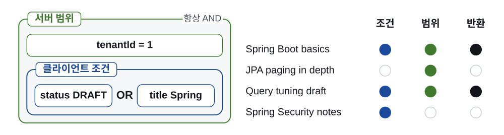

# 서버 범위와 제한

이 페이지를 마치면 클라이언트가 벗어날 수 없는 조건을 모든 조회와 쓰기에 결합하고, 요청 하나가 사용할 수 있는 크기를 제한할 수 있습니다. [조회 방법](./reading-results.md)의 메서드를 사용합니다.

## 서버 범위

테넌트, 소유자, 공개 상태처럼 서버가 정하는 조건은 DTO 필드로 받지 않고 `Specification`으로 전달합니다. 라이브러리는 서버 범위(scope)를 클라이언트 조건 전체의 바깥에서 AND로 결합합니다.



클라이언트가 `status DRAFT OR title Spring`을 보내도 범위 밖의 Spring Security notes는 반환하지 않습니다.

<!-- snippet: PostQueries.java#scope -->
```java
public Page<Post> ofTenant(SearchCondition<PostSearchDTO> fromClient, Long tenantId) {
    Specification<Post> ownTenant = (root, query, cb) -> cb.equal(root.get("tenantId"), tenantId);
    return service.findAllWithSearch(fromClient, ownTenant);
}
```

- 조회, 건수, 스크롤, 프로젝션, 수정, 삭제, 집계, 시간 구간 집계에 모두 범위를 받는 오버로드가 있습니다. 조건 다음 인자로 전달합니다.
- 범위에 사용하는 값은 인증 정보처럼 서버가 신뢰하는 출처에서 가져오세요. 클라이언트가 보낸 테넌트 값을 사용하면 안 됩니다.
- 범위는 엔티티 행 자체에 적용합니다. 범위가 컬렉션을 조인하거나 fetch를 추가하면 `SearchableConfigurationException`으로 거부합니다. 컬렉션에 대한 제한은 서브쿼리로 작성하세요.

## 조건 확장

DTO 필드로 표현할 수 있는 고정 조건은 빌더로 클라이언트 조건 뒤에 추가할 수 있습니다.

<!-- snippet: PostQueries.java#extend -->
```java
public Page<Post> publishedOnly(SearchCondition<PostSearchDTO> fromClient) {
    SearchCondition<PostSearchDTO> condition = SearchConditionBuilder.from(fromClient, PostSearchDTO.class)
            .and(g -> g.equals("status", PostStatus.PUBLISHED))
            .build();
    return service.findAllWithSearch(condition);
}
```

`from`은 조건, 정렬, fetch 구조를 복사한 뒤 확장하므로 원본 조건은 바뀌지 않습니다. 필수 조건은 클라이언트 식 전체 뒤에 AND로 추가하세요. OR로 추가하면 결과가 넓어집니다. 접근 통제에는 이 방식보다 서버 범위를 권장합니다. 범위는 DTO에 필드를 공개하지 않아도 되고 쓰기와 집계에도 같은 방식으로 적용되기 때문입니다.

## 요청 제한

| 대상 | 기본 한도 | 설정 |
| --- | --- | --- |
| 페이지 번호 | 0 이상 | 없음 |
| 페이지 크기 | 1 이상, 최대 1,000 | `searchable.max-page-size` |
| 오프셋 | `page × size`가 2,147,483,647 이하 | 없음 |
| 조건과 그룹의 수 | 1,000 | `searchable.limits.max-nodes` |
| 그룹 중첩 | 32단계 | `searchable.limits.max-depth` |
| `in` 등 목록 값 | 조건당 1,000 | `searchable.limits.max-in-values` |
| 정렬 필드 | 16 | `searchable.limits.max-sort-fields` |

구조 제한은 JSON 본문, 빌더, 서비스에 전달한 조건에 모두 적용하며 초과하면 조회 전에 거부합니다. 구조 제한은 프로세스 전체에, 페이지 크기는 영속성 단위별로 적용합니다.

## 쓰기의 조건 필수화

검색 조건으로 수정·삭제하는 메서드는 조건이 비어 있으면 테이블 전체를 대상으로 합니다. `searchable.write.require-filter=true`로 설정하면 조건과 범위가 모두 비어 있는 쓰기를 `SearchableValidationException`으로 거부합니다. [일괄 수정·삭제](./bulk-write.md)에서 설명합니다.

## 애플리케이션에서 구현할 통제

| 항목 | 설명 |
| --- | --- |
| 인증과 인가 | 라이브러리는 사용자를 식별하지 않습니다. 범위에 넣을 값은 애플리케이션이 정합니다 |
| 요청 본문 크기와 문자열 길이 | 서버와 프록시 설정, DTO 제약으로 제한하세요 |
| 호출 빈도와 쿼리 타임아웃 | 게이트웨이와 데이터소스에서 설정하세요 |
| 응답 필드 | 엔티티 대신 응답 타입으로 변환하세요 |
| fetch 경로 | 요청이 경로를 고르게 하려면 허용 목록으로 검사하세요 |

DTO 검증은 GET 파라미터, 타입 인자가 있는 JSON 본문, 빌더에서 수행합니다. 서버 코드가 `new SearchCondition<>()`으로 직접 구성한 조건은 신뢰하는 입력으로 취급하므로, 외부 입력을 검증 없이 이 방식으로 전달하지 마세요.

## 다음 단계

[일괄 수정·삭제](./bulk-write.md)에서 조건에 맞는 행을 변경합니다.
