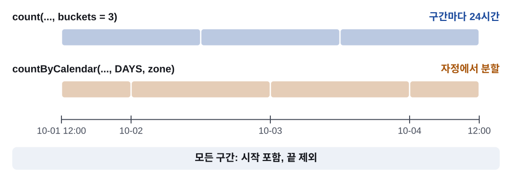

# 시간 구간 집계

이 페이지를 마치면 기간을 같은 폭이나 달력 단위로 나누어 구간별 건수를 계산하고, 그래프용 엔드포인트를 목록과 같은 검색 파라미터로 만들 수 있습니다. [집계](./aggregates.md)와 같은 조건·범위 규칙을 따릅니다.

## 구간의 종류

기간(time window)은 집계 대상 전체이고, 구간(bucket)은 기간을 나눈 한 조각입니다.



| 메서드 | 나누는 기준 | 반환 타입 |
| --- | --- | --- |
| `count` | 기간을 같은 폭의 구간으로 나눕니다 | `List<Long>` |
| `countByCalendar` | 시간대의 시·일·주·월·연 경계에서 나눕니다 | `List<TimeBucket>` |

starter는 `TimeBucketCounter` 빈을 등록합니다. starter 없이 쓸 때는 `new TimeBucketCounter(entityManager)`로 생성합니다.

## 같은 폭의 구간

<!-- snippet: PostStatsController.java#counts -->
```java
@GetMapping("/counts")
public List<Long> counts(@RequestParam Instant from, @RequestParam Instant to, @RequestParam int buckets,
                         @RequestParam @SearchableParams(PostSearchDTO.class) Map<String, String> params) {
    SearchCondition<PostSearchDTO> condition =
            new SearchableParamsParser<>(PostSearchDTO.class).convert(TimeWindowParams.strip(params));
    return counter.count(Post.class, condition, null, "createdAt", from, to, buckets);
}
```

<!-- snippet: counts.http -->
```http
GET /api/posts/counts?from=2026-10-01T00:00:00Z&to=2026-10-08T00:00:00Z&buckets=7&status.in=PUBLISHED,ARCHIVED
```

<!-- snippet: counts.json -->
```json
[1, 0, 1, 0, 0, 0, 1]
```

10월 1일부터 7일 동안을 하루 폭의 구간 7개로 나누고, 상태가 `PUBLISHED` 또는 `ARCHIVED`인 게시글을 셉니다. 결과는 항상 요청한 구간 수만큼의 값을 시간 순서로 반환하며 0건인 구간도 포함합니다.

이 엔드포인트의 쿼리 문자열에는 기간을 나타내는 파라미터 `from`, `to`, `buckets`와 검색 파라미터가 함께 전달됩니다. 기간 파라미터는 DTO 필드가 아니어서 파서가 거부하므로, `TimeWindowParams.strip`으로 제거한 뒤 파서에 전달합니다. 파라미터 이름은 `TimeWindowParams.FROM`, `TO`, `BUCKETS` 상수로도 참조할 수 있습니다.

## 달력 구간

<!-- snippet: PostStatsController.java#calendar -->
```java
public List<TimeBucket> perDay(SearchCondition<PostSearchDTO> condition, Instant from, Instant to, ZoneId zone) {
    return counter.countByCalendar(Post.class, condition, null, "createdAt", from, to, ChronoUnit.DAYS, zone);
}
```

`countByCalendar`는 기간을 지정한 시간대의 달력 경계에서 자르고, 구간마다 `TimeBucket(from, to, count)`를 반환합니다.

| 단위 | 경계 |
| --- | --- |
| `ChronoUnit.HOURS` | 매시 정각 |
| `ChronoUnit.DAYS` | 자정 |
| `ChronoUnit.WEEKS` | 월요일 자정 |
| `ChronoUnit.MONTHS` | 매월 1일 자정 |
| `ChronoUnit.YEARS` | 1월 1일 자정 |

- 기간이 경계에서 시작하거나 끝나지 않으면 첫 구간과 마지막 구간이 짧아집니다.
- 일광 절약 시간이 바뀌는 날은 실제 길이(23시간 또는 25시간)의 구간이 됩니다.
- 다른 단위를 지정하면 `SearchableValidationException`이 발생합니다.

## 집계 규칙

- 기간과 모든 구간은 시작을 포함하고 끝을 제외합니다. 구간의 경계에 있는 행은 뒤 구간에 속합니다.
- 조건에 맞는 루트 엔티티를 한 번씩 셉니다. 시각이 null인 행은 제외합니다.
- 조건의 페이지, 정렬, fetch 설정은 집계 대상에 영향을 주지 않습니다.
- `from`은 `to`보다 앞서야 하고, 구간 수는 1 이상 `searchable.bucket.max-buckets`(기본 512) 이하여야 합니다. 잘못된 기간, 구간 수, 시간축 필드는 `SearchableValidationException`으로 거부합니다.

## 시간축 필드

시간축은 루트 엔티티의 속성명으로 지정하며 DTO 별칭이나 연관 경로는 사용할 수 없습니다. 클라이언트 입력으로 시간축을 고르게 하려면 허용할 속성을 애플리케이션에서 검사하세요.

| 속성 타입 | 해석 |
| --- | --- |
| `Instant`, `OffsetDateTime`, `ZonedDateTime` | 절대 시각 |
| `LocalDateTime` | 애플리케이션 시간대의 시각 |

## 데이터베이스별 계산 방식

기간이 밀리초 경계에 맞고 구간 수로 나누어떨어지면, 시각을 밀리초 숫자로 바꾸는 `epoch_millis` 함수로 그룹화해 한 번에 계산합니다. 이 함수는 `EpochMillisFunctionContributor`가 데이터베이스별 식으로 등록하며, 클래스패스에 라이브러리가 있으면 자동으로 적용됩니다.

| 데이터베이스 | 방식 |
| --- | --- |
| PostgreSQL, CockroachDB, H2, MySQL, MariaDB, SQL Server, SQLite(정수 밀리초 저장) | `epoch_millis` 그룹화 |
| Oracle, 등록하지 않은 데이터베이스 | 구간마다 조건부 합계 |

다음 경우에는 데이터베이스와 관계없이 조건부 합계를 사용합니다.

- 경계가 밀리초보다 세밀하거나 기간이 구간 수로 나누어떨어지지 않는 경우
- 오프셋이 없는 컬럼에 드라이버가 UTC가 아닌 시간대의 시각을 기록하는 경우
- 달력 구간

조건부 합계에서는 구간 수가 SQL 식의 크기에 영향을 줍니다. 시간축 컬럼과 자주 쓰는 범위 조건에 인덱스를 구성하고, 실제 데이터베이스에서 대표 기간과 경계 시각을 확인하세요. 이 표는 구현 경로이며 H2와 SQL Server 외의 데이터베이스는 통합 테스트 대상이 아닙니다. 구간의 경계는 정수 나노초로 계산하지만 저장된 시각의 정밀도는 컬럼과 JDBC 매핑이 정하므로, 데이터베이스에 저장되지 않은 정밀도는 계산에 반영되지 않습니다. Oracle은 DATE로 변환할 때 소수 초가 사라지므로 조건부 합계를 사용합니다. SQLite에서 시각을 다른 형식으로 저장하는 매핑은 따로 확인하세요.

## 관련 설정

| 설정 | 기본값 | 설명 |
| --- | --- | --- |
| `searchable.bucket.max-buckets` | 512 | 한 번에 요청할 수 있는 구간 수 |

## 다음 단계

[OpenAPI](./openapi-integration.md)에서 검색 파라미터를 API 문서에 기재합니다.
