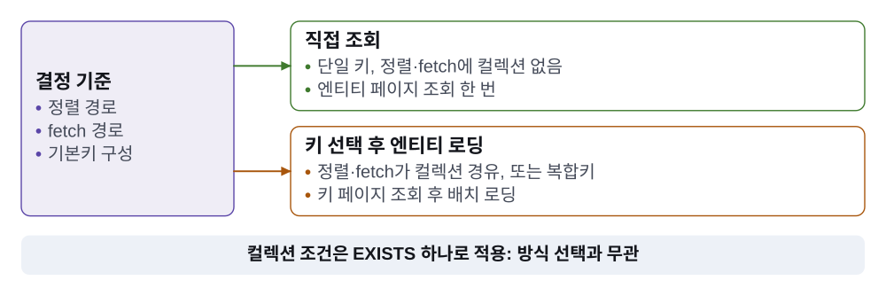
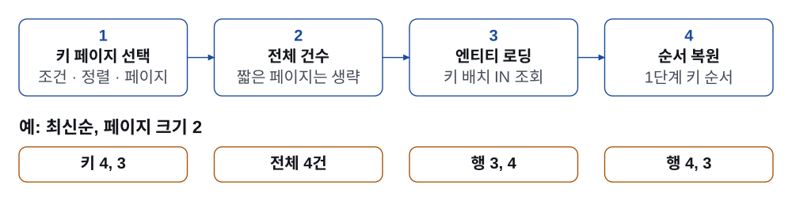

# 조회 전략과 성능

이 페이지를 마치면 검색 한 건이 어떤 SQL로 실행되는지 예측하고, 비용이 커지는 조건을 찾아낼 수 있습니다.

## 조회 방식의 결정

조회 방식은 정렬 경로, fetch 경로, 기본키 구성으로 정합니다. 조건은 방식을 바꾸지 않습니다.

| 조회의 형태 | 실행 방식 |
| --- | --- |
| 단일 기본키이고 정렬과 fetch가 컬렉션을 거치지 않음 | 엔티티를 페이지로 직접 조회합니다 |
| 정렬이나 fetch가 컬렉션을 거침 | 키를 페이지로 고른 뒤 엔티티를 조회합니다 |
| 복합 기본키 | 키를 페이지로 고른 뒤 엔티티를 조회합니다 |
| `findFirstWithSearch` | 키 한 건과 그 엔티티만 조회하고 건수는 세지 않습니다 |

컬렉션을 fetch하면서 페이지로 조회하면 SQL 행이 요소 수만큼 늘어나 메모리에서 페이지를 자르게 됩니다. 키를 먼저 페이지로 고르면 이 문제가 생기지 않고, 행이 늘어나지 않는 조회는 직접 조회로 왕복 한 번을 줄입니다.

## 컬렉션 조건

컬렉션 뒤의 필드에 건 조건은 조건 트리 전체를 담은 `EXISTS` 하나로 적용합니다. 바깥 조회는 엔티티마다 한 행을 유지하므로 `DISTINCT`를 사용하지 않습니다. 같은 컬렉션의 조건은 [연관 데이터 검색](./relationship-and-two-phase-query.md)의 비교 방식을 따릅니다.

## 키 선택 후 엔티티 로딩

1. 조건에 맞는 키를 요청한 정렬과 기본키 순서로 고르고, 이 조회에 오프셋과 페이지 크기를 적용합니다.
2. 전체 건수를 구합니다. 조회한 행이 페이지 크기보다 적으면 오프셋과 행 수로 계산하고, 첫 페이지가 비어 있으면 0입니다. 그 밖의 경우에만 건수 조회를 실행합니다.
3. 고른 키로 엔티티를 조회합니다. 한 문장에는 `searchable.in-clause-batch-size`개(기본 500)의 식별자를 포함하고, 복합키는 이 값을 키 컬럼 수로 나눈 만큼 포함합니다.
4. IN 조건은 순서를 보장하지 않으므로 1단계의 키 순서로 결과를 다시 정렬합니다.

건수는 같은 조건 아래에서 엔티티를 세는 조회이며 컬렉션 조건이 있을 때만 `EXISTS`를 포함합니다. 실행하는 SQL 문의 수는 건수 생략 여부, IN 배치 수, fetch하는 컬렉션 수에 따라 달라집니다.

## 컬렉션을 거치는 정렬

정렬이 컬렉션을 거치면 키 조회에서 키별로 그룹화합니다. 오름차순은 연관 값 중 가장 작은 값, 내림차순은 가장 큰 값으로 정렬합니다. 이때 조건도 같은 조인에 적용하므로 조건에서 제외된 요소는 정렬값에 반영되지 않습니다. 그 밖의 키 조회에는 GROUP BY가 없습니다.

null의 정렬 순서와 문자열 비교 규칙은 데이터베이스를 따릅니다. 기본키를 마지막 정렬 기준으로 추가해 같은 값의 순서를 고정하지만, 조회 사이에 다른 트랜잭션이 행을 추가하거나 수정하면 페이지 사이의 내용이 달라질 수 있습니다.

## 컬렉션 fetch

서로 다른 컬렉션(`comments`, `tags`)은 같은 읽기 트랜잭션 안에서 따로 조회합니다. 컬렉션 사이의 곱집합과 Hibernate의 다중 bag 제한을 피하기 위해서입니다. 첫 컬렉션이 같은 경로는 함께 조회합니다.

`searchable.hibernate.auto-fetch-collections=false`로 설정하면 컬렉션 요소의 단일 연관을 자동으로 조회하지 않습니다. 응답에 컬렉션이 필요 없으면 끄고, 필요한 경로만 `fetchFields`로 지정하세요. 지정하지 않은 지연 연관은 접근할 때 추가 조회가 발생합니다.

## 결과가 많은 조회

| 상황 | 권장 방법 |
| --- | --- |
| 뒤쪽 페이지까지 순회 | [조회 방법](./reading-results.md)의 keyset 스크롤 |
| 목록에 일부 컬럼만 표시 | [조회 방법](./reading-results.md)의 컬럼 프로젝션 |
| 건수와 합계만 필요 | [집계](./aggregates.md) |
| 기간별 추이 | [시간 구간 집계](./time-buckets.md) |

## 확인 방법

- 실행한 SQL은 `org.hibernate.SQL=DEBUG`로, 바인딩 값은 `org.hibernate.orm.jdbc.bind=TRACE`로 기록합니다. 바인딩 로그에는 요청 값이 포함되므로 로그 정책을 따르세요.
- 조건과 정렬에 사용하는 컬럼, 외래 키에 인덱스를 구성하고 실제 데이터베이스의 실행 계획을 확인하세요.
- `contains`와 `endsWith`는 일반 인덱스를 사용하지 못하고, 대소문자를 무시하는 검색은 `lower(컬럼)` 식의 인덱스가 필요합니다.
- 저장소의 `./gradlew performanceTest`는 한 페이지가 페이지 크기, IN 배치 크기, fetch하는 컬렉션 수로 정해지는 수보다 많은 SQL 문을 실행하지 않는지 검사합니다. 경과 시간은 참고용으로만 기록합니다.

## 데이터베이스 지원 범위

통합 테스트는 H2와 SQL Server 2022에서 실행합니다. 다른 데이터베이스는 JPA Criteria와 Hibernate 방언을 통해 동작하지만 이 저장소의 테스트 대상이 아니므로, 배포할 데이터베이스에서 대표 데이터로 SQL 수, 실행 계획, 시각 정밀도를 확인하세요.

## 다음 단계

[확장과 통합](./advanced-features.md)에서 기존 서비스에 검색 기능을 조합하고 트랜잭션 관리자를 지정합니다.
