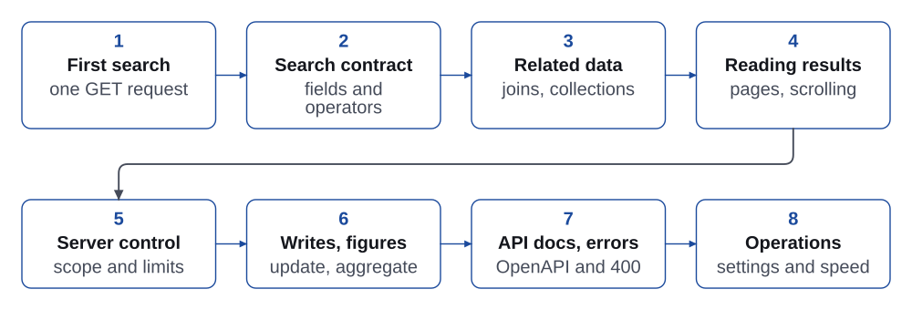

# Searchable JPA

English | [한국어](/ko/README.md)

Searchable JPA adds searching, sorting and paging to Spring Data JPA. An application declares the fields a client may search with `@SearchableField` on a DTO. A client sends conditions as a query string or as JSON, and the library runs only the requests that fit the declaration as JPA queries.

```text
GET /api/posts?title.contains=Spring&sort=createdAt.desc&page=0&size=20
```

## Supported lines

| Library | Spring Boot | Branch | Status |
| --- | --- | --- | --- |
| 2.x | 4.1.x and later 4.x | `master` | Active |
| 1.x | 3.2.x-3.5.x | `spring-boot-3x` | Maintained |
| 0.1.x | 2.7.x | `spring-boot-2x` | Unmaintained |

This documentation describes `2.1.2-SNAPSHOT`, built with Java 17 or later, Spring Boot 4.1.2 and Hibernate 7.4.14.Final. Select the documentation version that matches your dependency.

## Reading order

The pages follow the order of adoption. Each page relies only on the pages before it, and every example uses the same model: posts, authors, comments and tags. The model and its sample rows are defined in [First search API](/en/basic-usage.md).



## Find a feature

| What you want to do | Page |
| --- | --- |
| Add the dependency and build a first search endpoint | [Installation](/en/installation.md), [First search API](/en/basic-usage.md) |
| Declare the fields that may be searched, sorted or matched by keyword | [Declaring search fields](/en/search-fields.md) |
| Write conditions as GET parameters, a JSON body or with the Java builder | [Writing requests](/en/request-formats.md) |
| Check operators, value formats and date ranges | [Operators and values](/en/search-operators.md) |
| Search by fields of related entities and collections | [Searching related data](/en/relationship-and-two-phase-query.md) |
| Read a page, one row, a count, a scroll window or a projection | [Ways to read](/en/reading-results.md) |
| Add a scope the server decides and limit the size of a request | [Server scope and limits](/en/server-scope-and-limits.md) |
| Update or delete the rows a condition matches | [Bulk update and delete](/en/bulk-write.md) |
| Count per value, sum and average | [Aggregates](/en/aggregates.md) |
| Count per slice of a period | [Time buckets](/en/time-buckets.md) |
| Put the search parameters into the API document | [OpenAPI](/en/openapi-integration.md) |
| Answer invalid requests and replace messages | [Errors and messages](/en/errors-and-messages.md) |
| Adjust settings | [Settings](/en/auto-configuration.md) |
| See the SQL a search runs and what it costs | [Query strategy and performance](/en/two-phase-query-optimization.md) |
| Compose with an existing service or run without the starter | [Extension and integration](/en/advanced-features.md) |

Types and methods are listed in the [API reference](/en/api-reference.md), fixes by symptom in [Troubleshooting](/en/faq.md) and differences between versions in the [Upgrade guide](/en/upgrade.md).

## Scope

The library validates the structure and the values of a condition, bounds the page size and hands values to the database as Criteria predicates instead of concatenating them into SQL. Authorization, tenant isolation, response DTOs, and limits on body size and request rate belong to the application. Query speed depends on indexes, on how selective the conditions are and on the size of the related data.

## Modules

| Module | Responsibility |
| --- | --- |
| `searchable-jpa-core` | Conditions, validation, JPA queries, services, aggregates |
| `searchable-jpa-openapi` | The API document of search parameters |
| `spring-boot-starter-searchable-jpa` | Both modules above and Spring Boot auto-configuration |

## License and support

The [SimpleCORE License 1.0](/en/license.md) applies. Report reproducible problems through [GitHub Issues](https://github.com/simplix-framework/searchable-jpa/issues). Include the library, Java, Spring Boot and database versions, a minimal DTO and entity mapping, and a request with sensitive data removed.
